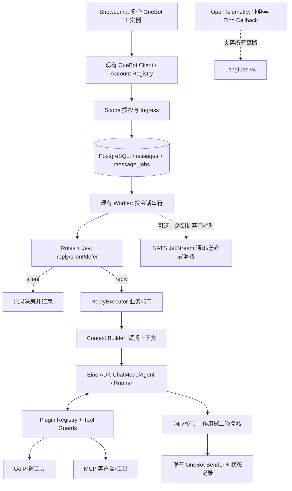
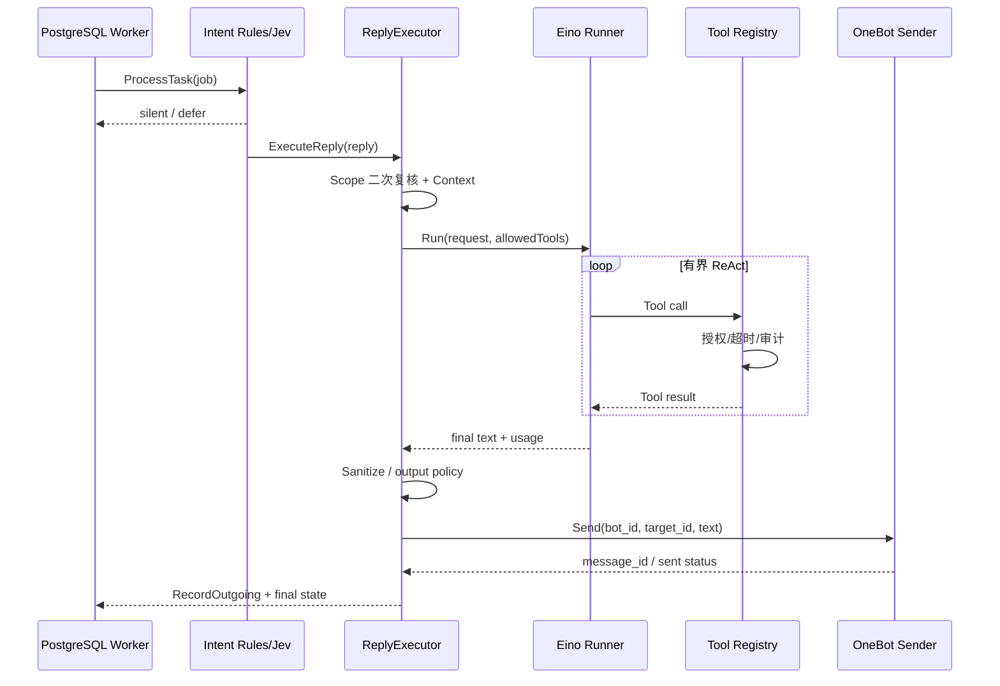

# Nagi Agent v3.0：Eino 插件化与 Langfuse 全链路重构实施方案

> **状态**：设计/待实施（本文件不代表功能已完成）  
> **目标仓库**：[HappyLadySauceM/Nagi](https://github.com/HappyLadySauceM/Nagi)  
> **代码基线**：`main`，`7962d83433803bfd4f43612ea30f436a6d430359`（2026-10-25 检查）  
> **目标语言版本**：Go **1.26 系列**，建议固定经安全维护的最新补丁版 **1.26.10**；`go.mod` 设 `go 1.26.0`，CI/镜像锁定相同工具链。  
> **范围**：Eino Agent Runtime、Go 原生插件/工具注册、MCP、Langfuse、必要的任务与追踪持久化；可选 NATS JetStream。  
> **明确不做**：DSH 插件兼容、长期记忆重构、Agent 自主生成 Skills、整站 UI 改版、重写 SnowLuma/OneBot、多账号系统重做。  
> **首要原则**：保留当前成熟链路，先修复可观测性，再最小切换 Agent，实现插件能力，最后按压测结果决定 NATS。

---

## 1. 执行摘要与完成定义

本轮建设是 **Agent 子系统重构**，不是 Nagi 全仓库重构。目标是使机器人在既有 `OneBot → Scope → PostgreSQL Job → Rules/Jev` 流程之后，由 **Eino ADK** 驱动生成与工具调用；插件系统向 Eino 暴露可授权能力；业务观测与 Eino Callback 通过**同一个 OpenTelemetry TracerProvider 和 Trace Context**形成 Langfuse 可检索的完整调用树。

最终单条 QQ 消息应做到：

1. 可以定位它属于哪个 QQ 账号、群/私聊、发送者、平台消息、数据库 Job、Langfuse Session 与 Trace。
2. 可以知道规则及 Jev **为什么回复/不回复**，而不是只有一条 `intent.decide` 的耗时。
3. 如果需要回复，可以展示 Agent、每轮模型调用、工具参数摘要、执行结果、Token 与费用（可获取时）、OneBot 发送结果。
4. MCP/工具断开、权限拒绝、超时和模型失败均有明确状态；不会使其他群、其他 QQ 账号串号。
5. 普通一次聊天只产生**一棵业务逻辑关联的 Trace 树**，不重复导出同一次模型调用。
6. Eino 可替换旧生成实现，同时保留原有 `ReplyExecutor` 业务边界与安全约束。
7. 即使 Langfuse 离线也不阻断 Nagi；观察链路的失败可告警和度量。
8. 长期记忆暂不参与新 Agent 的上下文组装；旧数据、数据库接口和审批页面不删除。

### 1.1 目标架构



**边界**：Jev 是回复前置决策服务，不是 Eino 的一个自由调用工具；Eino 只在决策为 `reply` 后运行。回复的最终发送仍由业务层控制，不将“发送当前回复”开放给 Agent 任意多次调用。

---

## 2. 现有代码检查结果与不变量

| 现有位置 | 已实现 | 本轮策略 |
|---|---|---|
| `cmd/app/assembly/work.go`、`cmd/app/svc/accounts.go` | 多 SnowLuma 端点、账号注册表、身份核验与路由 | **保留**；Agent 执行时显式携带 `BotID` |
| `internal/conversation/infrastructure/handler.go` | Scope 默认拒绝、授权后入库 | **保留**；扩展 Trace Context 的传递 |
| `internal/conversation/infrastructure/pg.go` | 消息与 Job 同事务、事件去重、`FOR UPDATE SKIP LOCKED` | **保留**；必要时为 Job 添加追踪字段 |
| `internal/conversation/infrastructure/worker.go` | 有界队列、按会话串行、跨会话并发、重试 | **保留**；只加 Trace 恢复，扩容前单独改租约 |
| `internal/intent/application/service.go` | 规则、Jev、决策记录、触发 `ReplyExecutor` | **保留**；补精细的子 Span、决策属性 |
| `internal/agent/application/replier.go` | 自组 Prompt、单次 HTTP 模型生成、出站净化与回写 | **替换模型执行部分**，保留发送与安全行为 |
| `internal/agent/infrastructure/openai.go` | 手写 Chat Completions Adapter | 改为 Eino Model Adapter；验证完成后移除失效实现 |
| `internal/observability/observability.go` | OTel OTLP/HTTP + Langfuse、内容导出开关 | 统一提供 `TracerProvider`，给 Eino Callback 共享 |
| `migrations/0004_drop_tool_policy.*` | 清除无执行路径的旧工具白名单 | **不恢复文本工具白名单**；改为真实权限执行层 |
| `migrations/0005_drop_dead_pipeline_objects.*` | 已移除旧 `active_threads`/摘要字段 | 不重新引入已删结构 |
| `internal/memory/`、已有 Memory API | 候选/审批等功能仍存在 | 数据和页面保留，暂不扩展，也不接入新 Agent |

### 2.1 必须保持的现有行为

- 不允许未授权作用域的消息进入持久化或 AI 工作流。
- OneBot 事件自己发出的回环消息不再触发回复。
- 同一会话必须串行处理；不同会话可并发处理；不同机器人账号不可错误路由。
- 回复前重新获取 Scope，已禁用的会话不能发送旧排队回复。
- 出站内容经原有净化器校验，`@全体`、不允许的链接或空消息继续按旧规则拒绝。
- OneBot 发送超时属于结果**未知**，不可简单重试发送，否则可能产生重复消息。
- 外部服务（Jev、LLM、MCP、Langfuse）错误不得扩大权限。
- 数据库 `up/down` 成对迁移；不得重写旧迁移版本；全部在独立 `_test` 数据库验证。

---

## 3. 技术栈与依赖策略

| 类别 | 目标选择 | 说明 |
|---|---|---|
| Go | `go 1.26.0` + Go 1.26.10 构建工具链 | 按用户要求使用 1.26 系列，不保留 1.22 兼容分支 |
| Agent | `github.com/cloudwego/eino` ADK | `ChatModelAgent` + `Runner`，由 Eino 执行 ReAct/工具循环 |
| 模型适配 | Eino 对应的 OpenAI-compatible ChatModel | 保留当前可配置 Base URL/Key/Model，适配协议实测 |
| Eino 观测 | `github.com/cloudwego/eino-ext/callbacks/langfuse/v2` | Langfuse v4 OTLP；与业务 OTel 共用 Provider |
| 可扩展工具 | `github.com/cloudwego/eino/components/tool` | Go 编译期注册 + 运行期按配置启停/权限过滤 |
| MCP | `github.com/cloudwego/eino-ext/components/tool/mcp/officialmcp` | 优先调查基于官方 MCP Go SDK 的适配，按所锁定版本验证 |
| 存储 | 现有 `pgx` / PostgreSQL | 业务数据与 Job 权威存储 |
| Observability | OpenTelemetry Trace + Langfuse v4 | 一套导出管线、一条 Trace Context 主链 |
| 队列（条件启用） | NATS JetStream | 只有达到本文件第 12 章的性能与扩容门槛时才加入 |

### 3.1 依赖升级实施要求

- 修改 `go.mod`、Go CI 工具链、Docker build 镜像并跑完现有测试；**不要用 `go fix` 自动大规模重写无关代码**。
- 以能共同编译的 `eino`、`eino-ext`、OpenTelemetry、MCP SDK 版本组为准，在同一变更提交中锁定 `go.sum`。
- 不在架构文档中假定 `@latest` 永远兼容；以安装时**实际测试版本**记录于依赖锁定文件及 PR 描述。
- 保留 `onebot` 公开能力端口；技术依赖不能反向渗透到 `intent/domain` 或 `onebot/domain`。

---

## 4. Eino Agent Runtime 设计

### 4.1 域边界

由 Nagi 定义稳定的业务调用接口，避免其他上下文直接导入 Eino：

```go
// internal/agent/contracts/runtime.go —— 自有业务接口草案（非 Eino 官方签名）
type Request struct {
    BotID          int64
    ConversationID string
    Kind           string
    TargetID       int64
    SenderID       int64
    MessageID      int64
    JobID          int64
    Context        []Message
}

type Result struct {
    Text       string
    Model      string
    InputUsage int64
    OutputUsage int64
    ToolRuns   []ToolRunSummary
}

type Runtime interface {
    Run(ctx context.Context, req Request) (Result, error)
}
```

`ReplyExecutor` 保持现有调用方式，在其内部委托 `Runtime.Run`：

1. 复核 Scope、消息存储与历史读取权限。
2. 使用现有最近消息形成 `Request.Context`。不得引入本轮未授权的跨会话知识检索。
3. 由 `EinoRuntime` 把业务消息转换为 Eino Message，调用 `Runner`。
4. `Runner` 在需要时选择、执行工具，输出最终文本；处理流式事件与错误。
5. `ReplyExecutor` 对文本执行原有净化、长度及敏感动作检查。
6. 通过 `SenderResolver` 按 `BotID` 发送一次，写回平台消息 ID 与 `sent_status`。

> `Context` 放在业务结构体中，不把 OneBot 客户端、管理员 token、数据库连接放进 Agent 提示词。具体 Eino 类型与 `Runner` API 以锁定版本的官方示例为准。

### 4.2 Runner 能力与限制

第一版先用**单一 ChatModelAgent**：

- ChatModel 为 OpenAI 兼容模型；同一 Run 的模型快照和工具列表冻结。
- 允许工具调用；限制 `max_steps`、`max_tool_calls`、`max_run_duration`、`max_output_tokens` 和上下文 token 预算。
- 输入历史仅从当前会话受权读取。群中每条消息保留发送者标识，但不得拼接任意系统级指令。
- 支持 `ctx` 截止时间、错误、流式事件消费与资源释放。
- 第一版不启用多 Agent Delegation、DeepAgents、自动执行跨群消息发送或自动写长期记忆。
- 工具返回内容视为**不可信数据**，不能重新定义 Agent 系统权限。

### 4.3 推荐请求生命周期



**严禁**在工具调用实现中绕过 `onebot/contracts`，直接向 SnowLuma Socket 拼帧。

### 4.4 Provider 可替换性

Model Provider 是注册项，不是硬编码 `OpenAI` 的类名。首期仅实现当前 OpenAI-compatible 配置及一个可运行的 Eino Model；未来可添加其他 Provider，不要求首期增加多模型负载均衡或 fallback 编排。

---

## 5. Go 插件架构：不是 Go `plugin.Open`

本轮“插件化”指 **清晰的能力注册与生命周期、可替换实现、配置启用和权限执行**，不等于加载任意 `.so` 文件。Go `plugin.Open` 对构建平台、版本、共享类型和运维均有较大限制，也不适合 Nagi 的跨平台需求。

### 5.1 首期只插件化确有使用者的扩展点

- `ToolProvider`：向 Eino Agent 注册工具。
- `ModelProvider`：向 Agent 提供 ChatModel（首期一个实现，接口预留仅因本轮需要替换旧模型调用）。
- `RunMiddleware`：授权、上下文约束和工具审计（可优先通过现有应用边界实现，不强制单独插件化）。
- MCP 作为外部 `ToolProvider`；不要求构建插件商店、热部署 UI 或插件市场。

### 5.2 Go 业务接口示例

```go
// internal/plugins/contracts/contracts.go —— Nagi 自定义契约草案
type Manifest struct {
    ID          string  // 如 builtin.qq.directory
    Version     string
    Description string
}

type ToolDescriptor struct {
    ID         string  // 如 qq.get_group_info
    ReadOnly   bool
    Permission string  // 业务权限，如 qq.group.read
}

type ToolProvider interface {
    Manifest() Manifest
    Tools(ctx context.Context) ([]RegisteredTool, error)
}

type RegisteredTool struct {
    Descriptor ToolDescriptor
    // Runtime wrapper 为 Eino BaseTool，放在基础设施实现，不在领域层泄露第三方类型。
}
```

这里的结构用于说明**边界**。真正的 `RegisteredTool` 可以在 `infrastructure/eino` 绑定成 Eino `tool.BaseTool`，避免定义难以演进的“全能型 Plugin Interface”。

### 5.3 Registry 必须具备的行为

- 启动时依次注册，检测插件 ID/工具 ID 冲突；失败应能回滚已成功初始化的资源。
- 每个 Agent Run 获取不可变的 **Tool Snapshot**；运行中修改配置不能悄悄扩大该 Run 权限。
- Plugin 可以 `Start`/`Close`，外部连接由拥有者关闭；超时与错误彼此隔离。
- 工具与权限采用命名空间：`qq.get_group_info`、`system.current_time`、`mcp.<server>.<tool>`。
- 每次工具执行都要在入口做一次 **Server-side Authorize**，不依赖模型自觉和前端按钮。
- 每种工具明确 `read_only`、`side_effect`、`requires_approval`，默认拒绝高影响操作。
- 初始化时实际注册成功的工具，才出现在管理接口/工具选择列表中。

### 5.4 第一批工具（小规模验证）

| 工具 | 能力 | 默认权限 | 说明 |
|---|---|---|---|
| `system.current_time` | 返回受控时间信息 | 允许 | 用于验证 Agent → Tool → 结果闭环 |
| `qq.get_group_info` | 读取当前账号有权限访问的群信息 | `qq.group.read` | 必须限定在当前 `BotID` 和当前已授权目标 |
| `qq.get_group_member_info` | 群成员信息查询（后续） | `qq.group.member.read` | 涉及成员资料与隐私，默认关闭 |
| `qq.send_message` | 主动发送 QQ 消息（未来） | `qq.message.write` | 不等于本次回复发送器，默认禁用，可能要求确认 |

**不要恢复旧 `tool_policy` 自由文本栏**；权限模型先放代码/配置和校验逻辑，只有可执行授权真正完成后再做 UI。

---

## 6. MCP 接入设计

Eino 生态提供 MCP Tool 适配组件，可把远端 MCP 工具映射到 Eino 的 `BaseTool`。首期仅开放配置列表中的可信 MCP Server，不自动扫描局域网或安装任意仓库代码。

**运行流程**：初始化 Server → 建立 Client Session → `ListTools` → 名称规范化/权限映射 → `Registry` 快照 → Eino 调用 → 执行时重新校验权限 → 记录 Trace。

配置示例（**设计格式，当前仓库不支持**）：

```yaml
agent:
  engine: eino
  limits:
    max-steps: 6
    max-tool-calls: 5
    max-run-duration: 30s
    max-output-tokens: 500
  plugins:
    enabled: [builtin.time, builtin.qq]
  mcp:
    servers:
      - id: trusted-docs
        transport: streamable-http
        url: https://mcp.example.invalid/mcp
        token-env: NAGI_MCP_DOCS_TOKEN
        enabled: false
        timeout: 8s
```

**实现要求**：

- 仅允许经管理端配置的 Server URL；生产环境做 SSRF 防护、地址限制与超时控制。
- `stdio` MCP 需要显式信任和受限进程权限，不支持未审查的命令字符串。
- 清单同步不是授权；服务端下架或权限变化需要撤销快照/拒绝后续执行。
- 工具原始参数与结果默认**不上传** Langfuse；可记录工具名称、耗时、结果状态、字节数和脱敏摘要。
- MCP Server 不可直接获得 PostgreSQL DSN、OneBot Token、Langfuse Secret 等全局凭据。
- Server 离线时降级为工具不可用，不能因此放开其他服务或绕过审批。

---

## 7. Langfuse：完整观测数据契约

### 7.1 当前问题及根因

用户当前 Langfuse 截图表现：`Sessions` 为空、`Users` 为空、Tracing 中 `nagi.ingress`、`nagi.intent.decide`、`nagi.agent.reply` 分散。

已核对源代码：

- Ingress 在 `Handle` 内建立 `nagi.ingress` span，然后将消息与 job 写入数据库；但没有把 span 的 W3C Trace Context 持久化。
- Worker 使用 `context.WithoutCancel(ctx)` 处理从数据库重新读出的 Job，没有原消息的 Trace Parent。
- `intent.decide` 在 Jev HTTP 请求**之后**才创建 span，因此 Jev 调用耗时虽然作为属性存在，却看不到该网络请求的子 Span。
- 旧 Replier 只记录 `agent.reply` 与 `onebot.send`，但没有 `session.id`、`user.id` 和完整 Eino 模型/工具树。
- OTel 已有 OTLP 导出器，但旧 Agent 没有 Eino Callback。

因此必须重构 **Trace 所有权与上下文传播**，不只是给已有 Span 增加几个标签。

### 7.2 唯一 Trace 所有权

首期采用**一个共享 `TracerProvider`**：

- `internal/observability` 创建 OTel SDK Provider、Exporter、Batch Processor，负责业务 Span 及初始化/关闭。
- Eino Langfuse Callback v2 使用 **调用方提供的同一个 `TracerProvider`**；禁止自己再建一套导出器并重复上报。
- Eino Callback 自动观测 Agent / Model / Tool，Nagi 手写 Scope、Queue、Jev、Send 等业务 Span。
- `TracerProvider` 生命周期由 Nagi Host 管理；Callback 关闭与 Provider Flush/Shutdown 顺序需按锁定版本文档验证。
- 所有 Span 通过标准 Context 传递；不生成平行的“伪子 Span”。

### 7.3 Trace 层级

```text
Trace: nagi.message.process                 [ingress/entry]
├── nagi.ingress.scope                    [enabled / disabled / reason]
├── nagi.message.persist                  [message_id / job_id]
└── nagi.worker.process                   [job wait / attempts / status]
    ├── nagi.intent.load_context          [context_count / hit]
    ├── nagi.intent.rules                 [rule outcome]
    ├── nagi.intent.jev                   [provider / latency / scores / fallback]
    ├── nagi.intent.policy                [reply / silent / defer / reason_code]
    ├── nagi.agent.run                    [Eino Agent: only on reply]
    │   ├── eino.chat_model                [model / tokens / params / TTFT]
    │   ├── eino.tool                      [tool_id / status / duration]
    │   └── eino.chat_model                [following tool result, if any]
    ├── nagi.response.validate            [sanitized / dropped]
    ├── nagi.onebot.send                  [sent / failed / unknown]
    └── nagi.message.finalize              [job final status]
```

这是**目标逻辑树**：不回复时没有 `agent`/`send`；规则直接拒绝时没有 Jev；工具未调用时没有 Tool Span。`nagi.message.process` 这个 root span 可以在 ingress 结束，后续 Worker 仍共享 Trace ID、保留 ParentSpanID 指向已经完成的 span；不要为等待异步队列无限延长一个活跃 Span。

### 7.4 关联字段与隐私

| 归属 | 字段 | 产生方式 |
|---|---|---|
| Trace | W3C `traceparent` / `tracestate` | Ingress Inject → PG Job → Worker Extract |
| Session | `session.id` / `langfuse.session.id`（按锁定 SDK 约定） | `conversation_id` |
| User | `user.id` / `langfuse.user.id`（按锁定 SDK 约定） | 稳定 **HMAC 假名 ID**，不直接上传原始 QQ 号 |
| Account | `nagi.bot_id_hash` | QQ Bot ID 的稳定假名或内部不敏感 ID |
| Run | `nagi.job_id`、`nagi.message_id` | 数据库 Job 与消息 ID |
| Scope | `nagi.scope_type` | `group`/`private` |
| Intent | `nagi.decision`、`nagi.reason_code` | 规则与 Jev 最终决策 |
| Agent | `gen_ai.request.model`/token usage 等 | Eino Model Callback |
| Tool | `nagi.tool_id`、`nagi.tool_status` | Tool Execution Guard |
| Delivery | `nagi.sent_status` | `sent`/`failed`/`unknown` |
| Deployment | `service.version`、`deployment.environment` | 启动参数与版本 |

`user.id` 采用类似 `u_` + `hex(HMAC-SHA256(secret, bot_id + ':' + sender_id))` 的稳定假名；不要只做无密钥哈希。HMAC 密钥由独立运行时 Secret 提供，轮换时明确解释跨版本统计会断开。多账号同一真实 QQ 用户是否合并视图需要产品定义，首期按账号隔离。

- `export-raw-content` **默认 false**；不开启时只记录安全摘要、长度和模型指标。
- 即使开启内容导出，也需先获得作用域许可，统一过滤 token、URL query 中的凭据、私人 QQ 标识及敏感内容。
- Langfuse 本身保存的历史数据适用独立的数据留存和管理员访问控制。

### 7.5 Trace Context 存入 PostgreSQL

建议创建新迁移版本 `0006_job_trace_context.up.sql` 与 `.down.sql`。**下列是设计 SQL 草案，不是已运行迁移。**

```sql
-- up
ALTER TABLE message_jobs
  ADD COLUMN traceparent TEXT NOT NULL DEFAULT '',
  ADD COLUMN tracestate TEXT NOT NULL DEFAULT '';

-- down
ALTER TABLE message_jobs
  DROP COLUMN tracestate,
  DROP COLUMN traceparent;
```

Ingress 在当前已授权的事务中通过 `propagation.TraceContext` Inject，将 `traceparent`/`tracestate` 与 Job 一起提交。Worker 取出后通过 Extract 恢复 Parent Context，再创建 `nagi.worker.process`。传播内容必须先作 W3C 格式校验和长度限制，避免无效或恶意 trace header；不存储 Baggage 中的个人数据。

若采用“消息入库失败则不处理”，不能仅成功发布 Trace 而误报消息已处理。历史任务没有 Trace Context 时创建独立新 Trace 并标注 `legacy_task=true`。

### 7.6 Jev 应被独立详细观测

原有 Jev 网络请求应置于 `nagi.intent.jev` Span 内：

- `provider=jev`、`model`、接口状态码类别、耗时、是否超时/降级。
- `directed_to_bot`、`continuation`、`interjection`、`addressed_other` 等实际返回分数，**仅记录已定义维度**。
- `decision=reply/silent/defer`、`reason_code` 和阈值版本。
- `rule_only=true` 时跳过 Jev 并明确归因，不产生虚假 Jev Span。
- Jev 请求失败降级为规则路径，不得由于埋点造成二次 Jev 调用。

### 7.7 Eino Langfuse Callback v2 接入原则

官方生态 Callback 已支持 Langfuse v4 Observation 类型、Session/User、模型 Token 与 Tool 调用，并允许由调用方传入 `TracerProvider`。目标是调用 Eino Runner 时为本次 Run 设置追踪元数据，Eino 的子操作在同一 Trace 下产生 Span。

**伪代码（实际签名以锁定的 Callback 版本为准）**：

```go
// 1. observability.Setup 返回共享的 sdktrace.TracerProvider。
// 2. langfuse.NewHandler(..., Config{TracerProvider: provider, ...})。
// 3. ctx := handler.StartTrace(restoredWorkerContext, WithSessionID(...), WithUserID(...))。
// 4. 使用这个 ctx 执行 Eino Runner，并按框架要求注册 Callback。
// 5. 收到 Agent 最终结果或错误后，EndTrace(ctx, summary)；执行完整关闭与 Flush。
```

特别检查 Eino ADK Runner 的事件迭代器必须**消费到终态**，不能拿到第一段输出就关闭；否则 Callback 的 Tool/Model 子 Span 可能不完整。Langfuse v4 不依赖旧版 `/api/public/ingestion` API，使用 `/api/public/otel/v1/traces` 的 OTLP/HTTP。

### 7.8 观测看板与验收查询

最少需要能回答：

1. 某个群中这条消息为什么不回复？`policy`、Jev 分数和 `reason_code` 是什么？
2. 一个 Session 连续发生多少次 Trace？每次实际发言者是谁？
3. Eino 每次回复发起多少个模型请求、多少次工具调用？
4. 哪个模型或工具耗时最高？Token 使用量和成本能否统计？
5. `done` 的 Job 里有多少 `send_status=failed/unknown`？绝不能把 Job done 等价于投递成功。
6. Langfuse 故障期间有没有丢失任务或向用户发送重复消息？

第一版建立 dashboard/过滤器和人工检查脚本（或可重现检查步骤）；第二版再使用 Langfuse Scores、Datasets 对“该不该回复”“Tool 选择是否正确”做回归评估。Prompt Management 可以延后，不要与第一版 Trace 基建耦合。

---

## 8. 代码组织与变更边界

建议目录结构（**目标规划，非要求一次性创建全部文件**）：

```text
internal/
  agent/
    contracts/
      runtime.go                 # Nagi Runtime 接口
    application/
      replier.go                 # 业务发送入口（保留已有职责）
      context_builder.go         # 当前会话上下文构建
    infrastructure/
      eino/
        runtime.go               # Eino ADK / Runner 包装
        model.go                 # ChatModel Provider
        callbacks.go             # Eino Callback 绑定
  plugins/
    contracts/
      provider.go                # Manifest / ToolProvider / 权限需求
    application/
      registry.go                # 注册、冲突处理、快照
    infrastructure/
      builtin/
        time.go
        qq_info.go
      mcp/
        client.go
        provider.go
  observability/
    observability.go             # 共享 OTel Provider
    context.go                   # Trace Context 与安全属性
  conversation/
    infrastructure/
      handler.go                 # trace Inject
      pg.go                      # job trace 字段读写
      worker.go                  # trace Extract + worker span
  intent/
    application/service.go       # 决策业务 Span
    infrastructure/jev.go       # Jev HTTP 子 Span
cmd/app/assembly/
  work.go                        # 只做装配
  intent.go                      # 替换原 NewReplier(Model) 的依赖绑定
migrations/
  0006_job_trace_context.up.sql
  0006_job_trace_context.down.sql
```

**实施最小化**：先在现有模块内增加必要接口与适配器，不为了“目录更漂亮”移动无关代码。只新增本阶段确有使用者的文件。`onebot/domain`、WebSocket、前端页面、旧 memory API 默认不改。

### 8.1 旧实现淘汰路径

- 初期保留 `OpenAI` Adapter 作为对比实现，测试 Eino 与旧路径的回复安全不变量。
- Eino 通过验收后，在**独立清理提交**删除不再被调用的旧 Adapter/Options，避免长期留两个生产入口。
- 清理旧代码不等于删除 Memory 存储、旧会话数据或管理 API。
- 如果需要短期灰度，采用进程级 `agent.engine=eino|legacy` 的**临时切换**；验收完成后移除冗余双引擎配置，而不是永久维持两套 Runtime。

---

## 9. 阶段计划与可交付任务

时间估计仅用于排期，依赖团队经验、Model Provider 兼容、MCP 环境和联调条件；每个阶段应拆成独立 PR，不一次性推进全部变更。

### R0 — Go 1.26 与可靠基线（1–2 人日）

- [ ] 固定 Go 1.26 系列最新维护补丁版，更新 `go.mod`、CI/容器构建环境。
- [ ] 运行完整现有测试、竞争检测及必要的数据库集成测试，记录失败/通过情况。
- [ ] 确定 Eino ADK + Callback v2 + OTel + MCP Adapter 的**兼容版本组合**并锁定。
- [ ] 保存对比基线：消息处理吞吐、Job 排队耗时、p50/p95 Agent 耗时、失败数与发送成功率。
- [ ] 记录 Langfuse 现状截图中的 Sessions/Users/Tracing 缺项，形成回归清单。

**验收**：Go 1.26 编译和 `just verify` 通过；不会因依赖升级改动无关业务逻辑。

### R1 — 贯通 Langfuse Trace / Sessions / Users（2–4 人日）

- [ ] `observability.Setup` 返回可复用的 SDK Provider/Tracer，而不只写全局状态。
- [ ] 新增 `0006` 迁移保存 Job 的 Trace Context，调整事务内写入与查询扫描。
- [ ] Ingress Inject、Worker Extract；保留 PostgreSQL Job 去重与状态边界。
- [ ] Jev HTTP 生成真正网络子 Span，决策结果记录关联字段。
- [ ] 为授权消息设置 Session ID 和 HMAC User ID，禁用默认原始内容上报。
- [ ] 给发送的 `sent/failed/unknown` 建立明确 Span 属性与独立指标。
- [ ] 实际在 Langfuse 验证同一消息的 Ingress + Worker + Intent 归属同一 Trace。

**验收**：会话可出现在 Sessions；用户可出现在 Users（如果实例支持并已正确映射）；同一 Job 的多个步骤可按一个 Trace ID 检索；没有新增越权内容记录。

### R2 — Eino 无工具回复替换（2–4 人日）

- [ ] 实现 `agent/contracts.Runtime`，将现有 `ReplyExecutor` 对接 `EinoRuntime`。
- [ ] 接入 Eino ADK ChatModelAgent + Runner；目前只执行单 Agent、无工具。
- [ ] 保留当前 Prompt、近况上下文与输出净化行为；暂不注入长期 Memory。
- [ ] 保留现有 OneBot SenderResolver、Scope 二次检查、出站状态记录。
- [ ] 将 Eino Agent 与 ChatModel Span 接入共享 Langfuse Trace。
- [ ] 对比旧/新在相同回归输入上的行为，确认不会重复发言。

**验收**：无工具时完整走通 `Scope → Jev → Eino → OneBot`；`silent` 消息不调用 Eino；消息净化、断线、超时行为符合现有合同。

### R3 — Go 原生 Tool Registry 与工具调用（3–5 人日）

- [ ] 新增 ToolProvider Registry，包含 ID 冲突检查、启停、生命周期与快照。
- [ ] 实现 `system.current_time` 与一个只读 OneBot 查询工具。
- [ ] Eino Runner 支持有界 ReAct Loop；工具调用链落 Langfuse 子 Span。
- [ ] 建立服务端授权、当前 BotID/Conversation 绑定与工具超时。
- [ ] 工具失效、未授权、结果过大或 JSON 参数错误有可预期行为。
- [ ] 测试 Agent 不会因工具返回恶意指令而越权调用其他动作。

**验收**：真实工具调用成功，另一账号/另一群不可访问本不属于它们的信息；非授权工具即使被模型请求也不会执行。

### R4 — MCP Provider（2–4 人日）

- [ ] 基于锁定版本的 Eino MCP Adapter 与官方 MCP SDK 建立连接。
- [ ] 支持配置允许的 MCP Server、读取工具列表并映射名字与权限。
- [ ] 实现调用限时、连接关闭、健康状态与最低权限运行。
- [ ] 对 MCP 远端故障和重连做集成测试，确认不泄漏凭据。
- [ ] 至少一个可信测试 MCP Server 通过真实 Agent Tool Call。

**验收**：能够添加、禁用并调用可信 MCP 工具，撤销权限立即阻止新调用，Langfuse 能识别每次 MCP Tool Run。

### R5 — 全链路观测、评估与可靠性（3–5 人日）

- [ ] 引入/配置 Eino Langfuse Callback v2 共用 `TracerProvider`，不重复导出模型 Span。
- [ ] 补充 Agent step、Tool start/end、模型调用、TTFT/Token/cost（可用时）、错误分类。
- [ ] Langfuse 建立运营级过滤视图：账号、会话、模型、意图、工具、失败原因。
- [ ] 建立“应该回复/沉默”和工具正确性的一组脱敏标注样本。
- [ ] 通过 Langfuse Score/API 或业务评估记录评估结果，给出可复现方式。
- [ ] 测试 Langfuse 网络失效、Shutdown/Flush、告警，不影响正常回复。

**验收**：可在一条 Trace 中看见 Agent、模型、工具与发送结局；Sessions/Users 可以有效查询；落库任务和 Trace ID 相互定位。

### R6 — 性能压测与可选 NATS 技术决策（2–3 人日，不包含可选 NATS 开发）

- [ ] 用多账号、多群、高频和慢模型场景建立负载测试。
- [ ] 测量 `ingress_commit_latency`、`queue_wait`、`worker_time`、`DB CPU`、`pool_wait`、`pending_jobs`、`OneBot send latency`。
- [ ] 先调优批量 Claim、索引、并发度、PollInterval、Prompt 长度与模型/工具耗时。
- [ ] 再按第 12 章门槛决定：继续 PostgreSQL 或立项 NATS JetStream。
- [ ] 如需多实例 Worker，先设计租约、去重、会话串行与发送幂等，不能直接多起进程。

**验收**：有性能对比报告和明确 NATS go/no-go 决策，不能仅因“队列更快”而增加基础设施。

### R7 — 发布验收与旧实现清理（2–3 人日）

- [ ] 完成端到端回归和长时间稳定性测试。
- [ ] 分环境启用 Eino，新 Agent 与旧版对比成功后移除失效代码路径。
- [ ] 补充运行与故障排查文档，保证字段、配置和真实实现一致。
- [ ] 审查所有新增文件、依赖与迁移，清除未用抽象、实验代码和无关重构。
- [ ] 标记下一个里程碑为“长期记忆与会话画像”（当前不实现）。

**验收**：发布清单与回滚动作经过演练，测试记录齐全；Agent 可稳定收发且 Langfuse 正常。

---

## 10. 验收测试矩阵

| 场景 | 输入或故障 | 期望结果 |
|---|---|---|
| 不授权群 | 群未启用 | 不入库正文、不调用 Jev/LLM/Tool |
| 默认沉默 | Jev 判定不回复 | Job 结束，无 Agent 调用，有决策原因 |
| @机器人 | 授权群显式 @ | Agent 一次执行，最多一次标准回复发送 |
| 双 QQ 账号 | 同时收到消息 | Session/数据/发件连接正确隔离 |
| 不同会话并发 | 群 A、群 B 同时发消息 | 可并行；同一会话顺序不乱 |
| 工具参数无效 | 模型传坏 JSON | 失败可观测，Agent 有界结束 |
| 工具跨群越权 | Tool 查询别的群 | 被 Guard 拒绝，无 OneBot 动作 |
| MCP 下线 | 调用期间断连 | 错误分类明确，不影响其他会话 |
| LLM 超时 | 模型无响应 | 任务重试按现有策略；不能导致重复发送 |
| QQ send 超时 | OneBot 收发结果未知 | `unknown`，不得盲目重发 |
| Langfuse 下线 | OTLP 不可达 | 不阻断 QQ 业务；失败/丢弃有指标和日志 |
| Trace 异步继承 | 入站后 DB 队列消费 | 同一 Trace ID 下有父子关系 |
| Langfuse Sessions | 同群多次聊天 | 聚合到同一 Session |
| Langfuse Users | 两位不同发送者 | 同 Session 中不同稳定假名 User |
| Agent Tool Callback | 工具调用 2 次 | Tool Observations 可见、无重复模型 Span |
| 重启恢复 | Worker 被中止后重启 | Job 可恢复，状态合法，不串会话 |
| 灰度回滚 | 切回旧二进制 | DB 版本与字段兼容；无中途消息重复 |

### 10.1 必跑验证

```bash
go version
go mod tidy
go vet ./...
go test ./...
go fmt ./...
go test -race ./...
# 或仓库统一入口
just verify
```

集成测试必须使用由仓库测试工具自动导出的 **`_test` 隔离数据库**，核对 DSN，绝不指向真实聊天数据所在库。迁移应测试 `up → down → up`。Agent 与外部 MCP/SnowLuma 集成场景若环境缺失，要标记为 **未执行**，不能写“通过”。

### 10.2 量化验收建议

这些是**首轮目标**，测试后按真实负载调整，不是已验证的系统性能：

- 一条授权消息可以 100% 关联到 Job、Conversation 和最终状态；Telemetry 采样关闭情况下，保留的 Trace 可按 ID 端到端定位。
- 不存在由重试或工具重复调用引发的重复标准 QQ 回复（专门测试未知发送状态）。
- 未授权跨作用域工具执行次数 = 0；高影响工具默认不注册到普通会话。
- Eino 纯文本回复的 P95 总耗时相较同模型旧路径无明显退化；区分模型网络耗时和代码运行开销。
- Langfuse 无原始 QQ 号、Token、私聊正文泄漏；原始内容导出默认为 0。
- 追踪失败对用户的直接回复成功率无明显负面影响；可观测丢 Span，不可观测时不得假装成功。

---

## 11. 上线顺序与回滚

### 11.1 建议的独立 PR

| PR | 包含 | 不包含 |
|---|---|---|
| PR-01 | Go 1.26、依赖与 CI 升级 | Agent 行为修改 |
| PR-02 | Trace Context 的 PG 迁移、Ingress/Worker、Langfuse 基础关联 | Eino/MCP/NATS |
| PR-03 | Eino Runtime + 无工具回复 | Registry/MCP/Memory |
| PR-04 | Tool Registry + 两个内置只读工具 + Guard | MCP/DSH |
| PR-05 | MCP Provider | NATS/Memory |
| PR-06 | Eino Langfuse Callback、评估看板、完整测试 | 记忆自进化 |
| PR-07 | 性能测试报告 + NATS 技术决策 | 未触发门槛时不创建 NATS 代码 |
| PR-08 | 行为验证、旧代码清理与部署文档 | 无关模块重构 |

### 11.2 回滚原则

- 每个 PR 具有明确回滚范围，不允许以 `git reset --hard` 覆盖并行工作。
- 数据库新字段 **先加后用**；新旧可执行程序可同时读取，直到完成 Eino 灰度。
- `0006` 新字段允许为空并有默认值，旧程序不会因为新列存在而报错。
- 旧 Agent Adapter 在 Eino 验收前可保留以便灰度；全面上线并观察稳定后再删除。
- Langfuse Callback 关闭时返回业务正常结果；工具注册失败不应造成错误权限放大。

---

## 12. NATS JetStream：条件启用的扩容方案

**结论**：现阶段不立刻替换 PostgreSQL Worker。核心瓶颈通常可能在 LLM、Jev、MCP 或单会话串行约束，不一定是 PostgreSQL Polling。JetStream 在消息扩散、跨进程消费者和负载缓冲方面有价值，但它是 **at-least-once**，不能天然保证“QQ 回复不重复”或全局同会话顺序。

### 12.1 启用门槛

可在以下情况**持续出现且数据库与模型调优后仍存在**时立项：

- 必须部署多个 Nagi Worker 实例横向扩容，单实例并发处理不能满足吞吐；
- `message_jobs` 长时间积压，`queue_wait` P95 与用户业务目标持续不符，且确认 DB Polling/Claim 是显著瓶颈；
- 希望不同职责服务（消息工作器、分析、非实时任务）独立消费事件；
- 可以投入额外运维维护 JetStream 的磁盘、消费者、备份、重试和排障。

在主要耗时由 LLM 推理决定时，仅加入 NATS 可能几乎不改善端到端响应时间。

### 12.2 推荐渐进架构

**首选阶段**：把 NATS 当作 **Job 就绪通知/加速器**，PostgreSQL 仍是状态真相。

```text
OneBot Ingress
   │
   ▼
PostgreSQL 事务: messages + message_jobs + outbox
   │
   ▼
Outbox Publisher ──NATS JetStream──> Workers
                                         │
                                         ▼
                                PG Claim/Lease 校验
                                         │
                                         ▼
                                Intent → Eino → Send
                                         │
                                         ▼
                                  PG 状态变更 → Ack
```

步骤：

1. 入站事务写 `messages`、`message_jobs` 和 `outbox_events`；提交后才由 Publisher 对 NATS 发布 `job_id`，避免 DB commit 与 Publish 之间丢任务。
2. Publisher 用 `Nats-Msg-Id`（如 `nagi.job.<job_id>`）降低发布重复；这**不是永久全局去重保证**。
3. Worker 从 NATS 收到 `job_id`，仍到 PostgreSQL Claim/Lease 检查 Job 是否应执行；重复消息被安全跳过。
4. 处理成功并完成 DB Job 状态提交后 `Ack`；失败按错误类型进入延迟重试或死信处理。
5. 队列消息携带 `traceparent`/`tracestate` 或仅 `job_id`，以 PostgreSQL 中保存的 Trace Context 为准。
6. 队列不可用时保留数据库 pending Job，由周期性扫表补偿，不静默丢失工作。

### 12.3 多实例前必须先改的点

当前 `Worker.Run()` 在启动时把**所有** `processing` Job 改回 `pending`。在多实例场景下会导致另一实例正在执行的任务被重复认领。需要改成 **持有者 + 租约过期恢复**：

- `message_jobs` 增加 `lease_owner`、`lease_until`、`run_attempt` 等必要字段与原子 Claim 条件。
- 只有租约过期的 Job 可以恢复；运行中的消费者定期续租。
- 同一 `conversation_id` 在不同实例之间必须有所有权/租约或稳定分区：当前内存里的“单会话串行”**不能跨实例保证**。
- 对非幂等 QQ 发送不能仅靠 Job 重试实现 exactly-once；应区分生成失败、预发送、结果未知和已发送；`unknown` 结果进入人工/专门核查路径，不自动重放。
- 最终一致性、重复发送风险要专门进行故障注入验证。

### 12.4 NATS 配置草案（仅在正式立项时实现）

```yaml
queue:
  backend: postgres           # 初始状态，不启动 NATS
  nats:
    enabled: false
    url: nats://127.0.0.1:4222
    stream: NAGI_JOBS
    subject: nagi.jobs.ready
    durable-consumer: nagi-agent-workers
    ack-wait: 60s
```

不能因为配置样例出现 NATS 就要求首期添加 Docker Compose 服务或客户端依赖。该章节是 **有前置验收的选项**。

---

## 13. 当前版本的架构决策记录（ADR）

| ADR | 决策 | 理由 |
|---|---|---|
| ADR-001 | Go 1.26 系列最新版补丁构建 | 用户明确允许升级；消除 Eino/Callback 兼容顾虑 |
| ADR-002 | Eino ADK 为唯一 Agent 推理 Runtime | 替换手写生成流程并原生支持工具循环 |
| ADR-003 | Jev/规则在 Eino 外部 | 节省无效 Agent 调用，保留独立意图评估 |
| ADR-004 | Go Registry + MCP，不使用 Go `.so` 动态插件 | 跨平台、可测试、可管理的插件能力 |
| ADR-005 | 一个共享 OTel Provider | 防止双重导出和孤立 Trace |
| ADR-006 | PostgreSQL 为业务和任务状态权威存储 | 复用现有可靠链路与会话隔离 |
| ADR-007 | NATS JetStream 为可选加速/扩容能力 | 无指标证据前不增加基础设施复杂度 |
| ADR-008 | 长期记忆与自进化下一阶段规划 | 先稳定 Agent 工具和观测，避免大范围同时重构 |

---

## 14. 交付物清单与结束标准

各阶段交付：**代码 diff、接口与行为说明、配置更改、必要迁移、测试记录、Langfuse 实际截图或可复现查询步骤、风险及回滚说明**。

本轮最终交付前必须满足：

- [ ] Nagi 在 Go 1.26 构建并通过仓库要求的 `just verify`。
- [ ] 原有多账号、Scope、Jev、Worker、OneBot 无明显行为回归。
- [ ] Eino Agent 运行成功，支持至少两个内置工具及一个可信 MCP Server。
- [ ] Tool Registry 有真实服务端授权，不是仅有配置字段。
- [ ] Langfuse Sessions、Users、Tracing 能查询到相关业务信息，单消息 Trace 可完整追踪。
- [ ] 生成式 Agent 没有依赖长效记忆模块才能启动。
- [ ] 所有外部调用超时和失败可观测；OneBot 超时不盲目重发。
- [ ] NATS 已做有依据的 go/no-go 结论；未启用时不对现有部署增加依赖。
- [ ] 旧代码清理遵循项目 `AGENTS.md` 与防乱改约束。
- [ ] **未对 DSH 兼容、自动学习记忆或 Skills 自进化做出未实现的承诺。**

---

## 15. 参考资料（用于实施时按锁定版本二次核对）

- Nagi 源码与项目约束：<https://github.com/HappyLadySauceM/Nagi>
- Go 1.26 发布说明：<https://go.dev/doc/go1.26>
- Go 版本维护记录（截至 2026-10-25，1.26.10 为最新 1.26 补丁版）：<https://go.dev/doc/devel/release>
- Eino ADK Quickstart：<https://www.cloudwego.io/docs/eino/core_modules/eino_adk/agent_quickstart/>
- Eino Langfuse Callback v2：<https://pkg.go.dev/github.com/cloudwego/eino-ext/callbacks/langfuse/v2>
- Eino MCP 适配：<https://github.com/cloudwego/eino-ext/tree/main/components/tool/mcp>
- 官方 MCP SDK 适配实现：<https://github.com/cloudwego/eino-ext/tree/main/components/tool/mcp/officialmcp>
- NATS JetStream 基本语义：<https://docs.nats.io/concepts/jetstream>
- NATS JetStream 深入：<https://docs.nats.io/learn/jetstream/>
- Langfuse 官网及 OTLP 文档入口：<https://langfuse.com/docs>

**备注**：本文为源码核对后的详细实施蓝图，未修改目标仓库，也未实际执行 Go 1.26 构建、Eino/MCP 联调或 NATS 压测。文中的新接口、配置结构和 SQL 均标注为待实现设计。
