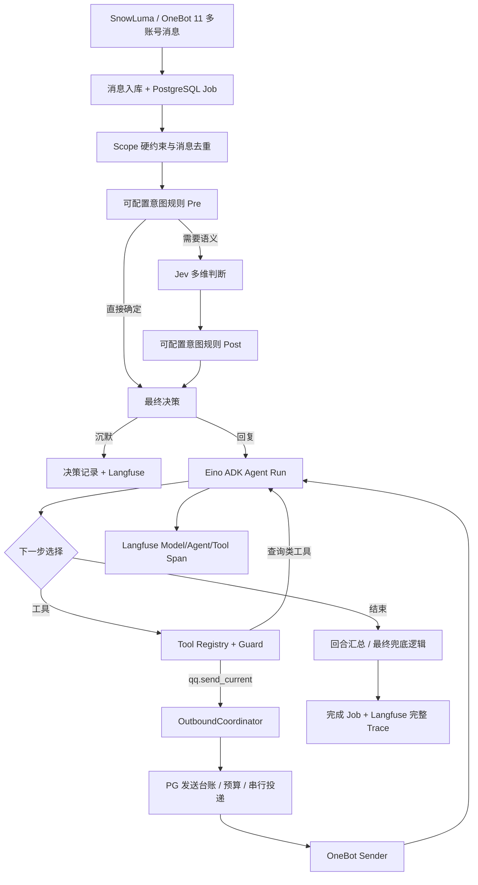

# Nagi / QQBot vNext：工具能力、意图识别与 Agent 自主连续发言实施计划

> 版本：v1.0（实施设计稿）  
> 编制日期：2026-10-29  
> 代码参考：`HappyLadySauceM/Nagi` 的 `main` 分支（由原 `HappyLadySauceM/QQBot` 重定向；开始实施前必须重新锁定 HEAD SHA）  
> 目标技术栈：Go 1.26、Eino ADK、Jev、SnowLuma / OneBot 11、PostgreSQL、Langfuse / OpenTelemetry、React + Vite / shadcn/ui  
> 交付范围：**只覆盖工具能力体系、可配置意图识别、Agent 自主多消息发送及其观测与管理 UI**。**暂不重构长期记忆，不接入 DSH 插件，不引入 NATS**。

---

## 0. 执行摘要：先解决什么

本轮目标不是“在发送逻辑中增加一个 `strings.Split`”，而是把 **Agent 能做什么、Agent 什么时候该说话、Agent 怎么说出多条话** 统一成可观测且可控的业务系统。

三个重点目标：

1. **能力目录与授权**：按 OneBot 11 定义完整的“潜在动作目录”，按当前插件注册状态区分已实现、已启用、不可用；每个工具有会话适用性、风险等级和独立授权。单聊不显示可开启的群管理能力；群聊工具也不能凭模型参数越界读取或跨群发送。
2. **意图识别中心**：保留硬规则 + Jev + 最终回复策略的三段式架构；前端可看到每一步的输入摘要、规则命中、Jev 多维分数、阈值、最终原因、耗时和 Trace；规则支持草稿、模拟、发布、回滚，不直接允许管理员注入 Go/JS 任意代码。
3. **Agent 自主连发**：通过 Eino 注册 `qq.send_current` 受限工具，让 Agent 在**一个回合内**连续决定是否发第 1、2、3 条消息，再主动结束；保留普通最终回复的兼容模式，增加同会话串行投递、消息预算、幂等台账和部分成功语义，杜绝失败后重复发送。

**关键实现顺序：先清理工具描述和授权模型 → 再交付自主连发的可靠投递 → 再完成意图管理与动态规则 → 最后完善全链路可观测与灰度验收。** 可以并行制作前端骨架，但不能用“虚假的可用工具”或伪造决策数据填充界面。

### 0.1 本轮非目标

- 不兼容或运行 DSH/Cordis 插件；只借鉴公开实现中的发送工具与队列设计。
- 不以 ReAct 名义另写一套推理循环；直接使用已有 **Eino ADK** 的工具调用机制。
- 不重做 SnowLuma 协议层、账号连接和 PostgreSQL Worker。
- 不将长期记忆、会话画像或 Agent 自我进化混入本次改造；保持旧数据库及 API 兼容。
- 不让普通 Agent 获取 `get_cookies`、`get_credentials`、`get_csrf_token` 等凭据敏感动作。
- 不在第一版提供跨好友/跨群主动发送；当前回合的发送目标始终由服务端绑定。

---

## 1. 最新一轮代码审查事实与缺口

> 以下结论来自本次讨论中已读取的 `Nagi/main` 主要源码，而不是尚未执行的功能。由于仓库持续更新，开发开始前要在 PR 描述里填写实际 HEAD SHA，并重新确认实现。

| 子系统 | 已有能力 | 问题/缺口 | 参考位置 |
|---|---|---|---|
| Eino Agent | Eino ADK Runtime、Tool Registry、工具守卫、执行记录回调 | Runtime 只返回一个 `Result.Text`，Replier 最终只调用一次 Sender | `internal/agent/contracts/runtime.go`、`internal/agent/application/replier.go` |
| 已注册工具 | `system.current_time`、`qq.get_group_info` | 真实可用工具少；仅后者声明 `qq.group.read`，前端只展示 `catalog.permissions` | `internal/plugins/infrastructure/builtin/`、`web/src/features/scopes/` |
| 权限守卫 | 读/写分级、`PermissionOverrides`、`AllowSideEffects` | 缺“会话类型适配”和“本轮回复专用副作用”粒度 | `internal/plugins/application/guard.go` |
| 私聊/群聊适配 | `qq.get_group_info` 在执行阶段拒绝非群聊 | 在工具曝光及前端目录阶段尚未过滤；单聊会误看到 `qq.group.read` | `internal/plugins/infrastructure/builtin/qq_info.go` |
| 意图判断 | 规则入口、Jev 多维语义、最终回复策略；Langfuse Span；最终决策入库 | 无逐规则步骤历史、规则版本、在线微调/回放管理 API | `internal/intent/application/`、`internal/intent/infrastructure/` |
| 私聊智能模式 | 现有 `private_direct` 路径 | `intent_based` 私聊跳过 Jev，与“智能回复”表述不一致 | `internal/intent/application/rules.go`、`rules_test.go` |
| 消息调度 | PostgreSQL Job、按 `conversation_id` 串行 Worker，Trace 上下文跨 Worker 传播 | 有“一回合单结果”假设；部分已发后运行失败的重试语义需要重新定义 | `internal/conversation/infrastructure/worker.go`、`pg.go` |
| 投递记录 | 最终消息落库、OneBot 发送状态 `sent/failed/unknown` | 缺“一回合多条”的独立发送台账与原子发送预算 | `internal/agent/application/replier.go` |
| 前端 | 联系人与作用域策略编辑、工具目录入口 | 需要完整工具目录、意图识别中心、连续发言策略与执行轨迹 | `web/src/features/` |

### 1.1 必须保留的稳定边界

- **OneBot**：负责协议动作，不吸收 Agent 规则、Jev、工具授权或 UI 逻辑。
- **Conversation Worker**：负责持久化消息与按会话排队，不直接决定模型如何发送；多条输出归属于同一个 Job/Agent Run。
- **Intent**：负责是否启动 Agent；不负责在 Agent Run 中重复触发每一条气泡的 Jev 判断。
- **Eino Runtime**：负责模型循环与 Tool Calling；通过接口依赖 QQBot OutboundCoordinator，不直接拿裸 OneBot Client。
- **Plugin Registry/Guard**：负责注册、曝光与执行前授权，区分普通数据工具和本轮回复动作。
- **Langfuse**：观察完整生命周期；数据正确性以 PostgreSQL 投递表为准。

---

## 2. DSH QQ 插件研究结论：借鉴机制，不接入其 Runtime

研究过三种实际方案：

1. [Aegink/dsh-channel-qq](https://github.com/Aegink/dsh-channel-qq)：`src/features/messaging/tools.ts` 注册 `qq_send_text`，执行前校验目标窗口和群权限，发送时可使用 `segmentText` 拆句，并通过 `OutboundQueue` 串行限速。它**同时支持模型选择发送工具**与**一次调用自动拆成多条**。`src/outbound.ts` 将硬长度切分与发送队列分离；`src/core/text/segment.ts` 实现拟人化分段。
2. [flyinstar/dsh-qq-bridge](https://github.com/flyinstar/dsh-qq-bridge)：`send.js` 将正常回复按换行、标点和长度拆成气泡，并按会话排队，控制“正在输入”等反馈；`tools.js` 另提供 `qq_send_message` 主动发送。
3. [sindo-s/dsh-qq-bot](https://github.com/sindo-s/dsh-qq-bot)：`src/qq-send.ts` 注册 `qq_send`，但一次发送成功后调用 `execution.concludeTurn()`，所以**有发送工具不等于能连续发送**。其实现强调发送结束即结束该轮。

### 2.1 架构取舍

| 机制 | 特点 | Nagi 选择 |
|---|---|---|
| 生成整段、后置按句拆分 | 便宜、容易，但每条不是 Agent 重新决策的结果 | 作为可选 `split` 模式 |
| Agent 反复调用发送工具 | 真正自主控制每条发送与停止，可随工具结果继续运行 | **主要模式：`agent`** |
| 发送工具一次调用即终止 Agent | 简单，但不满足连续自主发送 | 不采用默认终止 |

**ReAct 的位置**：Agent 可以“思考→调用 `qq.send_current`→拿到结果→再思考/继续工具调用”，这是 ReAct 式工具执行过程，但不需要另造 ReAct 框架。完成这些工作的仍是 Eino ADK。为了允许连续发送，不能在每次工具成功后自动终止 Run。

---

## 3. 总体架构（推荐目标）



### 3.1 三个不同的“权限问题”

- **意图是否允许**：当前消息是否需要回复（Scope + Rules + Jev）。
- **当前 Agent 可使用什么能力**：工具已注册、Provider 可用、会话类型适用、对应权限允许。
- **本次副作用是否允许**：工具实际执行时，还要检查 Agent Run 的已授权回复上下文、发送预算、当前会话、账号在线状态与速率。

三项互不替代。不能因为模型能看见工具就认为它有权限，也不能因为 Scope 允许回复就允许跨群/群管行为。

---

## 4. 工具目录、OneBot 11 分类和授权模型

### 4.1 工具目录须同时表示“已注册”和“协议可支持”

“全部工具”建议分两层展示：

- **已注册可执行工具**：当前 Go Provider/MCP 确实注册了执行器，允许授权或执行。
- **协议能力参考目录**：OneBot 11 能表达的动作，但 QQBot 未实现对应 Agent Tool 或 SnowLuma 版本不支持。前端只展示“未实现/不可用”，不可勾选为可执行。

不可把 `internal/onebot` 已有的 API wrapper 直接等同于已注册 Eino Tool。新增工具必须定义参数、目标约束、权限、输出处理和错误语义。

### 4.2 OneBot 工具能力映射建议

| 分类 | OneBot 动作代表 | Agent Tool 建议 | 范围 | 风险/默认 |
|---|---|---|---|---|
| 普通对话输出 | `send_private_msg`、`send_group_msg` | `qq.send_current`（绑定本会话） | 群、私聊 | 低风险但有限额；已批准回复回合可用 |
| 查询消息 | `get_msg`、`get_forward_msg` | `qq.get_current_message`、`qq.get_forward` | 群、私聊 | 只读但有历史/隐私限制 |
| 账号信息 | `get_login_info`、`get_status`、`get_version_info` | `qq.get_self_info`、`qq.get_status` | 账号 | 只读，需控制返回字段 |
| 好友及陌生人 | `get_friend_list`、`get_stranger_info` | `qq.list_friends`、`qq.get_user_info` | 账号/经授权查询 | 隐私读取，默认关闭 |
| 群信息 | `get_group_info`、`get_group_list` | `qq.get_group_info`、`qq.list_groups` | 群/账号 | 本群查询与全局查询分别授权 |
| 群成员 | `get_group_member_info`、`get_group_member_list` | `qq.get_group_member`、`qq.list_group_members` | 当前群 | 敏感读取，默认关闭或按群允许 |
| 消息互动 | `delete_msg`、`send_like` | `qq.recall_own_message`、`qq.send_like` | 按原消息归属 | 有副作用，默认关闭 |
| 群管理 | `set_group_ban`、`set_group_kick`、`set_group_card`、`set_group_name`、`set_group_admin` 等 | 独立群管 Tools | 群聊 | 高风险，额外确认且检查机器人群管理身份 |
| 申请审核 | `set_friend_add_request`、`set_group_add_request` | 事件审核工具 | 账号级/群级 | 默认关闭、管理员审批 |
| 媒体及能力 | `get_image`、`get_record`、`can_send_image` | 受限媒体 Tools | 适用会话 | 媒体读取/带大小限制 |
| 凭据/维护 | `get_cookies`、`get_credentials`、`get_csrf_token`、`set_restart`、`clean_cache` | **不向普通 Agent 暴露** | 系统 | 管理端保护 |

协议中的可选或非标准扩展需按 SnowLuma 实测结果标记，不做通用承诺。

### 4.3 工具描述符建议

```go
// 示意接口；最终与现有 plugin/contracts 合并，避免平行重复结构。
type ToolDescriptor struct {
    ID          string   // qq.send_current
    Name        string
    Description string
    Category    string   // messaging / group / profile / system
    ScopeKinds  []string // private / group / account
    RiskLevel   string   // low / medium / high / restricted
    Permission  string   // qq.reply_current / qq.group.read ...
    ReadOnly    bool
    SideEffect  bool
    Availability string // registered / disabled / unsupported / unimplemented
}
```

建议再定义 `ActionClass`，独立于通用 `SideEffect`：

```text
read_only         只读查询
reply_current     本轮获准回复到当前会话
write_current     当前会话的其他写操作
cross_conversation 跨会话行为（首期不开放）
administrative    群管理/审批/系统动作
```

`reply_current` 不能通过把全局 `allow-side-effects` 直接改为 `true` 来绕过守卫。它只能由 **通过意图决策且作用域启用的本轮 Agent Run** 获取短生命周期能力，且执行时再次授权。

### 4.4 Tool Registry 生效计算

```text
exposed = provider_registered
       && provider_enabled
       && supports(scope_kind)
       && scope_policy_enabled
       && permission_granted
       && risk_policy_satisfied
```

对于系统读取类工具，可采用明确的低风险默认授权；对于有副作用的 `qq.send_current`，需要有单独的“回复权限”而非任意写权限。执行时必须按相同条件再次判定；不适用会话的工具**在发给模型之前就移除**。

### 4.5 单聊与群聊 UI

- 单聊只显示私聊可适用能力；群工具可以在完整工具总览中查看，但标注**“不适用当前私聊”**且不可开启。
- 群聊展示本群读取、群互动与群管理能力；跨群查询与当前群读取要不同权限。
- 展示 `registered / not_configured / disabled / unsupported / permission_denied / applicable` 等明确状态。
- 批量开关不能绕过高风险单工具审批。
- “未实现”工具永远不能因为前端勾选而被错误存入生效权限。

### 4.6 兼容当前 `tool_permissions`

现有 `ToolPermissions map[string]bool` 可继续表示能力组的权限覆盖。要实现逐工具开关时，再新增工具级 override（例如 `tool_overrides`），按“硬拒绝 > 明确工具拒绝 > 明确工具允许 > 能力组默认 > 系统默认”计算。**现有 `qq.group.read` 不必删除**，可作为群信息读取类权限组；其实际工具在私聊中仍不应曝光。

---

## 5. 意图识别管理平台设计

### 5.1 保留的判断流水线

```text
hard_gate(禁用/隐私/风控/自身消息)
→ pre_rules(可配置的前置规则)
→ jev(按需，含四个 Noul 与 Choice)
→ post_rules(结合语义结果和阈值)
→ reply_policy(reply / silent / defer + reason_code)
→ decision_steps + trace
```

硬约束必须由 Go 代码保证，可配置规则不能绕过。Jev 请求失败或数据无效时采取保守降级，默认不主动插话；明确 @、管理员命令等仍要受既有硬策略约束。

### 5.2 修正私聊 `intent_based` 行为

当前私聊实际触发 `private_direct`，不调用 Jev。目标：

- `always_reply`：通过硬约束就进入 Agent。
- `intent_based`：也可以不回复，例如礼貌结束、无回应期待、重复轻量消息；需要一套**私聊适用的**判断问题与阈值，不能照抄群聊的 `appropriate_to_join`。
- `mention_only`：私聊没有 @ 的等价行为，需要清楚的产品定义；建议私聊按“明确直接提问/回复机器人”等规则解释，或在 UI 里限制不适用选项。
- 改变默认行为必须灰度，保留旧行为兼容开关并使用真实样本评估漏回复。

### 5.3 决策详情最小必要字段

一次决策需要能回答以下问题：

1. 这是哪个 QQ 账号、哪个群/私聊、哪条消息？
2. 当时作用域和规则集是什么版本？
3. 哪些硬规则/自定义规则被执行、命中、跳过？为什么？
4. Jev 是否调用？返回哪些分数与类别？哪套 Prompt/问题模板？
5. 最终阈值是多少，哪个判据决定了 `reply/silent/defer`？
6. 因为哪个 `reason_code` 结束？耗时、异常与 Langfuse Trace 链接是什么？

至少保存结构化步骤：`step_index`、`phase`、`rule_id`、`evaluated`、`matched`、`input_summary`、`result`、`duration_ms`、`ruleset_version`、`trace_id`。原始消息文本应遵守 Scope 的存储授权与脱敏设置。

### 5.4 动态规则引擎：第一版做受控 DSL

规则建议支持两类执行阶段：

- **pre_semantic**：不依赖 Jev，例如账号、会话类型、是否 @、是否引用、用户类型、时间段、消息长度、重复频率、固定指令前缀。
- **post_semantic**：依赖 Jev，例如 `continues_bot_thread >= 0.8`、`addressed_to_other >= 0.6`、意图分类为 `closing`，并可在群级覆盖插话阈值。

规则动作允许：`silent`、`reply_candidate`、`require_jev`、`set_threshold`、`set_priority`（仅在编译发布时）、`tag_decision`；禁止普通规则直接绕过硬权限或执行 QQ 工具。

```json
{
  "id": "quiet-hours",
  "name": "夜间关闭主动插话",
  "enabled": true,
  "phase": "pre_semantic",
  "priority": 200,
  "conditions": {
    "all": [
      {"field": "scope_kind", "op": "eq", "value": "group"},
      {"field": "local_hour", "op": "between_wrap", "value": [23, 7]},
      {"field": "explicitly_addressed", "op": "eq", "value": false}
    ]
  },
  "action": {"type": "silent", "reason_code": "quiet_hours"}
}
```

> 只是建议的 DSL，不是当前已有 API。`local_hour` 需要来自明确时区设置，避免使用服务器所在时区隐式判断。

### 5.5 规则的生效生命周期

`草稿 → 校验 → 回放/模拟 → 发布版本 → 灰度观察 → 全量 → 回滚`。

- **持久化版本**：不可原地修改已发布版本；每次发布创建新版本快照。
- **优先级冲突**：硬拒绝绝对优先；普通规则冲突采取固定次序（显式优先级 + 稳定规则 ID），并记录冲突原因。
- **作用域覆盖**：全局模板 + bot 账号级 + 指定会话覆盖；高风险“强制回复”不得覆盖禁用 Scope。
- **模拟模式**：不发送 QQ、不执行 Eino 工具、不写生产决策；Jev 实时模式须注明产生外部调用成本，并可使用已存分数复算。
- **发布审计**：记录管理员、变更摘要、规则差异、影响范围、发布时间、回滚版本。

### 5.6 前端信息架构

`意图识别` 左侧导航，至少包含四个 Tab：

1. **决策记录**：账号/会话/时间/回复状态/原因码筛选，支持一键打开详情；链接到 Langfuse Trace。
2. **规则管理**：规则列表、启停状态、优先级、阶段、适用范围、编辑器、版本 Diff、发布与回滚。
3. **Jev 配置**：按私聊/群聊区分问题模板、模型、阈值、故障降级策略；版本化生效。
4. **模拟与评估**：输入或选择历史消息，查看每一步判断与最终结果；A/B 对比新旧规则、导出误判样本。

页面必须显示**实际决策结果**，不要把 Langfuse 的链路图直接当作规则管理 UI。PostgreSQL 是业务判定记录来源，Langfuse 用于深度排查模型与工具调用。

---

## 6. Agent 自主多消息发送架构

### 6.1 发送模式

| 模式 | 行为 | 发布策略 |
|---|---|---|
| `single` | 老模式：Agent 最终文本发送一次 | 兼容默认，支持回滚 |
| `split` | 完整文本经过安全分句器，按序发送多条 | 可选功能；不增加 Agent 决策 |
| `agent` | Eino Agent 可以多次调用 `qq.send_current` 并继续推理 | **目标模式；灰度启用** |

建议先在内部测试群开 `agent`，完成投递台账后再扩大启用范围。

### 6.2 `qq.send_current` 协议

模型输入**只有消息内容及受控呈现选项**，不允许传 `bot_id`、`target_id`、`group_id`、`user_id`：

```json
{"text": "哈哈哈，这个真有意思"}
```

服务端从已批准的当前 Run Context 得到：`bot_id`、`conversation_id`、`scope_kind`、`target_id`、`job_id`、`run_id`、权限快照和已用预算。工具返回“第几条、实际状态、平台消息 ID（若已确认）”等机器可读信息，不向模型泄露其他会话消息或敏感凭据。

> **会话内回复工具不是跨会话主动发送工具。** 后者如果要做，应单独定义 `qq.send_to` 和更强授权，不纳入本轮。

### 6.3 Eino 调用链改造

现有流程：

```text
runtime.Run(...) → Result.Text → SanitizeReply → send once → RecordOutgoing
```

目标流程：

```text
runtime.Run(...)
  ├─ model generates tool call qq.send_current
  │    └─ OutboundCoordinator.Emit → RecordIntent → Guard → OneBot → RecordReceipt
  ├─ model sees receipt, may call qq.send_current again
  │    └─ OutboundCoordinator.Emit → ...
  └─ model finishes → Replier checks confirmed send ledger
       ├─ already attempted/sent: no final duplicate
       ├─ no send + normal final text: optional fallback send once
       └─ explicit silent: finish without sending
```

为了让模型对“结束本轮、不再发送”有可预测的表达，建议使用明确的 Run 结束协议（如 `FinishMode`，由受控响应解析器得到），而不是依赖空白文本或 `NO_REPLY` 魔法字符串；第一版可保留兼容降级逻辑。

### 6.4 建议 Go 端口

```go
// 业务接口草案，不代表已存在；最终尽量复用现有 contracts。
type OutboundRequest struct {
    JobID          int64
    RunID          string
    ConversationID string
    BotID          int64
    Kind           string // group / private
    TargetID       int64  // 服务端注入，不来自模型
    Text           string
    ToolCallID     string
}

type DeliveryReceipt struct {
    Sequence  int
    MessageID int64
    Status    string // sent / failed / unknown / denied
}

type OutboundCoordinator interface {
    EmitCurrent(ctx context.Context, req OutboundRequest) (DeliveryReceipt, error)
    Summary(ctx context.Context, jobID int64) (OutboundSummary, error)
}

type OutboundSummary struct {
    Attempted int
    Sent      int
    Failed    int
    Unknown   int
}
```

`AgentRequest` 可增加受限的 `ReplyCapability` / `RunID` 供 Tool Guard 验证；不要把完整 OneBot API 放入 Eino `Request`。真正的 Runner 注入的是已经过 Scope 绑定的工具实例或执行 Context。

### 6.5 发送台账是必须项，而非可选增强

每条工具调用产生一个**独立的投递记录**：

`prepared → sending → sent`，失败则 `failed`，超时/连接中断导致无法判断时 `unknown`。

必须遵守：

1. **先写投递意图再发**，携带 `job_id`、回合内 `sequence`、`tool_call_id`（若可获取）、目标会话；发送前再校验最新 Scope 权限。
2. **序号与限额原子分配**，唯一键避免同一次发送动作的并发重复执行；会话发送队列串行化。
3. 超时或重启恢复时，凡进入 `sending` 但无确定回执的消息改为 `unknown`，**不得自动重发**。
4. Run 已经发出至少一条后，就算后续模型或工具失败，也不能把 Job 当作“可以从头再执行而完全没有副作用”的普通可重试任务。记录 `partial` 运行结果和失败原因，按补偿/人工介入策略处理。
5. 如果发送工具**被尝试过但返回失败**，不要悄悄通过最终回答再发送一次；应向日志和状态表说明“工具调用失败，本轮未回退自动发送”。
6. 对 `unknown` 结果只在具备可靠的平台消息回查能力时执行对账；OneBot 未提供可靠幂等键时不能假定查询不到就等于未发送。

> SQL 数据库唯一键只能防止本程序重复处理某个动作，无法让 OneBot 网络发送天然具备“恰好一次”语义。目标是**尽量避免重复**、记录不确定性并支持对账。

### 6.6 串行发送和拟人节奏

- 相同 `bot_id + scope_kind + target_id` 的发送必须顺序稳定；不同会话可并行。
- 一个 Agent 回合内可先发一句、等模型下一步、再发一句；无需人为等待完整结果。
- 当 Eino 一轮同时产出多个 Tool Call 时，**不能只用互斥锁抢到的先后作为语义顺序**；应明确规定工具调用列表顺序，并为副作用调用使用串行执行器或排队适配层。
- 默认建议作为**可调实验参数**：单轮最多 3～4 条，轮内基准间隔 500～1000ms，每条最大长度按 OneBot 和体验限制控制。不是保证风控安全的数值。
- `split` 模式要保护代码块、URL、引用和表情/图片标记，不可机械按每个逗号切分；如果分段超预算，优先保守合并或拒绝，而不是静默丢掉内容。
- 当第一条已发送，之后 Scope 被禁用、人工停止或发送预算已满，剩余动作应拒绝并结束本轮；不能把旧的权限快照当作永久通行证。
- 新消息到达时，当前 Worker 仍按会话串行排队；**打断/steer** 作为下一期增量，避免本轮混入过多并发语义。

### 6.7 回合预算与行为边界

至少设置：

- `max_messages_per_run`：单次 Agent Run 允许的 QQ 气泡数量。
- `max_total_chars_per_run`、`max_chars_per_message`。
- `min_interval_ms`：同会话连续发送间隔；账号级/群级节流。
- `max_model_steps`、`max_tool_calls`、`run_timeout`。
- `max_replies_per_hour`：从旧“只在意图阶段检查”改为**每次发送预留额度时原子检查**，避免一轮多条绕过小时限额。
- `allow_send_current`：只有通过 Scope 和意图授权的 Agent Run 才可用，不能被 `allow-side-effects` 的宽泛设置间接放开全部写操作。

---

## 7. PostgreSQL 迁移设计草案

以下 SQL 是**目标模式示例**；实际迁移必须先读最新表结构与 migration 命名，创建新的增量迁移文件，不重写历史迁移。字段/类型、索引与外键需在实现时对齐现有实体。

### 7.1 Agent 多条消息发送台账

```sql
CREATE TABLE agent_outbound_messages (
    id UUID PRIMARY KEY,
    job_id BIGINT NOT NULL REFERENCES message_jobs(id),
    conversation_id UUID NOT NULL REFERENCES conversations(id),
    bot_id BIGINT NOT NULL REFERENCES bot_accounts(bot_id),
    run_id TEXT NOT NULL,
    sequence INTEGER NOT NULL CHECK (sequence > 0),
    tool_call_id TEXT,
    text_content TEXT NOT NULL,
    status TEXT NOT NULL CHECK (status IN
        ('prepared','sending','sent','failed','unknown','denied','cancelled')),
    platform_message_id BIGINT,
    error_code TEXT,
    created_at TIMESTAMPTZ NOT NULL DEFAULT now(),
    updated_at TIMESTAMPTZ NOT NULL DEFAULT now(),
    UNIQUE (job_id, sequence)
);
CREATE UNIQUE INDEX agent_outbound_job_tool_call_uidx
    ON agent_outbound_messages(job_id, tool_call_id)
    WHERE tool_call_id IS NOT NULL;
CREATE INDEX agent_outbound_conversation_idx
    ON agent_outbound_messages(conversation_id, created_at, sequence);
```

单轮预算需要独立的 `agent_run_budgets` 或稳定的会话/账号额度计数结构，用事务和行级锁/原子 UPDATE 保证并发扣减。不要在用户态“读取已发送条数→加一”后再提交，避免竞争超额。文本内容是否留存必须服从 Scope 的 `store_messages`/隐私策略；必要时保存摘要与敏感字段隔离，不无条件写入明文。

### 7.2 意图决策步骤

```sql
CREATE TABLE intent_decision_steps (
    id BIGSERIAL PRIMARY KEY,
    decision_id BIGINT NOT NULL REFERENCES intent_decisions(id) ON DELETE CASCADE,
    step_index INTEGER NOT NULL,
    phase TEXT NOT NULL,
    rule_id TEXT,
    evaluated BOOLEAN NOT NULL,
    matched BOOLEAN,
    result JSONB NOT NULL DEFAULT '{}'::jsonb,
    duration_ms INTEGER NOT NULL DEFAULT 0,
    ruleset_version TEXT NOT NULL DEFAULT '',
    trace_id TEXT NOT NULL DEFAULT '',
    created_at TIMESTAMPTZ NOT NULL DEFAULT now(),
    UNIQUE (decision_id, step_index)
);
```

### 7.3 规则草稿、版本和发布

建议使用 `intent_rulesets`（归属账号/Scope、当前状态、版本）与 `intent_rule_entries`（所属版本、优先级、phase、条件 JSONB、动作 JSONB）。**已发布规则版本不可原地 UPDATE**。可建立 `intent_rule_activations` 记录当前生效版本与发布时间；发布操作在事务内做版本指针切换与审计。

### 7.4 向后兼容

- 不修改历史 `intent_decisions` 的含义；新字段和新表增量引入。
- 不删除现有 `messages`、`message_jobs`、`conversations`、`tool_permissions`。
- `agent_outbound_messages` 作为新投递单据来源；最终仍可同步写现有 `messages(direction='outgoing')`，但需要建立投递 ID 关联，避免双份“逻辑消息”统计。
- 旧 Worker Job 没有新增字段时仍按 `single` 执行。

---

## 8. 管理 API 设计

所有账号/作用域级 API 必须携带并校验 `bot_id`，多账号时不得隐式使用最后连接的 QQ 号；写操作必须管理员身份认证、CSRF/同源保护、审计并合理限速。

### 8.1 工具能力 API

```http
GET  /api/v1/tools/catalog?bot_id={botId}&scope_kind={group|private}
GET  /api/v1/scopes/{type}/{id}/tools?bot_id={botId}
PATCH /api/v1/scopes/{type}/{id}/tools?bot_id={botId}
GET  /api/v1/tools/{tool_id}/executions?bot_id={botId}
```

目录至少返回：`id/name/category/provider/supported_scopes/registered/enabled/applicable/authorized/risk_level/permission/unavailable_reason`；客户端禁止对未实现/不适用的工具提交“启用”。

### 8.2 意图识别 API

```http
GET  /api/v1/intent/decisions
GET  /api/v1/intent/decisions/{id}
GET  /api/v1/intent/rulesets
POST /api/v1/intent/rulesets              # 新建草稿
PATCH /api/v1/intent/rulesets/{id}        # 修改草稿
POST /api/v1/intent/simulate             # 只读模拟 / 可选 Jev 实时调用
POST /api/v1/intent/rulesets/{id}/publish
POST /api/v1/intent/rulesets/{id}/rollback
GET  /api/v1/intent/config?bot_id={botId}
PATCH /api/v1/intent/config/draft
```

决策列表需要分页和时间窗口限制，详情返回 `steps[]`、Jev 分数、实际版本及 `trace_id`；未经 Scope 授权的原始消息正文不可通过管理员搜索接口泄漏。

### 8.3 连续发送与回合 API

```http
GET   /api/v1/agent/sending-policy?bot_id={botId}
PUT   /api/v1/agent/sending-policy?bot_id={botId}
GET   /api/v1/agent/runs?bot_id={botId}
GET   /api/v1/agent/runs/{run_id}
GET   /api/v1/agent/runs/{run_id}/outbound
POST  /api/v1/agent/sending-policy/simulate
```

`simulate` 仅模拟分句、预算与拟人节奏，**不能实际发送到 QQ**。真实 Agent 发送仍只能从受保护的 Runtime/Tool 路径发起。

### 8.4 返回结构建议

```json
{
  "run_id": "example-run",
  "mode": "agent",
  "finish_reason": "normal",
  "outbound": [
    {"sequence": 1, "status": "sent", "platform_message_id": 123},
    {"sequence": 2, "status": "sent", "platform_message_id": 124},
    {"sequence": 3, "status": "unknown", "platform_message_id": null}
  ],
  "final_text_sent": false,
  "trace_id": "example-trace-id"
}
```

---

## 9. 前端改造方案

### 9.1 页面与导航

建议增加两处顶层入口：

- **Agent → 工具与能力**：工具总览、Provider 状态、Scope 适用性与执行记录。
- **Agent → 意图识别**：决策记录、规则管理、Jev 配置、模拟与评估。

另在 **Agent → 发送策略** 或 Agent 设置增加“单条/自动分句/自主发送”、单轮最多发送数、节奏与异常终止策略配置。

### 9.2 作用域编辑器改造

从现在只有 `qq.group.read` 的单一开关，改为按“消息/账号/群查询/群管理/系统”等分类的工具列表：

- 搜索工具名、Tool ID 和描述。
- 群聊/私聊正确过滤；详情解释为什么不适用。
- 展示只读/写操作/高风险标签和权限来源（继承默认/作用域覆盖/硬拒绝）。
- 已实现与未实现工具视觉分离；未实现项不可勾选。
- 对 `qq.send_current` 说明其只作用于当前会话、由 Agent 回合内部使用，且受发送预算约束。
- 修改后展示差异和确认；更新后刷新当前 Query，不把保存成功当作“当前 Agent Run 的旧 Snapshot 已被覆盖”。执行时必须再查权限。

### 9.3 意图识别可视化

决策详情 UI 要按时间线列出：Scope → pre-rules → Jev（如果执行）→ post-rules → final policy；每步显示命中状态、原因、耗时。Jev 多维分数用简洁条形图，阈值以参考线/文字表示。支持按钮“用当前/草稿规则复算此决策”，并高亮新旧结果差异。

### 9.4 Agent 发送执行时间线

```text
Agent Run #ABC  [completed_with_partial_delivery]
  Model Step 1
  qq.send_current  #1  “哈哈哈”       [sent]
  Model Step 2
  qq.send_current  #2  “我刚看了一下” [sent]
  Model Step 3
  qq.send_current  #3  “还有个细节”   [unknown]
  Agent Finished: no final fallback
```

前端需明确区分：**Agent 正常结束**、**Job 已完成**、**所有消息均已投递**是三个不同状态。`unknown` 不标红为“确定失败”，也不能写“已全部发送”。

### 9.5 UI 视觉规范

延续现有深色、简洁、现代风格；决策过程与工具执行利用时间线和状态标签提升信息密度，避免堆叠同类卡片。优先完善中文可读性（正文约 14px、辅助约 12–13px）、空状态、失败态、移动端交互与长文本折叠。所有图表、数字来自真实 API，不添加纯装饰性模拟运行指标。

---

## 10. Langfuse / OpenTelemetry 改造

### 10.1 一条 Agent Run 的完整 Trace

```text
nagi.worker.process [session.id = conversation UUID]
  nagi.intent.rules.pre
  nagi.intent.jev                 (if needed)
  nagi.intent.rules.post
  nagi.intent.policy
  nagi.agent.run
    eino.model.step_1
    nagi.tool.qq_send_current
      nagi.outbound.reserve #1
      nagi.onebot.send #1
    eino.model.step_2
    nagi.tool.qq_send_current
      nagi.outbound.reserve #2
      nagi.onebot.send #2
    eino.model.step_3
  nagi.agent.finalize
  nagi.message.finalize
```

如果当前 Worker 已支持 `traceparent/tracestate` 与 Session/User 关联，**复用现有传播逻辑**，不要再建第二套 OTLP Provider。对于一个 QQ 发送工具的回执要有独立 Tool Span + OneBot Send 子 Span，避免只见汇总 `tool_calls = 2` 却不知道是否真的发成功。

### 10.2 建议维度

- `nagi.bot_id`（可做脱敏稳定 ID）、`session.id`、`user.id`（稳定假名）、`nagi.job_id`、`nagi.agent_run_id`。
- `nagi.intent.ruleset_version`、`nagi.intent.decision`、`nagi.intent.reason_code`、`nagi.jev.*` 各分数。
- `gen_ai.system`、模型名、每步 Token、调用耗时、错误类别。
- `nagi.tool_id`、`nagi.tool_status`、权限拒绝原因；`nagi.outbound.sequence`、`nagi.outbound.status`、OneBot 消息 ID。
- `nagi.agent.messages_sent`、`nagi.agent.finish_reason`、`nagi.agent.final_fallback`、`nagi.agent.partial_delivery`。

### 10.3 监控面板和告警

指标建议：平均每轮气泡数、分布、单轮超过预算次数、工具调用失败率、OneBot `unknown` 比率、重复发送疑似率、未授权发送阻止次数、Jev 误回复/漏回复人工反馈、新旧规则版本差异。日志/追踪遵守正文脱敏与留存期限，不把 QQ 消息和凭据默认全部推送到外部观测平台。

---

## 11. 推荐代码目录与改动范围

```text
internal/
├── agent/
│   ├── contracts/runtime.go            # 扩充 Run 结果与发送摘要/终止原因
│   ├── application/replier.go           # 不再默认每次 Run 只发送一个 Result.Text
│   └── infrastructure/eino/             # 注册 send_current、Eino Tools Schema、回调
├── outbound/                            # 新业务边界，唯一消息投递协调器
│   ├── contracts/
│   ├── application/coordinator.go
│   ├── domain/
│   └── infrastructure/pg.go
├── plugins/
│   ├── contracts/                       # ToolDescriptor 增加 scope/risk/action class
│   ├── application/                     # Registry / Permissions / Guard
│   └── infrastructure/builtin/
│       └── qq_send.go                   # 当前会话发送工具
├── intent/
│   ├── application/                     # RuleEngine、RulesetService、模拟/评估
│   ├── domain/                          # 规则 DSL、决策步骤
│   └── infrastructure/                  # PostgreSQL 规则版本/决策步骤
├── conversation/                        # 保留 Worker；调整部分成功的 Job 语义
└── observability/                       # 统一 Trace/identity、投递与规则 Span
cmd/app/
├── assembly/                             # 最小改动装配相关服务
└── routes/
    ├── tools/
    ├── intent/                           # 新增管理 API
    └── agent/                            # 发送策略、回合详情 API
web/src/features/
├── tools/                                # 工具目录与状态
├── intent/                               # 决策、规则、Jev、回放
├── agent/                                # 发送策略与执行记录
└── scopes/                               # 作用域权限 UI 改造
migrations/                               # 新增迁移，不改历史迁移
```

若实际仓库已经有合适的 `internal/outbound` 或等效模块，**复用现有代码，不强行按本草案新建重复目录**。仓库已有 `AGENTS.md` 和架构约束必须先读，并以其最小改动原则为准。

---

## 12. 开发任务分期与 PR 切分

### P0 — 锁定基线与行为测试（独立 PR）

- [ ] 记录最新 HEAD SHA、运行 Go 1.26、`just verify`、前端 lint/typecheck/test/build。
- [ ] 为当前单条回复、私聊 `private_direct`、群聊工具拒绝、OneBot 发送失败建立行为快照。
- [ ] 确认 Eino Tools Schema、工具执行顺序、Agent `Run()` 错误时回调和返回内容。
- **验收**：不改业务行为，测试基线可复现；每个后续 PR 能单独回滚。

### P1 — 完整工具目录 + 作用域正确过滤（独立 PR）

- [ ] 扩充 ToolDescriptor 的范围、风险、状态等字段；引入 OneBot 协议能力参考目录。
- [ ] Registry Snapshot 和 `Guard` 两侧加入会话适用性校验。
- [ ] 私聊不再曝光/允许 `qq.get_group_info`；支持 `system.current_time` 等无显式权限的工具状态展示。
- [ ] 工具目录 API + 范围过滤 UI；保留现有 `tool_permissions` 兼容。
- **验收**：单聊/群聊的工具曝光准确，未实现动作不可开启或调用；旧权限数据不失效。

### P2 — `qq.send_current` 与单次多发打通（独立 PR）

- [ ] 提供带 JSON 参数 Schema 的 Eino `qq.send_current`。
- [ ] 引入 OutboundCoordinator；服务端绑定当前 Bot、会话、Job。
- [ ] 允许同一 Agent Run 调用两次或更多发送工具且不自动结束。
- [ ] 修改 Replier：已有真实发送记录时禁止最终文本重复发送。
- [ ] `single` 兼容模式保留，默认仍使用旧模式。
- **验收**：在 Fake OneBot 下，一个 Agent Run 连发至少三条，目标身份正确，发送顺序一致，无重复最终回复。

### P3 — 台账、幂等、节奏与故障恢复（独立 PR）

- [ ] `agent_outbound_messages` 增量迁移及事务化预算分配。
- [ ] 单会话序列化、间隔、轮次/小时/字符上限。
- [ ] `sent/failed/unknown` 终态、重启恢复、失败后不盲目重试。
- [ ] 已部分发送后 Agent 失败时不从头重放；新增部分成功回合状态。
- [ ] 可选 `split` 模式、分句器及单元测试。
- **验收**：超时未知、并行工具调用、进程在发送中重启、Scope 撤销等场景下不发生自动重复投递或串群。

### P4 — 意图决策可解释与查询（独立 PR）

- [ ] 扩充 `intent_decision_steps`，记录规则判断、Jev 分数、阈值和版本。
- [ ] 建立决策详情查询 API，关联 Langfuse Trace。
- [ ] 私聊 `intent_based` 的语义重构先用兼容开关与离线样本验证。
- [ ] 前端“意图识别 / 决策记录”页面，逐步时间线和过滤器。
- **验收**：任意保留的决策能解释为何回复/沉默；对跳过 Jev 的记录显示明确原因。

### P5 — 规则配置、模拟与版本发布（独立 PR）

- [ ] 规则 DSL 的 schema/校验器；硬/软规则边界。
- [ ] 草稿、测试、发布、回滚、灰度生效及变更审计。
- [ ] `simulate` 可重用历史 Jev 分数进行无副作用回放。
- [ ] Jev 配置支持群聊/私聊区分阈值与问题模板，版本化生效。
- [ ] 前端规则管理、Jev 配置、回放对比页面。
- **验收**：无需重启即可调整软规则；旧版本一键回滚；任何模拟都不会发 QQ 消息。

### P6 — 前端发送策略、Langfuse 与联调（独立 PR）

- [ ] `single/split/agent` 策略开关，按账号/作用域灰度。
- [ ] Agent Run 详情增加每条发送的先后顺序与回执状态。
- [ ] Langfuse 显示多次 Eino Tool Call、OneBot 子 Span、部分成功/unknown 终态。
- [ ] 使用 SnowLuma 测试账号在群聊和私聊分别实测，加入观测指标与告警。
- **验收**：真实 QQ 会话连续收取多条顺序正确消息，Langfuse 可逐条审计且 Sessions/Users 不丢关联。

### P7 — 逐步补全 OneBot 11 工具（按需求分 PR）

- [ ] 首先实现当前会话只读信息、消息查询等低风险工具。
- [ ] 随后实现经授权的群成员查询与消息互动。
- [ ] 群管理等高风险动作最后做，必须人工确认/一次性授权。
- [ ] 每个新增动作有单独的参数验证、权限边界、测试与 UI 文案。
- **验收**：协议目录逐步从“未实现”变为“已注册”；不承诺一次性开放所有动作。

---

## 13. 验收测试矩阵

| 场景 | 必须验证的行为 |
|---|---|
| 私聊查看工具目录 | 不允许启用/曝光只适用群聊的 `qq.get_group_info` |
| 群聊查询工具 | 只能访问当前授权群；不能靠模型传参跨群 |
| 未注册 Tool | API 显示“未实现”，前端不可开启，模型不会获得此工具 |
| Agent 连发三条 | 同一 Run 发三条，顺序、QQ 目标、平台消息 ID 正确 |
| 连发后的最终回复 | 不再把 `Result.Text` 作为第四条自动补发 |
| 没有发送工具调用 | 兼容模式下仍能正常发送一次最终回复 |
| 第 1 条成功、第 2 条超时 | 第 1 条不重发，第 2 条记 `unknown`，回合标记部分完成 |
| Worker 重启 | 投递台账可恢复；`sending` 不确定状态不自动重试 |
| Agent 中途异常 | 保留已经成功发送的回执，不把整个 Job 从头无条件重试 |
| Scope 中途关闭 | 后续工具发送拒绝，不能沿用过期授权 |
| 同会话并行 Tool Calls | 发送符合模型工具调用顺序，不能交错或反序 |
| 两个 QQ 账号 | 同群/同好友 ID 不串账号，不共享不该共享的预算 |
| 小时限制临界值 | 多条输出逐条原子扣减，不能一轮突破上限 |
| `intent_based` 私聊 | 灰度开启后可调用私聊语义判定而非 `private_direct` |
| Jev 超时 | 记录降级原因，不在群聊中贸然主动插话 |
| 动态规则冲突 | 确定性优先级，硬限制绝不可被覆盖 |
| 规则模拟/回放 | 零 QQ 发送、零有副作用工具调用 |
| Langfuse | 每个气泡各有 Tool/OneBot 子 Span，同一个 Session/Trace 下关联 |
| 隐私关停 | 不暴露未经授权的消息内容、API 密钥、QQ 凭据 |
| 前端 | 类型检查/单测/真实 API 联调；空状态、异常状态和移动端可用 |

### 13.1 必须运行的检查

- Go：仓库 `just verify`（若最新命令有改动，以仓库为准）、受影响包 `go test`、关键并发测试 `-race`。
- PostgreSQL：全新测试库迁移、旧数据升级、回滚校验；不得对生产库进行试验性 down/up。
- 前端：`pnpm lint`、`pnpm typecheck`、`pnpm test`、`pnpm build`（按仓库实际 scripts 修正）。
- 集成：Mock OneBot 发送回执 + SnowLuma 测试账号端到端联调。
- 负载：同时跑多群/私聊，核对每会话有序、队列耗时、回合超时和连接降级。

---

## 14. 灰度、兼容和回滚

### 14.1 功能开关建议

```yaml
# 新配置结构示意；不是当前 Nagi 配置格式
agent:
  sending:
    default-mode: single       # single | split | agent
    max-messages-per-run: 4
    min-interval-ms: 700
    max-total-chars-per-run: 1200
    allow-final-fallback: true
intent:
  configurable-rules-enabled: false
  private-semantic-enabled: false
  ruleset-version: stable
tools:
  current-reply-tool-enabled: false
```

- 第一阶段不改变线上默认发送方式：`single`。
- 先在测试群放开 `agent`，保留同会话发送台账和行为指标。
- 出现重复发送或状态不明激增时，立即关闭发送 Tool 的新 Run 曝光，旧 Run 自然结束；保留台账，不删除发送历史。
- 动态规则使用版本指针回滚，不直接 SQL 批量改写既有版本。
- 任何涉及数据库的新表即使前端关掉也必须保留数据，直到明确完成数据迁移与备份。

### 14.2 不可接受的快捷实现

- `strings.Split` 后直接 `for` 循环发 QQ、完全不记录每条发送状态。
- Eino 发送 Tool 不进行目标和权限验证，允许模型自由填写目标 QQ 号。
- “发送失败”就重新调用整个 Agent Run，导致第一条成功消息重复。
- 只在意图阶段限制回复次数，而不限制工具内部多条消息。
- 给所有写入工具打开 `allow-side-effects: true` 以便发送 Tool 生效。
- 把所有 OneBot API 当作默认可用工具，无 Schema/验证/权限和风险分级。
- 在前端提供可执行任意代码的规则编辑器，或者“保存即直接发布”且无回滚。
- 绕过仓库 `AGENTS.md` 约束、对无关模块做顺手重构。

---

## 15. 建议的第一轮 Sprint（优先交付）

如果需要尽快获得真实可感知的效果，建议最先落地：

1. **P0 + P1**：工具目录、群/私聊会话适用性和参数 Schema 修正。
2. **P2 + P3**：`qq.send_current`、OutboundCoordinator、发送台账和部分成功终态。完成后即可在测试群体验 Agent 自主连发。
3. **P4**：意图识别决策详情页，补全真实过程数据。
4. **P5 + P6**：动态规则、模拟测试、Langfuse 和管理 UI。
5. **P7**：根据实际使用需求逐个增加 OneBot 11 工具，而不是一次性做完。

### 15.1 第一轮“完成”的定义（Definition of Done）

- [ ] 一条群消息触发一次获准 Agent Run，Agent 连续调用 `qq.send_current` 发送三条；每条消息都有独立回执。
- [ ] 模型最终文本不会被多补发一次；失败/unknown 不导致自动重复发第一条。
- [ ] 私聊/群聊的工具可见性和实际执行权限一致。
- [ ] 一个完整的 Langfuse Trace 能说明“为什么启动 Agent、何时发了哪几条、每条是否发送成功”。
- [ ] 前端可以查看上述 Run 的真实记录；所有修改都可通过功能开关回退。
- [ ] 测试、文档和最低限度的运维告警完整，未引入记忆或 DSH 兼容等无关改造。

---

## 16. 代码与参考资料

### Nagi 源码（开始实现前重新确认 HEAD SHA）

- 仓库：https://github.com/HappyLadySauceM/Nagi
- Agent Replier：https://github.com/HappyLadySauceM/Nagi/blob/main/internal/agent/application/replier.go
- Agent Runtime Contract：https://github.com/HappyLadySauceM/Nagi/blob/main/internal/agent/contracts/runtime.go
- Plugin Guard：https://github.com/HappyLadySauceM/Nagi/blob/main/internal/plugins/application/guard.go
- Eino Tool Adapter：https://github.com/HappyLadySauceM/Nagi/blob/main/internal/plugins/infrastructure/eino/tools.go
- Jev Client：https://github.com/HappyLadySauceM/Nagi/blob/main/internal/intent/infrastructure/jev.go
- Intent Rules：https://github.com/HappyLadySauceM/Nagi/blob/main/internal/intent/application/rules.go
- Worker：https://github.com/HappyLadySauceM/Nagi/blob/main/internal/conversation/infrastructure/worker.go
- OneBot Contracts：https://github.com/HappyLadySauceM/Nagi/blob/main/internal/onebot/contracts/contracts.go

### DSH QQ 插件源码参考（**仅借鉴实现思想，不运行 DSH**）

- `dsh-channel-qq` QQ Tool：https://github.com/Aegink/dsh-channel-qq/blob/main/src/features/messaging/tools.ts
- `dsh-channel-qq` OutboundQueue：https://github.com/Aegink/dsh-channel-qq/blob/main/src/outbound.ts
- `dsh-channel-qq` 自动分句：https://github.com/Aegink/dsh-channel-qq/blob/main/src/core/text/segment.ts
- `dsh-qq-bridge` 发送流程：https://github.com/flyinstar/dsh-qq-bridge/blob/main/send.js
- `dsh-qq-bridge` 发送 Tool：https://github.com/flyinstar/dsh-qq-bridge/blob/main/tools.js
- `dsh-qq-bot` `qq_send` 与回合终止：https://github.com/sindo-s/dsh-qq-bot/blob/main/src/qq-send.ts

### 最终架构判断

**用 Eino 负责“思考与选择动作”，用插件 Registry 定义“哪些动作存在”，用意图引擎决定“这一轮要不要说话”，用 OutboundCoordinator 保证“说出去的每一句有顺序、权限与回执”，用 Langfuse 让整个过程可解释、可评估。** 这比简单拆分最终答案更符合真实 QQ 群聊/私聊的连续互动模型。
