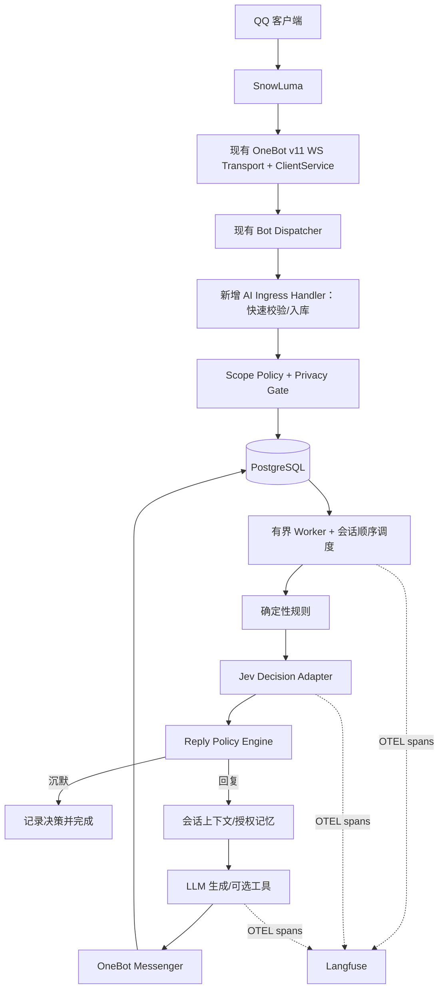

# QQBot 智能会话与长期记忆系统：详细实施计划 v1.0

> 日期：2026-10-23  
> 目标仓库：[HappyLadySauceM/QQBot](https://github.com/HappyLadySauceM/QQBot)  
> 代码基线：`main`，commit `7ebf7e1c24c16f2b23eb4d4a48d51d44a57e272f`（2026-10-19）  
> 状态：**技术设计 / 待开发**；此文档不表示相关功能已实现。  
> 主要技术：Go 1.22、SnowLuma、OneBot v11、PostgreSQL、pgvector、Jev、LLM、Langfuse、OpenTelemetry。

## 0. 执行摘要

把现有 QQBot 从“已具备 OneBot v11 接入和 Echo 示例的 Go 框架”演进为可配置、可观测、可控权限的智能 QQ 助手。核心机制是：**硬性规则决定能否处理；Jev 辅助判断是否应该参与聊天；会话状态判断是否在延续对话；LLM 负责生成；PostgreSQL 负责记录与记忆；Langfuse 负责追踪与优化**。

首个可验收闭环为：SnowLuma 接入 → 同步好友和群 → 管理端选择作用域 → 消息去重入库 → 规则和 Jev 决策 → 读取会话上下文 → LLM 生成 → 通过 OneBot 发送 → 记录 Trace。长期记忆与高风险工具调用在基础闭环稳定后上线。

**关键原则**：保持现有 `internal/onebot` 协议层，不重写 OneBot 动作；不把 LLM 放进 WebSocket 读泵或同步消息分发循环；无权限不读取/保存聊天正文；不跨私聊、群聊泄露记忆；服务异常时默认沉默，不主动插话。

## 1. 已确认的代码基线与差距

当前主干已有：

- `cmd/app/initialize.go`：启动、装配、管理 HTTP 生命周期；`cmd/app/assembly/work.go`：装配 Transport、Dispatcher、Echo。
- `internal/onebot/{domain,application,contracts,infrastructure}`：OneBot v11 类型化动作与事件、正向 WS、echo 响应关联、超时、重连与心跳；`InfoReader` 已具备 `GetLoginInfo`、`GetFriendList`、`GetGroupList`、`GetGroupMemberList`。
- `internal/bot/application/service.go`：一个事件消费者顺序调用匹配的 Handler；现有 `Handler` 接口是 `Name/Match/Handle`。
- `internal/echo`：示例 `ping`/`/echo`，默认启用。
- `GET /livez`、`GET /readyz`、`GET /api/v1/status`；管理 API 默认 `127.0.0.1:5080`，响应信封 `{code,message,data}`。
- `AGENTS.md`、`.agents/skills/coding`、`.agents/skills/onebot` 有明确 DDD 依赖方向、最小改动和 `just verify` 约束。

当前欠缺：PostgreSQL、持久化联系人/群目录、作用域管理 API、会话存储、消息任务队列、Jev/LLM Provider、长期记忆、Langfuse 追踪、管理后台和权限审计。

**必须解决的运行时限制**：目前 Dispatcher 同步调用 Handler，且事件通道容量 256；若在 Handler 里直接等待 LLM，队列可能溢出。OneBot 入站事件不应假设支持可靠重放：应用只保证“已成功入库消息的可恢复处理”，不能承诺上游丢包后无损回补。

## 2. 本期范围与不做事项

### 本期必须交付（MVP）

1. 单个 QQ 账号连接和状态（表结构保留 `bot_id`，为多账号留键，但本期不做多连接控制台）。
2. 同步好友、群以及按需的群成员，管理 API 支持筛选与分页。
3. 好友/群的作用域模式与权限开关，默认未启用范围不参与智能聊天。
4. 消息去重、事务入库、可恢复任务、单会话顺序处理、跨会话受控并发。
5. Jev 决策 + 确定性规则 + 明确降级；可切换提供商但先只实施一个 Jev HTTP 适配器。
6. 私聊/群聊短期上下文、聊天历史、摘要更新；统一 LLM 适配接口。
7. OTEL → Langfuse 追踪、基础监控、人工标注与回归评估。
8. 管理 API 的认证/审计及基础安全保护。

### 第二阶段交付

长期记忆（提取、权限校验、语义检索、修订、删除）、可选工具调用及审批、管理 Web UI、图片/语音理解。**不把标准 OneBot 11 的全部能力等同于“允许 AI 无审批使用全部能力”**。

### 明确不做

不重写 SnowLuma、不添加无业务需求的微服务/消息中间件、不直接开放踢人/禁言/审批给自动聊天模型、不做无边界的跨群知识共享、不在本期实现完整多账号水平扩容、不承诺 OneBot 未支持的消息重放与精准发送幂等。

## 3. 架构与数据流



**依赖规则**：业务通过 `onebot/contracts` 使用最小能力端口；`domain` 保持纯领域值；JSON、HTTP、SQL、OTEL、WS 属于 `infrastructure`；`cmd/app/assembly` 仅绑定实现，不放业务规则。`internal/bot` 继续拥有唯一事件消费者，新增 Handler 不自行读 `Events()`。

### 消息处理序列（推荐）

1. OneBot 解析消息事件；`AIIngress.Match` 只做廉价类型判断，`Handle` 执行本地基础过滤和作用域读取。
2. 黑名单、无授权、机器人自身消息、无效群等直接结束；不把未授权正文写入数据库或遥测。
3. 已授权内容在短事务内写入 `messages`，同时插入 `message_jobs`；通过唯一键避免重复处理。入站处理应快速返回。
4. Worker 拉取待处理任务。按 `conversation_id` 维护单飞顺序，同一群/私聊一次只处理一个决策任务；不同会话设置总并发上限。
5. 读取近期消息和“机器人最近是否参与/对谁说话/最后一轮是否已结束”等结构化状态。新消息到达时先做短暂合并窗口，避免连续刷三条就连续回复三次。
6. 硬性规则优先；模糊情况请求 Jev。将 Jev 输出交给本地 `ReplyPolicy`，统一生成 `reply/silent/defer` 与 reason code。
7. 需要回复时读取最小必要的会话摘要与经过权限过滤的记忆，调用 LLM；输出经过长度、@所有人、链接/敏感内容及工具权限检查。
8. 发送前再次核验 scope（管理员可能在模型生成期间关闭某群）；发送成功记录结果。发送超时但状态不明时标记 `unknown`，不得盲目再次发送。
9. 完成任务，更新会话活跃状态；异步生成滚动摘要及可选长期记忆候选。关闭程序时停止接收新工作，等待有界在途任务结束。

## 4. 作用域设计（重要的权限边界）

### 4.1 作用域类型

- `global`：机器人统一设定和通用开关（仅管理员可配置）。
- `group`：一个群的聊天模式、消息记录策略和可用工具。
- `private`：一个 QQ 联系人的私聊模式和数据保留策略。
- `group_member`：可选额外覆盖策略，如群内某用户禁用/管理权限；**不得提升群策略禁止的能力**。

推荐优先级：全局强制禁止 > 黑名单/合规限制 > 具体会话禁用 > 群/私聊显式策略 > 默认关闭。下层策略只能缩小权限，不得越权放大上层禁令。

### 4.2 维度与模式

| 维度 | 建议字段 | 意义 |
|---|---|---|
| 是否接入智能回复 | `enabled` | 主开关，默认 `false` |
| 回复模式 | `reply_mode` | `mention_only` / `intent_based` / `always_reply` / `observe_only` |
| 保存消息 | `store_messages` | 与聊天参与开关独立，默认 `false` |
| 写长期记忆 | `allow_memory_write` | 默认 `false` |
| 使用会话记忆 | `allow_history_read` | 默认仅已授权会话 |
| 执行工具 | `tool_policy` | 允许动作白名单，默认只读和普通发送 |
| 频率 | `min_reply_interval_ms`、`max_replies_per_hour` | 群聊防刷屏 |
| 留存 | `retention_days` | 可选数据到期清理 |

`observe_only` 只代表“不发送”；**是否允许存储**仍由 `store_messages` 单独决定，不能暗含默认收集全部群聊消息。

### 4.3 场景规则

- 群聊 `mention_only`：检测真正的 `at` 段指向自身 QQ ID，或引用机器人消息，**不能仅靠文本中出现昵称**。
- 群聊 `intent_based`：直接 @ 通过快速路径，其他消息交给 Jev + 会话状态评估。
- 私聊 `intent_based`：通常只做是否需要回应/是否已结束判断，可设置更高响应倾向。
- `always_reply` 仅限白名单测试会话，不能绕过速率、安全、工具权限。
- 管理员将作用域禁用后，执行中的任务发送前必须复核且不能继续回复。

## 5. Jev 意图决策与拟人化参与

### 5.1 职责划分

- **规则层**：自发消息过滤、黑名单、作用域、@、引用、冷却/静默时间、频率、管理员禁言、隐私限制；它具有最终否决权。
- **Jev 层**：判断语义指向和参与时机，不负责生成文本，也不决定 QQ 操作权限。
- **会话状态层**：最近是否与机器人互动、最近谁在说话、持续时间、是否明显切话题。
- **回复策略层**：综合上述信息，输出稳定的决策原因码；不是把 Jev 的某一个概率直接当动作指令。

### 5.2 Jev API 契约

官方接口：`POST https://api.typesafe.ai/v1/systemone`，`Authorization: Bearer ...`。请求字段为 `model/state/questions`；`noul` 返回 0～1 的数值；`choice` 返回结构化分类。`jev-latest` 可用于开发，生产上线应记录真实返回的 model 标识并评估固定版本的稳定性。

**示意请求（实际使用时不提交未经授权的完整群聊天记录）**：

```json
{
  "model": "jev-latest",
  "state": {
    "bot_name": "小雪",
    "channel": "group",
    "current_message": {"sender": "user_A", "text": "那你觉得呢？"},
    "recent_messages": [
      {"sender": "user_A", "text": "小雪，你觉得 Go 合适吗？"},
      {"sender": "bot", "text": "适合，主要看你要做什么。"}
    ],
    "bot_last_spoke_seconds_ago": 35,
    "mentions_bot": false,
    "replies_to_bot": false
  },
  "questions": {
    "directed_to_bot": {"type":"noul","instructions":"当前发言是否明确是在向机器人说话？"},
    "continues_bot_thread": {"type":"noul","instructions":"这是否是对机器人最近发言的自然追问？"},
    "addressed_to_other": {"type":"noul","instructions":"这是否主要是在和另一位真人群友说话？"},
    "appropriate_to_join": {"type":"noul","instructions":"在没有被点名的情况下，机器人此时插话是否自然且有帮助？"},
    "intent": {
      "type":"choice",
      "instructions":"当前消息的主要聊天功能是什么？",
      "criteria": {
        "question":"求助或提问",
        "chat":"普通闲聊或讨论",
        "command":"明确提出执行动作",
        "closing":"告别、结束或不再期待回复",
        "other":"无法归入以上类型"
      }
    }
  }
}
```

按官方响应解析 `answers.<name>`；对 `noul` 读取 `noul`，对 `choice` 按官方结构读取分类及概率。**Jev 不应被假定会返回 `reason` 自由文本**；`reason_code` 由本地策略引擎生成。任何响应结构异常、数值越界、空答案都视为不可用。

### 5.3 初始决策表（需离线标注校准，不是官方阈值）

| 场景 | 建议判定 |
|---|---|
| 无权限/被禁用/触发静默限流 | `silent`，不调用 Jev |
| 明确 @ 或引用机器人 | 通过意图闸门，后续仍受安全和速率规则限制 |
| 活跃会话续聊，`continues_bot_thread >= 0.80` 且 `addressed_to_other < 0.60` | `reply` |
| 无明确指向但 `appropriate_to_join >= 0.95` 且群策略允许主动参与 | `reply`，再施加冷却时间与群发言比例门槛 |
| 明确问其他群友或意图为结束 | `silent` |
| 分数模糊、互相冲突 | `silent` 或 `defer` 等后续消息；不要硬猜 |
| Jev 429/5xx/超时 | 只保留明确 @ / 引用 / 受允许的明确命令，禁止自动插话 |

`noul` 数值只是模型估计；需要按中文群聊人工标注评估其可靠性。为避免每条消息都调用：规则快速决策 → 已参与的短窗续聊判定 → Jev 语义判定；长消息、引用、图片优先裁剪或结构化提取。

### 5.4 Active Conversation Window

- `group` 保持群级可检索消息历史，但参与状态以 `conversation_id + thread_key` 追踪；`thread_key` 可由回复关系、参与者、最近话题推断，不能只凭群 ID 假定全群所有人属于同一段对话。
- 建议初始活跃窗口 180 秒（配置化）；机器人被追问时刷新，明确切话题、结束对话、群中他人接管时降低或终止。
- 连续多条消息可采用 0.8～1.5 秒小窗口聚合，新的消息到达时取消尚未开始生成的旧任务；**不得在已经确定发送后自动重复回复**。
- 群内机器人每小时上限、群内发言占比上限和单用户冷却独立生效。

## 6. 会话管理与长期记忆

### 6.1 会话键

- 私聊：`(bot_id, private, peer_user_id)`，仅这个人及机器人可见。
- 群聊：`(bot_id, group, group_id)`，用于群级历史与群级摘要。
- 可选对话线程：`(conversation_id, thread_key)`，表示群中某个正在进行的机器人互动话题。

输入上下文只取已授权历史：最近 N 条消息（例如 30 条或 4k token，以 Token 上限为准）+ 最近摘要 + 少量检索结果。消息按事件时间和数据库序号稳定排序，发送者必须标注，避免把群友 A 的话当成 B 的上下文。

### 6.2 短期与摘要

- 保存标准化文本、必要消息段（引用、at、图片占位符），原始隐私字段按配置裁剪。
- 达到 token/消息阈值后异步生成滚动摘要：角色、当前话题、未解决问题、最新结论与出处 ID。
- 摘要须版本化，记录 `source_message_id` 范围；原文撤回/删除时触发摘要失效或重建策略。
- LLM 回复作为出站消息持久化，保证后续上下文能看到机器人之前说过什么。

### 6.3 长期记忆的可见性模型

建议把“全局长期记忆”限定为**经过管理员授权公开给全部会话的机器人设定/通用知识**，而不是把所有 QQ 私聊自动并入共享库。记忆分层：

| 记忆级别 | `visibility` | 允许读取者 |
|---|---|---|
| 全局机器人知识 | `bot_shared` | 该机器人所有已授权会话 |
| 群共享事实 | `group` | 指定群会话 |
| 私聊个人偏好 | `private_user` | 指定 QQ 用户的私聊和被明确授权的同主体场景 |
| 临时会话事实 | `conversation` | 单个会话 |

每条记忆至少包含：`bot_id`、可见性和归属键、正文、`source_message_id`、来源、置信度、状态、创建/更新时间、到期时间、用户/管理员审批信息。抽取新记忆时：**候选 → 去重 → 核验归属与授权 → 合并/替换冲突 → 激活**，不得由群友一句“记住所有人都喜欢 X”直接覆盖全局事实。

语义检索使用 PostgreSQL `pgvector`；向量维度必须与选定 embedding 模型一致。初期先做结构化/关键词检索，选定具体 embedding 模型后再创建对应维度索引；避免盲目固定为 1536。查询需先按 `bot_id + visibility + owner_id + status` 过滤，再做语义相似度排名。可辅以关键词检索混排和时间衰减。

记忆管理必须支持：查看、授权范围、纠错、忘记、过期自动清理、删除历史来源关联、退出记忆（opt-out）。涉及删除时同步排查摘要、向量和观测数据的保留策略。

## 7. PostgreSQL 数据设计

**数据库建议**：Go `pgx/v5` + `pgxpool`；版本化 SQL migrations；纯 SQL 参数化查询，不额外引入大型 ORM。业务 UUID 可在 Go 生成；时间统一 UTC；QQ ID 使用 `BIGINT`。

### 7.1 核心表

| 表 | 核心主键/重要列 | 核心约束 |
|---|---|---|
| `bot_accounts` | `bot_id BIGINT PK`, nickname, status | 当前一个账号，保留多账号键 |
| `contacts` | `(bot_id,user_id)`、nickname, remark, last_seen_at | 账号隔离；同步使用 upsert |
| `qq_groups` | `(bot_id,group_id)`、name, member_count, last_seen_at | 群数据隔离 |
| `group_members` | `(bot_id,group_id,user_id)`、card, role | 按需同步，不要求实时全量 |
| `scope_policies` | `(bot_id,scope_type,scope_id)`、mode、权限字段 | 默认关闭，管理变更审计 |
| `conversations` | `id UUID PK`、bot_id、kind、target_id、summary、last_message_at | 唯一 `(bot_id,kind,target_id)` |
| `messages` | id、conversation_id、direction、platform_message_id、sender_id、segments, text, created_at | 去重 + 会话时间索引 |
| `message_jobs` | id、message_id、status、attempts、next_run_at、error_code | 入站入库与建任务同事务 |
| `active_threads` | thread_id、conversation_id、participants、expires_at | 群内续聊状态 |
| `intent_decisions` | job_id、provider、model、decision、reason_code、scores、latency_ms | 用于误判评估 |
| `memories` | memory_id、bot_id、visibility、owner_key、content、source_id、status、embedding | 强制可见性过滤 |
| `tool_calls` | run_id、action、target、approval_status、result | 幂等与审计 |
| `admin_audit_logs` | actor、action、resource、before/after、time | 管理操作可追溯 |

### 7.2 关键 SQL 草案

此处是**核心约束示例**，不是可直接用于全部表的完整 migration；实施时每个 migration 要有 up/down、FK、必要 CHECK 和索引。

```sql
CREATE EXTENSION IF NOT EXISTS vector;

CREATE TABLE bot_accounts (
  bot_id BIGINT PRIMARY KEY,
  nickname TEXT NOT NULL DEFAULT '',
  last_seen_at TIMESTAMPTZ
);

CREATE TABLE scope_policies (
  bot_id BIGINT NOT NULL REFERENCES bot_accounts(bot_id),
  scope_type TEXT NOT NULL CHECK (scope_type IN ('group','private')),
  scope_id BIGINT NOT NULL,
  enabled BOOLEAN NOT NULL DEFAULT FALSE,
  reply_mode TEXT NOT NULL DEFAULT 'mention_only'
    CHECK (reply_mode IN ('mention_only','intent_based','always_reply','observe_only')),
  store_messages BOOLEAN NOT NULL DEFAULT FALSE,
  allow_memory_write BOOLEAN NOT NULL DEFAULT FALSE,
  allow_history_read BOOLEAN NOT NULL DEFAULT FALSE,
  min_reply_interval_ms INTEGER NOT NULL DEFAULT 10000,
  max_replies_per_hour INTEGER NOT NULL DEFAULT 20,
  retention_days INTEGER NOT NULL DEFAULT 30,
  updated_at TIMESTAMPTZ NOT NULL DEFAULT now(),
  PRIMARY KEY (bot_id, scope_type, scope_id)
);

CREATE TABLE conversations (
  id UUID PRIMARY KEY,
  bot_id BIGINT NOT NULL REFERENCES bot_accounts(bot_id),
  kind TEXT NOT NULL CHECK (kind IN ('group','private')),
  target_id BIGINT NOT NULL,
  summary TEXT NOT NULL DEFAULT '',
  summary_upto_message_id BIGINT,
  last_message_at TIMESTAMPTZ,
  UNIQUE(bot_id, kind, target_id)
);

CREATE TABLE messages (
  id BIGSERIAL PRIMARY KEY,
  conversation_id UUID NOT NULL REFERENCES conversations(id),
  bot_id BIGINT NOT NULL REFERENCES bot_accounts(bot_id),
  direction TEXT NOT NULL CHECK (direction IN ('incoming','outgoing')),
  platform_message_id BIGINT,
  sender_id BIGINT NOT NULL,
  text_content TEXT NOT NULL DEFAULT '',
  segments JSONB NOT NULL DEFAULT '[]'::jsonb,
  sent_status TEXT,
  created_at TIMESTAMPTZ NOT NULL DEFAULT now()
);
-- 避免同一会话内重复处理同一个平台事件；没有 message_id 时另设受控去重策略。
CREATE UNIQUE INDEX messages_incoming_event_uniq
ON messages(bot_id, conversation_id, platform_message_id)
WHERE direction = 'incoming' AND platform_message_id IS NOT NULL;
CREATE INDEX messages_conversation_timeline
ON messages(conversation_id, created_at, id);

CREATE TABLE message_jobs (
  id BIGSERIAL PRIMARY KEY,
  incoming_message_id BIGINT NOT NULL UNIQUE REFERENCES messages(id),
  status TEXT NOT NULL DEFAULT 'pending'
    CHECK(status IN ('pending','processing','done','failed','cancelled')),
  attempts INTEGER NOT NULL DEFAULT 0,
  next_run_at TIMESTAMPTZ NOT NULL DEFAULT now(),
  updated_at TIMESTAMPTZ NOT NULL DEFAULT now(),
  last_error_code TEXT
);
CREATE INDEX message_jobs_ready ON message_jobs(status, next_run_at, id);
```

长期记忆表的 embedding 推荐在模型选定时生成 `vector(<模型维度>)` 字段及 `hnsw (... vector_cosine_ops)` 索引，索引与过滤查询同时压测。在小数据量先使用精确检索，不需要为了“用了向量库”立即建 HNSW。

### 7.3 可靠性边界

- 写入 `messages` + `message_jobs` 在一个事务完成，失败时不产生孤儿任务。
- 重启后恢复 `processing` 超时任务；同会话有界单飞，避免重复执行。
- OneBot 发送超时无法确认时状态为 `unknown`/待人工核验，**不盲目重试发送**；已发送的 `platform_message_id` 如可取得，记录实际返回值。
- PostgreSQL 故障时默认降级为不响应、记录脱敏错误；不能无限保留敏感正文于内存或公开日志。
- 后续扩为多 Worker 进程时需另外实现数据库租约/栅栏令牌，不能仅依赖进程内 mutex 保证跨节点单飞。

## 8. 管理 API（先做 API，后做 Web UI）

全部管理路由沿用现有 `/api/v1`、`{code,message,data}`、Go ServeMux，并添加认证、操作审计、分页和过滤。API 不直接调用 WebSocket，而是经应用服务与 `onebot/contracts.InfoReader`。

| HTTP | 路径 | 说明 |
|---|---|---|
| GET | `/api/v1/accounts` | 机器人账号与连接状态 |
| POST | `/api/v1/directory/sync` | 按需触发好友/群目录同步 |
| GET | `/api/v1/contacts?search=&page=&limit=` | 联系人查询 |
| GET | `/api/v1/groups?search=&page=&limit=` | 群列表 |
| GET | `/api/v1/groups/{id}/members` | 群成员（允许按需刷新） |
| GET | `/api/v1/scopes` | 作用域与生效策略 |
| PUT | `/api/v1/scopes/{type}/{id}` | 修改一项作用域、模式、留存权限 |
| GET | `/api/v1/conversations` | 管理员可访问且经授权的会话索引 |
| GET | `/api/v1/conversations/{id}/messages` | 会话历史，需审计与脱敏 |
| GET | `/api/v1/memories` | 根据 visibility、owner、status 筛选 |
| POST | `/api/v1/memories` | 管理员新增/审批记忆 |
| PATCH | `/api/v1/memories/{id}` | 修订记忆/可见性 |
| DELETE | `/api/v1/memories/{id}` | 删除及撤销检索索引 |
| GET | `/api/v1/decisions` | Jev 与回复策略历史 |
| POST | `/api/v1/decisions/{id}/feedback` | 标注应回复/应沉默 |
| GET | `/api/v1/metrics` | 限流、成本、失误率、异常率 |

初期管理服务继续仅监听 `127.0.0.1`。如远程访问需通过受保护反向代理、身份认证及 TLS；写操作必须校验管理员身份并审计，防止 CSRF、滥用和越权；不要把 OneBot token、Jev key、LLM key 通过管理 API 返回。

## 9. Go 代码模块拆分与接口

**保留现有**：`internal/onebot`、`internal/bot`、`internal/echo` 的已实现协议与示例行为；不为本次功能重构标准 OneBot 模型。

建议仅在对应阶段创建业务上下文，不一次性创建所有占位目录：

```text
internal/
  directory/        # 联系人/群同步与本地目录
    domain/ application/ contracts/ infrastructure/
  scope/            # 授权与作用域策略
    domain/ application/ contracts/ infrastructure/
  conversation/     # 消息存储、摘要、活动线程、任务调度
    domain/ application/ contracts/ infrastructure/
  intent/           # Jev + 规则 + 最终决策
    domain/ application/ contracts/ infrastructure/
  agent/            # LLM 生成、Prompt、工具调用
    domain/ application/ contracts/ infrastructure/
  memory/           # 记忆提取、审核、检索、删除
    domain/ application/ contracts/ infrastructure/
cmd/app/
  assembly/work.go  # 仅装配具体接口实现
  routes/           # 新增各管理 API 的路由适配器
pkg/config/          # 分阶段添加实际使用的配置域
migrations/          # 版本化数据库 schema
```

建议的业务契约（**签名草案，非已存在的项目 API**）：

```go
type ScopeAuthorizer interface {
    Resolve(ctx context.Context, botID int64, kind string, targetID int64) (EffectivePolicy, error)
}

type DirectoryReader interface {
    ListContacts(ctx context.Context, query DirectoryQuery) (ContactPage, error)
    ListGroups(ctx context.Context, query DirectoryQuery) (GroupPage, error)
}

type IntentDecider interface {
    Decide(ctx context.Context, in DecisionInput) (SemanticDecision, error)
}

type ReplyPolicy interface {
    Evaluate(in ReplyPolicyInput) FinalDecision
}

type ChatModel interface {
    Generate(ctx context.Context, req ChatRequest) (ChatResult, error)
}

type MemoryRepository interface {
    SearchVisible(ctx context.Context, in SearchVisibleRequest) ([]Memory, error)
}
```

`AIIngress` 是 `bot/contracts.Handler`：`Match` 只做纯且廉价的事件过滤，`Handle` 只快速入库/投递；不得包含 HTTP Jev/LLM 调用。目录同步基于现有 `onebot/contracts.InfoReader`，回复基于 `onebot/contracts.Sender`，高危工具则显式要求更高等级 capability + 二次授权。

## 10. 配置设计（示意）

新增配置遵循默认值 → YAML → 环境变量 `QQBOT_*` → Flags 的已有优先级；只为实际使用的参数增加配置，密钥一律来自环境或 Secret。

```yaml
# configs/config-example.yaml 新增域示意，实际字段实施时按阶段增加
database:
  dsn-env: QQBOT_DATABASE_DSN
  max-conns: 10

ai:
  enabled: false
  model: "your-chat-model"
  base-url: "https://YOUR_LLM_ENDPOINT"
  api-key-env: QQBOT_LLM_API_KEY
  generation-timeout: 25s
  max-output-tokens: 400

intent:
  enabled: true
  provider: jev
  model: jev-latest
  api-key-env: TYPESAFE_API_KEY
  timeout: 3s
  active-window: 180s
  continuation-threshold: 0.80
  interjection-threshold: 0.95
  fail-open-explicit-mention: true

worker:
  concurrency: 4
  max-pending-jobs: 1000
  coalesce-window: 1s

memory:
  enabled: false
  embedding-model: ""
  embedding-dimension: 0
  max-retrieved: 5

observability:
  enabled: true
  langfuse-base-url-env: LANGFUSE_BASE_URL
  public-key-env: LANGFUSE_PUBLIC_KEY
  secret-key-env: LANGFUSE_SECRET_KEY
  export-raw-content: false
```

如新增 `dsn-env` 这样引用环境变量名称的配置项，需要在实现时定义清楚其解析语义，不将 YAML 值直接当作数据库连接字符串。样例只是设计稿，不应直接复制为已支持的 `config.yaml`。

## 11. Langfuse 可观测性与优化闭环

Go 使用 OpenTelemetry SDK 和 OTLP/HTTP exporter，发送至 **实际 Langfuse 部署的 Base URL**，而不是把 `langfuse.com.cn` 介绍页面硬当 API 主机。实际路径：`<base-url>/api/public/otel/v1/traces`；Basic Auth 为 `base64(public_key:secret_key)`。部署为 Langfuse v4 时带 `x-langfuse-ingestion-version: 4`，让直接 OTLP 输入及时可见。关闭进程时 flush exporter，遥测失败不能影响 QQ 聊天主链路。

建议每条事件 Trace：

```text
qqbot.message
  scope.resolve
  message.persist
  intent.rules
  intent.jev                (未调用则无需伪造 span)
  reply.policy
  conversation.load
  memory.retrieve
  llm.generate
  onebot.send
  memory.candidate         (异步子任务使用关联 ID)
```

记录：trace_id、bot_id 的不可逆映射、scope 类型、conversation_id 的脱敏映射、rule_version、Jev model/输入输出 token/概率、决策原因码、LLM model/用量/延迟、是否发送成功、错误类别。默认**不上传完整 QQ 聊天正文或群成员原始身份**；原始内容只在获得授权且确有需要的特定调试场景启用，并限定保留周期。

建立匿名化评估样本：`message_context`, `human_should_reply`, `human_intent`, `actual_decision`, `prompt_version`, `model_version`。先标注不少于 200 条多样化中文群聊样本（提问、@、引用、讽刺、表情、多人串话、结束聊天等），再调参。

观察指标：
- 核心：**误回复率（不该回却回）**、漏回复率、续聊命中率、用户负反馈率。
- 性能：接收入库成功率、工作队列深度/延迟、决策 P50/P95、生成 P95、消息发送未知状态。
- 成本：Jev 调用率、LLM 请求次数、tokens/会话、日成本。
- 稳定性：OneBot 断线、队列丢弃、PG 错误、重复事件、超时和限流。

评估目标是建议的**上线门槛，不是现有实测值**：误回复率 < 5%，漏回复率 < 15%，重大越权 0，消息重复发送可控且有记录；目标值可按场景和人工标注结果调整。

> 自托管 Langfuse v4 是独立系统：除了 PostgreSQL 还涉及 ClickHouse、Redis/Valkey、对象存储和 Web/Worker；QQBot 的 PostgreSQL 与 Langfuse 的部署拓扑应分别规划。

## 12. 安全、异常处理与运维

- **权限**：管理 API 认证和审计；消息发送前二次作用域核验；机器人工具按最小能力授权。禁言、踢人、批准入群、修改群配置默认禁用，必要时要求管理员二次确认。
- **隐私**：先判断授权，再决定保存或外发正文；可撤销记忆与记录；按 scope retention 删除数据；群聊全文不直接进入全局共享记忆。
- **LLM 安全**：用户聊天消息不作为系统指令；工具结果也视为不可信输入；提示词注入不能改变作用域或管理员配置。禁止模型凭自然语言绕过工具权限。
- **限流**：每群/每用户/全账号多维限流，主动插话比例限制，避免刷屏与 QQ 风控。
- **可用性**：Jev 不可用退化为只响应明确 @/引用；LLM 不可用默认不发送编造答案；PG 不可用停止持久化智能回复；OTEL 故障不阻断主业务。
- **消息**：正确处理非文本、撤回、消息引用、自身发送事件、临时会话或未知 OneBot 扩展；未知事件默认不触发智能回复。
- **运维**：数据库备份与恢复演练，迁移前快照，配置密钥隔离，安全的 graceful shutdown，readiness 可考虑单独暴露 AI/PG 子系统健康而不破坏 `/readyz` 原有语义。

## 13. 实施阶段与具体任务（可直接转 Issue）

以下按依赖顺序推进。估算以**一名熟悉 Go/DDD 的开发者**为基准，仅用于排期讨论，不含外部接口审批和真实 QQ 联调的不确定时间。

### P0：数据库 + 目录 + Scope（约 3–5 开发日）

- [ ] P0-01 接入 `pgxpool`、数据库迁移与启动时连接检查；完成本地测试数据库。
- [ ] P0-02 建立 `bot_accounts/contacts/qq_groups/group_members/scope_policies` 与索引。
- [ ] P0-03 `directory` service 通过 `InfoReader` 同步好友、群，群成员按需刷新；断线返回明确错误；同步采用 upsert + last_seen，不直接全量硬删。
- [ ] P0-04 `scope` service 实现权限优先级、默认拒绝、缓存失效/即时生效。
- [ ] P0-05 管理 API 提供联系人/群列表、单项 scope 更新、查询；增加最小管理员认证、审计。
- [ ] P0-06 添加单元/DB 集成测试、越权测试，运行仓库 `just verify`。

**验收**：能读取实际 QQ 好友和群列表；默认所有群/好友未开启 AI；启用/禁用某一项立即生效；未授权正文不会落库或发送给外部模型。

### P1：会话持久化与受控调度（约 4–6 开发日）

- [ ] P1-01 建 `conversations/messages/message_jobs/active_threads`；实现消息去重、原子建任务。
- [ ] P1-02 增加 `AIIngress Handler`，入库后快速返回，保留现有 Dispatcher 的唯一消费者设计。
- [ ] P1-03 有界 worker：同会话顺序执行、跨会话并发、超时、取消、失败恢复、积压监测。
- [ ] P1-04 处理引用/@/群成员 sender 与消息段；正确存取入站与出站消息。
- [ ] P1-05 活跃线程状态、小窗口合并、消息撤回/删除与历史清理基本流程。
- [ ] P1-06 并发及故障注入测试，包括 worker 重启、重复事件、PG 中断。

**验收**：模拟慢操作不会阻塞 Dispatcher；同一会话回复顺序可控；重启可恢复已入库未完成任务；重复事件不重复安排回复；网络结果未知不会盲目重发。

### P2：Jev 规则 + LLM 回复（约 4–7 开发日）

- [ ] P2-01 建 `intent` domain/application/contracts；制定 `ReplyPolicy` 决策原因码。
- [ ] P2-02 基础硬规则：自身消息、群/私聊模式、@/引用、黑名单、速率、最后发送时间。
- [ ] P2-03 Jev HTTP adapter，固定请求/响应结构、限时、错误分类、模型版本与用量记录。
- [ ] P2-04 中文场景决策样本与阈值配置；加 `silent/defer/reply` 分支及降级测试。
- [ ] P2-05 `agent` LLM adapter、Prompt 构建、上下文裁剪、文本回复、长度限制、发送前复核。
- [ ] P2-06 在启用 AI 的测试群关闭 `echo.enabled`，避免重复响应；验收多群独立作用域。

**验收**：@ 机器人可稳定回复；明确与他人对话时不插话；Jev 断线仍不乱说；相同消息的决策记录可复盘；群聊/私聊隔离。

### P3：短期摘要 + 长期记忆（约 4–7 开发日）

- [ ] P3-01 会话摘要器（范围、版本、异步刷新）、最大 token 预算与摘要失效规则。
- [ ] P3-02 记忆候选提取、审核/合并/过期/删除，所有候选带来源与可见性。
- [ ] P3-03 选择 embedding 模型后创建 `vector(dim)`、向量/过滤索引，优先验证隔离正确性。
- [ ] P3-04 建 `MemoryRepository.SearchVisible` 和上下文拼装；按权限过滤再检索。
- [ ] P3-05 管理 API 可查看、纠正、删除记忆；用户拒绝记忆时不再采集。

**验收**：跨进程重启有会话记忆；同群历史能续聊；A 的私聊偏好不会泄露给 B 或无关群；已删除记忆不再出现在检索结果。

### P4：Langfuse 与离线评估（约 2–4 开发日）

- [ ] P4-01 OTEL exporter、Langfuse 凭据、v4 ingestion header，敏感数据过滤。
- [ ] P4-02 核心 pipeline span、决策与生成指标、失败分类。
- [ ] P4-03 录入经授权脱敏的人工标注集，建立“误回复/漏回复”回归分析。
- [ ] P4-04 比较规则版本/Jev 阈值/提示词版本，形成每周人工验收记录。

**验收**：从收到消息到发送能以同一 trace 定位；能复现“为什么回/为什么不回”；关闭观测后核心聊天正常。

### P5：安全工具 + 管理 UI（约 4–8 开发日，按需要拆批）

- [ ] P5-01 工具能力清单与最小权限（先只读查询）；高危动作审批和审计。
- [ ] P5-02 UI 显示 QQ 联系人、群、当前作用域；可以选择授权并查看有效配置。
- [ ] P5-03 UI 查看对话、意图结果、记忆、反馈，支持搜索、脱敏和删除。
- [ ] P5-04 完成密钥管理、备份/恢复与运行指标告警。

**验收**：管理员能直观看到哪个群启用了机器人；工具越权 100% 被拒绝；修改策略不会要求手工重启。

## 14. 测试矩阵与完成定义

| 类别 | 重点测试 |
|---|---|
| 协议 | SnowLuma 模拟 WS、echo 关联、断线重连、CQ 字符串与段数组、@/引用 |
| 隔离 | 群 A 和 B、A 和 B 私聊、群成员不同身份、单一全局设定作用域 |
| 决策 | 被点名、续聊、多人交叉对话、问他人、冷场插话、告别、表情、恶意注入 |
| 可靠性 | 256 缓冲溢出风险、积压、PG 中断、任务重入、重启恢复、未知发送状态 |
| 隐私 | 未授权不存储、未授权不外传、停用后不发送、记忆撤销与删除 |
| 负载 | 高频群消息、慢 Jev/LLM、并发会话、取消和 graceful shutdown |
| 可观测 | trace 串联、无敏感内容输出、Langfuse 不可用时业务继续 |

每个阶段编码完成运行仓库规定的 `just verify`（等效 `go mod tidy`、`go vet ./...`、`go test ./...`、`go fmt ./...`）；并发相关修改额外执行 `go test -race ./...`，数据库部分增加独立集成测试。**本计划写作阶段未执行这些命令，不能宣称测试通过。**

## 15. 上线前决策与默认值

- **账号规模**：先一账号单进程，所有表预留 `bot_id`；需要多账号后再设计连接池和跨进程会话调度。
- **默认权限**：群和私聊均默认关闭 AI；管理员显式授权；消息存储与记忆写入是独立 opt-in。
- **模型**：Jev 优先提供意图决策，LLM 使用可配置兼容接口；上线固定可评估的模型版本和 Prompt 版本。
- **主动插话**：先不开启，采集标注评估后只在白名单群渐进灰度。
- **记忆**：先短期历史和摘要，再上长期；全局只放显式批准的机器人共享知识。
- **UI**：先后端管理 API，前端在 P5，避免妨碍主聊天闭环。
- **成本与合规**：测试 QQ 账号、外部模型请求的数据告知与授权、QQ 平台规则评估后再进行大群部署。SnowLuma 为独立第三方项目，非腾讯官方授权。

## 16. 参考资料

- [QQBot 仓库](https://github.com/HappyLadySauceM/QQBot/tree/main) 与 [架构文档](https://github.com/HappyLadySauceM/QQBot/blob/main/docs/architecture.md)
- [SnowLuma 官方仓库](https://github.com/SnowLuma/SnowLuma) 与 [文档](https://snowluma.github.io/zh/)
- [TypeSafe Jev / System One 官方 API](https://docs.typesafe.ai/api/system-one)
- [Langfuse OpenTelemetry 集成](https://langfuse.com/integrations/native/opentelemetry)
- [Langfuse 自托管组件](https://langfuse.com/self-hosting)
- [pgvector 官方仓库](https://github.com/pgvector/pgvector)

---

**最先实施的切入点**：P0-01～P0-05（PostgreSQL + 目录 + Scope 管理），随后 P1 实现快速入库与会话调度，再进入 Jev/LLM。不要先在现有 Echo Handler 中直接放模型调用。
