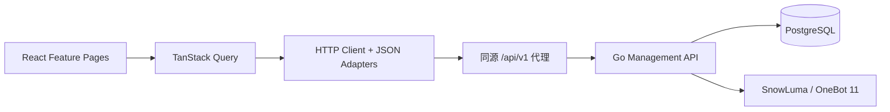

# QQBot Web 管理后台详细实施计划 v1.0

> **项目**：HappyLadySauceM/QQBot  
> **代码基线**：`main`（设计基线 `79e20914`，2026-10-24 核对）  
> **计划位置**：`web/`（已创建并入库）  
> **状态**：W0 + W1 已实现，`pnpm lint`、`pnpm test`、`pnpm build` 通过；W2–W4 待实施  
> **目标风格**：AI Agent Control Center；简洁、现代、克制的科技感  
> **主要参考**：[satnaing/shadcn-admin](https://github.com/satnaing/shadcn-admin)（MIT，[预览](https://shadcn-admin.netlify.app/)）；[Magic UI](https://magicui.design)；[Motion Primitives](https://motion-primitives.com)

---

## 0. 执行摘要与决策

本期在 **不重构 Go/OneBot/SnowLuma 主链路**的前提下，新增可运行的 Web 管理后台，优先完成以下闭环：

1. 查看机器人是否连接、是否具备数据库、24 小时消息和意图任务统计。
2. 浏览 QQ 好友、群和群成员，手动同步联系人。
3. 以好友/群为粒度**查看并修改作用域策略**，默认拒绝；用户明确保存才写入。
4. 浏览、创建、审批、编辑和删除长期记忆，明确展示共享边界。
5. 对接现有 Go HTTP API，统一处理错误、加载、权限不足、断线与未启用数据库状态。
6. 建立一致的现代深色视觉系统，可持续扩展"会话中心 / Jev 决策分析 / 运行追踪"。

**确定选型**：**Vite + React + TypeScript + Tailwind CSS + shadcn/ui + TanStack Router + TanStack Query**；以 `satnaing/shadcn-admin` 的布局、交互模式作为参考，择需复用组件（保留许可证），**不直接整体搬入其演示工程**，避免 Clerk、Demo 数据和无关依赖。

**明确不做**：本期不重写 OneBot、数据库业务模型、消息工作器、Jev/LLM 逻辑，不自动添加插件系统/全局状态框架，不制作所有尚无 API 支持的"假功能"。

## 1. 基线与真实 API 清单

### 1.1 仓库实情

当前服务主要包含 `cmd/app`（组合根、路由、中间件）、`internal/directory`（联系人/群）、`internal/scope`、`internal/conversation`、`internal/intent`（Jev）、`internal/agent`、`internal/memory`、`internal/observability`、`internal/onebot`，并使用 PostgreSQL。`cmd/app/middleware/auth.go` 提供静态 Bearer Token；`cmd/app/router/router.go` 在数据库服务未装配时**不注册**目录/作用域/记忆/指标路由。`README.md` 指出无数据库时只运行 echo 和状态接口。账号快照 `GET /api/v1/accounts` 只读 OneBot 连接，已改由 `system` handler 无条件注册，不再受数据库门控。

截至基线，**有实际可用的 API**：

| 模块 | 方法 / 路径 | 页面用途 | 实现位置 |
|---|---|---|---|
| 存活 | `GET /livez` | 服务进程状态 | `routes/system` |
| 就绪 | `GET /readyz` | SnowLuma/OneBot 是否连接（未连接为 503） | `routes/system` |
| 状态 | `GET /api/v1/status` | 连接、自身 QQ、运行时长、Handler | `routes/system` |
| 指标 | `GET /api/v1/metrics` | 消息、任务、意图与记忆计数 | `routes/metrics` |
| 同步 | `POST /api/v1/directory/sync` | 同步好友/群 | `routes/directory` |
| 账号 | `GET /api/v1/accounts` | 当前机器人账号和连接状态（无数据库也可用） | `routes/system` |
| 好友 | `GET /api/v1/contacts?search=&page=&limit=` | 分页好友列表 | `routes/directory` |
| 群聊 | `GET /api/v1/groups?search=&page=&limit=` | 分页群列表 | `routes/directory` |
| 成员 | `GET /api/v1/groups/{id}/members?page=&limit=&refresh=true` | 群成员、强制刷新 | `routes/directory` |
| 作用域列表 | `GET /api/v1/scopes?bot_id=` | 已存储策略；不是全部好友/群的全集 | `routes/scope` |
| 作用域详情 | `GET /api/v1/scopes/{group\|private}/{id}` | 获取默认策略或已有策略 | `routes/scope` |
| 作用域写入 | `PUT /api/v1/scopes/{group\|private}/{id}` | 保存完整策略 | `routes/scope` |
| 记忆列表 | `GET /api/v1/memories?bot_id=&visibility=&owner_key=&status=&search=&page=&limit=` | 搜索、筛选 | `routes/memory` |
| 创建记忆 | `POST /api/v1/memories` | 创建候选或直接审批 | `routes/memory` |
| 修改/审批 | `PATCH /api/v1/memories/{id}` | 文本、归属、状态 | `routes/memory` |
| 删除记忆 | `DELETE /api/v1/memories/{id}` | 从检索中移除 | `routes/memory` |

**当前尚无专用后台 API**：会话列表/消息分页、单次 Jev 决策详细追踪、时序图表、Langfuse trace 列表、模型动态配置、管理员浏览器登录/登出。它们必须明确标为**后续增补**，不能先把页面做成假可用。没有实际服务端数据时不展示虚构趋势/准确率。

### 1.2 JSON 契约兼容要求（高优先级）

- 所有管理 API 的响应信封为 `{ "code": 200, "message": "success", "data": ... }`；非 2xx 从 `message` 显示安全错误信息。
- **部分 Go domain DTO 没有 `json` tags，序列化字段为 PascalCase**，例如好友页 `Items/Total/Page/Limit`，联系人 `UserID/Nickname/Remark/LastSeenAt`，作用域读取 `ScopeType/ScopeID/Enabled/ReplyMode/...`，长期记忆模型 `ID/BotID/Visibility/...`。
- **写入 API 的 JSON 使用 snake_case**，例如 `enabled`、`reply_mode`、`store_messages`。不要依赖自动驼峰猜测、直接把读 DTO 回传给 PUT。
- `/api/v1/metrics` 返回字段名称为 `message_jobs`、`intent_decisions_24h`、`messages_24h`、`memories`；**它是聚合数据，不是时间序列**。
- 列表的 `GET /api/v1/scopes` 只列已保存的策略；"所有可管理好友/群"应由联系人/群列表与策略详情合并展示。
- `PUT /scopes/...` 当前要求已知 `self_id`，连接未就绪返回 `409`；前端禁用保存并解释"机器人账号尚未识别"。
- 数据库未配置时，一部分 API **返回 404（路由未注册）**，不是一定返回 503；区分模块不可用和真实资源不存在。
- `GET /api/v1/scopes?type=<group|private>&id=<id>` 与路径式详情等价，可直接取单条生效策略，无需先拉全表。
- `POST /api/v1/directory/sync` 服务端超时为 30 秒，失败返回 `502`；前端请求超时必须大于该值并禁止重复提交。

**适配约定**：只在 `src/lib/api/adapters/` 做输入/输出归一化；展示层只使用统一的前端 `camelCase` DTO。未来后端添加 JSON tag 时，只修改适配器与对应契约测试。

## 2. 产品目标、用户故事与范围

### 2.1 目标用户

初期为**单管理员、本地/受控网络访问**，管理一个 SnowLuma 连接下的 QQBot。页面结构预留账号切换展示区，但**不假装已经支持多连接实例管理**。

### 2.2 本期必须完成（MVP）

- 进入控制台，5 秒内区分"前端运行正常 / Go 不可达 / OneBot 未连接 / 数据库未配置"。
- 查看与搜索好友、群，点击查看群成员；同步按钮有状态、错误反馈和防重复提交。
- 在好友或群列表中快捷进入作用域配置；开关、模式、记忆/历史权限、限频字段正确读写。
- 安全管理长期记忆：候选、已启用、已取代、已删除状态清楚；审批共享记忆需额外确认。
- 左侧导航、面包屑、全局状态栏、主题切换、空态/错误态、响应式布局可用。
- Go 后端不因 Web 前端引入 Node 服务运行时；产物为静态文件。

### 2.3 第二阶段功能（必须等后端支持）

- **会话中心**：会话分页、消息详情、上下文摘要、授权可见性、消息状态。
- **Jev 决策中心**：每次决策的 reason、provider、confidence、所用规则、Trace ID（需新查询 API）。
- **Langfuse 页面**：服务端生成的安全跳转链接或聚合指标；浏览器不暴露 Langfuse secret。
- **模型设置**：支持查看安全的模型摘要、非密钥参数调整、保存审计；密钥仍由环境变量/密钥服务管理。
- **远程管理安全会话**：如需公网部署，先完成服务端会话认证后再开放。

## 3. UI/UX 设计规范

### 3.1 视觉主题：Quiet Futurism（克制的未来感）

- **默认深色**：主背景 `#0B0D12`，二级表面 `#121620`，卡片 `#171B25`，分隔线 `#292F3B`，主文字 `#F4F6FB`，次文字 `#98A2B3`。
- 强调色为冷蓝紫 `#818CF8`，成功 `#34D399`，风险 `#F59E0B`，失败 `#FB7185`；保持较低覆盖率，避免纯霓虹铺满界面。
- 字体：中文系统字体优先；界面数字 `font-variant-numeric: tabular-nums`，大标题 24–30px，正文 13–14px。
- 桌面 Sidebar 约 240–260px，可折叠；顶栏 56–64px，内容区宽度约 1440px，卡片圆角 12px。
- 网格 8pt 节奏；为每个页面设置明确主操作，避免把全部功能塞进一个总览。
- **状态表达**：连接状态绿点可用，错误使用图标+文案，不只靠颜色；未同步/未配置明确解释。

### 3.2 动效边界

- 使用 Motion Primitives 做 Sidebar 过渡、页面进入、Popover/Drawer、列表切换；建议 120–220ms。
- Magic UI 只用于**首页主要统计卡片、状态高亮等最多 2–3 处**；不默认引入背景粒子、炫光鼠标跟随。
- 表格滚动、筛选、键盘导航流畅；尊重 `prefers-reduced-motion`；动画不得阻塞操作。
- 图表仅使用真实有来源的数据；当前只做统计卡片、分布条图，不做伪 24h 曲线。

### 3.3 导航信息架构

```text
控制台
├─ 概览                    /dashboard            [MVP]
├─ QQ 账号                 /accounts             [MVP]
├─ 联系人                 /contacts             [MVP]
├─ 群聊                   /groups               [MVP]
│  └─ 群详情/成员           /groups/$groupId       [MVP]
├─ 作用域策略              /scopes               [MVP]
│  └─ 编辑                 /scopes/$type/$id      [MVP]
├─ 长期记忆                /memories             [MVP]
├─ 会话中心                /conversations        [后端增补]
├─ 意图与决策              /intent               [后端增补]
├─ 观测与追踪              /observability        [MVP仅汇总/跳转]
└─ 系统设置                /settings             [MVP仅只读]
```

**注意**：暂不可用页面不出现在 MVP 正式导航，或明确标为"开发中"且不伪造操作，不创建大量占位页。

### 3.4 页面详细定义

| 页面 | 信息和组件 | 操作 | 状态/权限处理 |
|---|---|---|---|
| 概览 | 连接卡、运行时长、24h 消息量、Job 状态、24h 意图决策原因、记忆状态计数 | 手动刷新 | 断线/DB 不可用/暂无数据分别提示 |
| QQ 账号 | SelfID、是否连接、DB 就绪、心跳时间 | 复制 ID、前往联系人 | 未识别 selfID 不可修改作用域 |
| 联系人 | 搜索、分页、昵称、备注、最近同步时间、作用域状态 | 同步、打开作用域编辑 | 未同步的空状态与无搜索结果区分 |
| 群聊 | 搜索、分页、群名、群 ID、人数、策略状态 | 同步、群详情、作用域编辑 | 成员刷新可能耗时，需 Loading+超时提示 |
| 群详情 | 群信息、成员分页、角色筛选（若 API 不支持则本地过滤当前页并标注） | 刷新成员、定位策略 | 刷新不引入高频轮询 |
| 作用域编辑 | 开关、回复模式、消息留存、历史读取、记忆写入、限频、TTL、工具白名单 | 保存/取消/恢复未保存状态 | 审核差异、危险操作二次确认、409 提示 |
| 长期记忆 | 可见性、归属、状态、来源、内容、置信度、创建时间、分页 | 新增、审批、修改、删除 | 共享记忆风险提示；不跨作用域泄露 |
| 观测 | 聚合指标、Langfuse 状态链接（部署时配置） | 跳转 Langfuse | 不发送秘密密钥、不显示私聊正文 |
| 设置 | 当前前端版本、API 基地址（只读）、服务端安全配置摘要（已有数据时） | 复制诊断信息（脱敏） | 无动态模型保存功能前，不展示可写模型设置 |

### 3.5 关键交互路径

1. 首次进入：Dashboard → 连接卡提示状态 → 点击"同步目录" → 联系人/群出现真实结果。
2. 启用群聊：群列表 → "配置作用域" → 读取生效默认（默认 disabled）→ 勾选 `enabled` → 选择 `mention_only` → 如需持久化勾选 `store_messages`、历史/记忆权限 → 确认变更 → 保存 → GET 重新查询确保成功。
3. 记忆审批：记忆列表筛选 `candidate` → 查看内容、来源和可见性 → 确认审批 → PATCH `status: active` → 刷新列表；全局 `bot_shared` 须提示共享范围。

## 4. 前端技术架构

### 4.1 依赖选择

| 功能 | 选型 | 原因 |
|---|---|---|
| 构建/运行 | Vite + React + TypeScript | 静态构建，不需要 Next.js Node 服务 |
| 组件系统 | shadcn/ui + Tailwind CSS | 可控、可定制、轻量 |
| 路由 | TanStack Router | 类型安全、筛选参数 URL 化 |
| 服务端数据 | TanStack Query | 缓存、请求状态、失效刷新 |
| 表格 | TanStack Table | 分页、搜索、列显示 |
| 表单 | React Hook Form + Zod | 表单校验、差异检测 |
| 图表 | CSS 分布条（Recharts 暂不引入） | 当前只有聚合计数，没有时间序列 |
| 动效 | Motion Primitives（按需） | 克制微交互 |
| 特效 | Magic UI（按需，限制范围） | 品牌质感 |
| 提示 | Sonner | Toast 和错误反馈 |
| 图标 | Lucide | 一致线性视觉 |
| API 类型 | 手写小型 DTO + Zod 边界校验 | 现有服务暂无 OpenAPI；避免凭空生成类型 |
| 测试 | Vitest + React Testing Library；关键 E2E 可用 Playwright | 覆盖交互和 API 边界 |

模板只作布局与组件参考；若直接复制部分源码，保留相应许可声明。不要导入其 Clerk 登录页、角色系统、Fake Users 和无关演示资源。

### 4.2 `web/` 结构（按需创建，不预建空目录）

```text
web/
├─ index.html
├─ package.json
├─ pnpm-lock.yaml
├─ vite.config.ts
├─ tsconfig.json
├─ components.json
├─ public/
│  └─ brand/                     # 实际使用的图标/品牌资源
└─ src/
   ├─ main.tsx
   ├─ app/
   │  ├─ router.tsx
   │  ├─ providers.tsx
   │  └─ layout/
   │     ├─ app-shell.tsx
   │     ├─ sidebar.tsx
   │     └─ topbar.tsx
   ├─ components/
   │  ├─ ui/                    # shadcn 组件
   │  ├─ status-indicator.tsx
   │  ├─ page-header.tsx
   │  └─ feedback-state.tsx
   ├─ features/
   │  ├─ dashboard/
   │  ├─ accounts/
   │  ├─ directory/
   │  ├─ scopes/
   │  ├─ memories/
   │  └─ observability/
   ├─ lib/
   │  ├─ api/
   │  │  ├─ client.ts
   │  │  ├─ contracts.ts
   │  │  └─ adapters/
   │  │     ├─ directory.ts
   │  │     ├─ scope.ts
   │  │     └─ memory.ts
   │  ├─ query-keys.ts
   │  └─ utils.ts
   └─ styles/
      └─ globals.css
```

此结构代表目标信息组织方式，并非要求一次性创建所有文件。原则：**feature 封装自身页面与 hooks；跨 feature 的网络通用能力在 `lib/api`；状态默认交给 URL + TanStack Query + 本地表单，无需上来就引入 Zustand。**

### 4.3 组件职责与数据流



- 所有网络请求通过 `apiClient` 统一设置 `credentials`、`AbortSignal`、超时与异常翻译。
- query keys 必须含分页、搜索、群 ID 等参数，避免数据串页；Mutation 成功后只 invalidates 关联 keys。
- 查询视图 `staleTime` 可设 10–30 秒，Dashboard 的状态 10–15 秒；**不要全局 1 秒轮询**。
- 对于带耗时的目录同步操作，使用 disable/retry UI；用户主动点击后再发请求。

### 4.4 示例类型（仅为前端适配草案）

```ts
export type ApiEnvelope<T> = {
  code: number;
  message: string;
  data?: T;
};

export type ScopeType = 'group' | 'private';
export type ReplyMode =
  | 'mention_only'
  | 'intent_based'
  | 'always_reply'
  | 'observe_only';

// 表单层的统一结构；读响应要从 PascalCase 适配。
export interface ScopeForm {
  enabled: boolean;
  replyMode: ReplyMode;
  storeMessages: boolean;
  allowHistoryRead: boolean;
  allowMemoryWrite: boolean;
  toolPolicy: string[];
  minReplyIntervalMs: number;
  maxRepliesPerHour: number;
  retentionDays: number;
}

export function toScopePutBody(form: ScopeForm) {
  return {
    enabled: form.enabled,
    reply_mode: form.replyMode,
    store_messages: form.storeMessages,
    allow_history_read: form.allowHistoryRead,
    allow_memory_write: form.allowMemoryWrite,
    tool_policy: form.toolPolicy,
    min_reply_interval_ms: form.minReplyIntervalMs,
    max_replies_per_hour: form.maxRepliesPerHour,
    retention_days: form.retentionDays,
  };
}
```

**重要**：`PUT` 是完整策略覆盖，不是 PATCH。必须先 GET 得到生效策略、填满表单、展示更改，再提交所有字段，不能只提交被改的 `enabled`，否则布尔字段会被重置。客户端对 `reply_mode` 仅允许四个后端枚举值。

### 4.5 前端与后端边界

- 前端不得直连 PostgreSQL、SnowLuma WebSocket、Jev、LLM 或 Langfuse Secret API。
- 所有控制操作经现有 Go 管理 HTTP API；需要的新数据须先明确后端契约再开发 UI。
- 前端只做输入验证与交互保护；最终权限、可见性校验和审计由 Go 负责。
- 现有后端响应体差异仅在 adapters 修正，不影响原协议层；为美观不改动 OneBot/domain。

## 5. 认证、安全与部署方案

### 5.1 本地开发 / MVP：同源代理，不暴露秘密

- 后端继续 `127.0.0.1:5080`，前端 Vite 本地运行 `127.0.0.1:5173`。
- Vite dev server 将 `/api`、`/livez`、`/readyz` 转发到 Go；页面只使用相对路径，**不需要 CORS 宽放**。
- 使用现有 README 的本机管理模式：本地 `server.admin-token` 可为空；**本方案仅适用于可信单机环境**。
- 若 Go 端配置了 admin token，**不把它写入 `VITE_*`、JS bundle、localStorage 或 URL**。本地可手工借助仅开发环境的服务端代理设置 Header，但不要把固定密钥提交进配置或脚本。

开发代理示意：

```ts
// web/vite.config.ts 中的相关片段（开发使用）
server: {
  host: '127.0.0.1',
  port: 5173,
  proxy: {
    '/api': 'http://127.0.0.1:5080',
    '/livez': 'http://127.0.0.1:5080',
    '/readyz': 'http://127.0.0.1:5080',
  },
}
```

**安全前提**：开发代理会向转发请求注入 `Authorization`，因此 `server.allowedHosts` **不得设为 `true`**（等于关闭 Host 校验，DNS rebinding 页面可借到管理员令牌）。默认只允许 `localhost` 与回环 IP；确需隧道域名时通过 `QQBOT_DEV_ALLOWED_HOSTS` 追加白名单。

### 5.2 远程访问：必须先加服务端管理会话

如果后台将来通过域名访问，不能依赖浏览器保存静态 Bearer Token。建议建立**同源的 Go 管理会话**，前端接收 `HttpOnly; Secure; SameSite=Lax/Strict` Cookie：

1. 登录用受控管理员身份凭据；密码只存 Argon2id 哈希或接入现有身份提供者，启用速率限制和审计。
2. `POST /api/v1/admin/session`、`GET /api/v1/admin/session`、`DELETE /api/v1/admin/session`（**新增 API，当前不存在**）。
3. Server-side session 有有效期、主动注销和轮换；变更操作验证 CSRF token 和 Origin/Referer。Cookie 非 JS 可读。
4. 将管理端与 API 置于同一 HTTPS Origin，Go API 不直接公网裸露；代理只允许受控来源。
5. 原有 Bearer 鉴权供自动化/CLI 使用时可以保留，但不能被浏览器 JS 持有。

远程管理与多管理员 RBAC 不纳入首期 MVP；当需要实际远程部署时，此项变为上线阻断项。

### 5.3 部署选项

**推荐**：`pnpm build` 输出 `web/dist/`，由同源 Caddy/Nginx 托管 `/`，把 `/api/`、`/livez`、`/readyz` 反代到 Go。SPA 回退到 `index.html`，**但不能让 `/api/` 的 404 被改写为 200 HTML**。

- Go 进程仍只监听内网/回环管理地址；不要为了前端直接改为 `0.0.0.0`。
- 生产前检查 `Cache-Control`：指纹 JS/CSS 可强缓存，HTML 不可强缓存；涉及敏感 API 继续 `no-store`。
- 后台页面/响应禁止搜索引擎索引；备份和数据库不由 web 暴露。
- 不必让 `docker-compose.yml` 现在就新增 Node 服务；部署变更只在选择正式交付方式时实施。

## 6. 页面/API 交互契约（重要验收点）

### 6.1 目录页面

- 首次无同步记录：展示"尚未同步"，提供 `POST /api/v1/directory/sync`；不要伪造好友。
- 联系人：URL `?search=&page=&limit=` 与请求保持一致；`GET /api/v1/contacts` 读取 `data.Items` 和 `data.Total`。
- 群：群 `GroupID` 作路由参数；成员使用 `GET /api/v1/groups/{id}/members?refresh=true` 触发强制刷新。
- 列表上的"作用域状态"不是由目录 API 自带，需按可接受并发调用作用域 GET，或取 `GET /scopes` 已保存策略索引，未知项以默认关闭展示。大列表避免对每一行独立发无界请求。
- 当前 `/accounts` 是**单个当前账号状态**，不是多账号数组。

### 6.2 作用域编辑

当前后端有效类型：`group`、`private`；`reply_mode` 为 `mention_only` / `intent_based` / `always_reply` / `observe_only`。

完整表单应展示：

| 前端字段 | 写入字段 | UI 说明 |
|---|---|---|
| enabled | `enabled` | 默认关闭；开启后才参与该目标 |
| replyMode | `reply_mode` | `observe_only` 不主动回复 |
| storeMessages | `store_messages` | 保存消息；包含隐私说明 |
| allowHistoryRead | `allow_history_read` | 控制读取聊天历史 |
| allowMemoryWrite | `allow_memory_write` | 允许写入长期记忆 |
| toolPolicy | `tool_policy` | 已授权工具标识数组，默认空 |
| minReplyIntervalMs | `min_reply_interval_ms` | 两次回复最低间隔 |
| maxRepliesPerHour | `max_replies_per_hour` | 每小时最多回复数 |
| retentionDays | `retention_days` | 消息留存天数 |

**建议处理**：开启 `store_messages`、`allow_memory_write`、`allow_history_read` 时明确数据收集提示；高级工具权限需二次确认；保存后重新 GET，避免只在前端本地乐观更新。

### 6.3 长期记忆

- `visibility`：`bot_shared` / `group` / `private_user` / `conversation`；非 `bot_shared` 需要 `owner_key`，共享记忆不能带个人 owner。
- `status`：`candidate` / `active` / `superseded` / `deleted`。
- `POST` 实际接受：`bot_id`、`visibility`、`owner_key`、`content`、`source`、`confidence`、`approve`。
- `PATCH` 实际接受：`content?`、`visibility?`、`owner_key?`、`status?`。区分"仅审批"与"修改字段"；状态变更先显示当前归属。
- `PATCH` 会先无条件执行 `Revise`（`content`/`visibility` 为空时保持原值），再按 `status` 分派，两次读写成对但非原子；"仅审批"也会先重写一次记录。
- `status` 传 `candidate` 或 `superseded` 会被接受但**不生效**，接口仍返回 200；UI 不提供这两个状态切换，避免假成功。
- 把记忆改为 `bot_shared` 时必须在同一请求传 `owner_key: ""`，否则后端校验失败返回 400。
- 对 `bot_shared` 明确提示将作为该机器人的共享记忆；审批时要求确认。
- 删除的语义为从检索移除，不随意宣称"已从所有系统永久擦除"。
- 记忆详情含 `Source` 与 `SourceMessageID` 时只显示经当前 API 允许的来源；不自行追溯未授权的聊天内容。

### 6.4 指标

当前 `GET /api/v1/metrics` 是**累积 Job 状态计数、最近 24h 决策理由分布、消息数和按状态分组的记忆数量**，因此：

- 可做 4 张 KPI 卡 + Job 状态横条图 + 意图原因分布图。
- **不可做真实按小时折线趋势、回复准确率、延迟 P95、Token 成本**，除非新增时间桶/观测数据 API。
- 卡片数值 0 必须表示真实 0，不能用 `—` 混同；请求失败时显示"不可获取"，不显示虚构默认值。

## 7. 分阶段开发计划与任务拆分

| 阶段 | 内容 | 预计（单人参考） | 关键产出 |
|---|---|---|---|
| W0 | Vite 工程骨架 + 设计系统 + HTTP Client | 1–2 天 | web 可启动、空态、导航、API 请求层 |
| W1 | Dashboard + 账号 + 指标 | 1–2 天 | 真实连接状态、统计卡 |
| W2 | 好友/群 + 同步 + 群成员 | 2–3 天 | 可搜索分页、同步、详情 |
| W3 | 作用域编辑及授权反馈 | 2–3 天 | 能可靠更新一项群/私聊策略 |
| W4 | 长期记忆管理 | 2–3 天 | 列表、筛选、新增、编辑、审批、删除 |
| W5 | 体验、测试、打包部署与联调 | 2–3 天 | 验收通过、可本机正式运行 |
| W6（后续） | 会话中心/Jev 详情/安全登录 | 依后端能力定 | 新增受控 API + 真实页面 |

时间仅为规模估计，不是交付承诺，联调受 QQ 登录、SnowLuma、数据库等外部条件影响。

**当前进展**：W0、W1 已入库并通过 `pnpm lint`、`pnpm test`、`pnpm build`；W2–W6 未开始。

### W0：工程搭建与基础 UI（依赖：无）

**任务**：
- [x] 创建 `web/` Vite React TS 项目，选择 pnpm 并提交锁文件。
- [x] 初始化 shadcn/ui、Tailwind、TanStack Router、TanStack Query。
- [x] 从参考模板择需移植 Sidebar/AppShell；剔除 Clerk、Demo 数据、无关页面（命令面板留待后续）。
- [x] 建立浅色/深色 Token（默认深色）与可访问的状态控件。
- [x] 建立 `apiClient`：信封解包、状态码、异常、取消请求；实现必要 DTO adapters。
- [x] 加 dev proxy；设置 404/503/断线通用界面；`web/README.md` 只写可执行命令。

**验收**：`pnpm install --frozen-lockfile`、`pnpm lint`、`pnpm test`、`pnpm build` 已本地通过；页面不请求任何硬编码第三方域名或 Demo API；断线、接口未注册与未授权各有独立错误界面。

### W1：Dashboard / 账号 / 指标（依赖 W0）

**任务**：
- [x] 请求 `/livez`、`/readyz`、`/api/v1/status`、`/api/v1/accounts`、`/api/v1/metrics`。
- [x] 实现状态卡、24h 消息、Job 状态、决策分布、记忆计数。
- [x] 仅在页面可见时以 10–30 秒合理频率刷新；手动刷新和上次更新时间。
- [x] 断线、DB 不可用、没有数据三态清楚分离。

**验收**：模拟 OneBot 断线返回 503，页面只标 OneBot 离线，不误判整个 Go 进程宕机；真实 0 显示为 0。

### W2：好友/群和目录同步（依赖 W0）

**任务**：
- [ ] `contacts` / `groups` / `groups/$groupId` 3 个页面及查询 hooks。
- [ ] 支持 `search/page/limit` URL 联动，服务器分页；保留筛选条件。
- [ ] 同步按钮调用 POST，禁重、超时提示、成功后局部刷新缓存。
- [ ] 群成员按需强制刷新，未同步时显示可操作提示。
- [ ] 列表允许进入相应作用域编辑页面。

**验收**：有真实好友和群时数据显示正确；不管数据多少都不把全部好友拉到浏览器一次性搜索；切换不同群不会混用成员缓存。

### W3：作用域策略管理（依赖 W2，可与 W1 并行）

**任务**：
- [ ] `scopes` 列表结合已存策略与目录实体，未知默认为关闭。
- [ ] 表单字段与 GET/PUT 映射完整；Zod 校验类型、范围和枚举。
- [ ] 区分 `mention_only`、`intent_based`、`always_reply`、`observe_only` 的交互解释。
- [ ] 开启记忆/历史写入、赋予工具权限前确认；切换作用域提示未保存更改。
- [ ] 保存成功后重新查询验证，失败维持输入且不会误报成功。

**验收**：从默认关闭开启一个指定群，刷新页面保持已保存状态；`409` 连接未就绪时显示清楚阻断原因；仅更改 reply mode 不清空其他布尔权限字段。

### W4：长期记忆（依赖 W0）

**任务**：
- [ ] 列表筛选状态/可见性/owner/search，并保持 URL 状态。
- [ ] 创建对话框、编辑抽屉、审批确认、删除二次确认。
- [ ] 支持候选 → active、修改内容/归属；共享记忆强提醒。
- [ ] 明确后端软删除语义；错误不吞没。

**验收**：至少成功创建一条候选记忆→审批→编辑→删除；前端不能错误允许 `bot_shared` 带个人 owner；无权限数据不通过 UI 查询绕过服务端。

### W5：整体验证和交付（依赖 W0–W4）

**任务**：
- [ ] 实现错误页、404、Toast、骨架屏、空态、键盘操作、窄屏响应式。
- [ ] 编写 contract/adapters 单元测试、关键表单交互测试、浏览器 E2E happy path。
- [ ] 产出静态 bundle，检查初始体积和网络请求；大型 feature 使用 route-level lazy loading。
- [ ] 提供 Caddy/Nginx 同源反代示例（仅在部署任务明确要求时写入对应配置）。
- [ ] 和运行中的 QQBot/SnowLuma/PG 联调，记录失败项、实际可用 API 与环境要求。

**验收**：首次数据加载、保存、刷新、断线、未配置数据库、异常网络、移动端导航均可工作；没有 `.env` 中的 secret 被写入 JS 产物。

### W6：后续新后端 API 的契约草案（不在 MVP 偷做）

**只有产品确定需要后，再逐项实现**：

| 新增（拟议）API | 用途 | 关键安全要求 |
|---|---|---|
| `GET /api/v1/conversations` | 按 bot/作用域分页查会话 | 服务端作用域审查 |
| `GET /api/v1/conversations/{id}/messages` | 分页历史消息、发送状态 | 内容脱敏、严格鉴权与审计 |
| `GET /api/v1/intent/decisions` | 决策、原因、时间、trace ID | 默认不返回正文 |
| `GET /api/v1/metrics/timeseries` | 真实按分钟/小时聚合统计 | 合理时间桶与查询成本 |
| `GET /api/v1/observability/traces` | 指向 Langfuse 的 trace 元信息 | 不透传 Langfuse secret |
| `POST /api/v1/admin/session` 等 | 远程浏览器登录与登出 | 服务端会话+CSRF+审计 |

## 8. 开发规范与质量门禁

### 8.1 最小改动边界

- 首轮提交原则上只修改 `web/`，必要的根目录 .gitignore 变更需说明理由；**不触碰** `internal/onebot`、`internal/intent`、`internal/agent`、`internal/conversation`、`migrations`、`docker-compose.yml`。
- 不修改现有 `AGENTS.md` / `.agents/skills` 来放行无关重构；若后续设计真正要求调整 Go 管理 API，单开 PR 说明接口变更和测试。
- 不自动生成大批无用文件、Demo 页面/假数据、无引用组件或暂时不可用的"插件系统"。
- 遵守仓库 `AGENTS.md`、coding/OneBot skills 的最小修改范围；凡改 Go 文件需跑仓库指定 `just verify`，涉及并发则按需 `go test -race`。

### 8.2 前端质量标准

- TypeScript 严格模式；禁止在核心 API 边界使用无约束 `any`。
- 请求异常要可恢复；写入动作有 loading/disabled；错误 Toast 不展示密钥或原始未经处理的堆栈。
- 组件具备键盘焦点、表单标签、状态的语义化表达；考虑 WCAG AA 对比度。
- 支持 reduced motion；卡片 hover 不影响布局跳动；无自动循环的大型背景动画。
- 认证或代理缺失时显式失败，不静默降级为不安全的浏览器 Token 存储。

### 8.3 关键测试矩阵

| 用例 | 预期 |
|---|---|
| `/readyz` 503、`/livez` 200 | 提示 OneBot 未连接，后台仍在线 |
| DB 未配置导致 `/contacts` 404 | 提示模块未启用或未配置，不显示"无联系人" |
| `GET contacts` 使用 `Items/Total` | 页面适配成功并分页正确 |
| `GET scopes` 返回 PascalCase | 策略状态适配正确 |
| `PUT scopes` 发送 snake_case 完整请求 | 其他权限不被清零 |
| Scope PUT 返回 409 | 保留表单草稿、提示先连接机器人 |
| 同步请求正在执行 | 禁止重复提交，展示状态 |
| 记忆 create/approve/delete | UI 与返回数据状态一致 |
| 直接访问不存在的客户端路由 | 显示前端 404，不访问真实 API |
| 减少动效偏好 | 禁止非必要进入动画 |
| JS 构建产物/网络日志扫描 | 无 Token / Jev Key / Langfuse Secret |

## 9. 可执行的开发交付约定（提供给 Coding Agent）

**工作目标**：基于 `main` 当前架构，仅新增 `web/` 的 React 管理后台。采用已确认的 Vite/shadcn 技术栈，分阶段实现真实 API 对接。必须准确处理 Go 的 PascalCase 读取与 snake_case 写入。不得为视觉演示改后端业务或暴露管理员密钥。

**每次任务要求**：
1. 读取当前 `AGENTS.md`、相关技能和将修改的实际文件；检查工作区差异。
2. 写出本次阶段的文件清单、输入/输出契约与验收条件。
3. 仅实现当前阶段，不扩张其他功能；不实现没有 API 的虚构数据页。
4. 执行 `pnpm install --frozen-lockfile`、`pnpm lint`、`pnpm build` 及必要的 UI 单测；若动了 Go 文件再执行 `just verify`。
5. 审查 diff，剔除 Demo/无关变更，报告所有跳过的真实联调。

**推荐提交切分**：
- `feat(web): bootstrap admin shell and api client`
- `feat(web): add dashboard and account status`
- `feat(web): manage contacts and groups`
- `feat(web): manage conversation scopes`
- `feat(web): manage long-term memories`
- `test(web): verify admin workflows and build`

以上仅为建议命名；是否 commit/push/PR 必须服从当次用户授权。

## 10. 最终验收定义（DoD）

满足以下各项才算 **Web 管理后台 MVP 完成**：

- [ ] `web/` 单独运行和生产构建成功，保留 MIT 组件引用许可。
- [ ] 在真实 QQBot 后端下显示连接状态和聚合指标，未连接不误报在线。
- [ ] 能同步并分页检索联系人、群、群成员。
- [ ] 能选择一个好友/群，正确查看、保存、回读作用域全部字段。
- [ ] 能创建、审批、修改、删除一条长期记忆，权限边界文案正确。
- [ ] 所有 API 有加载、空数据、错误、超时或离线处理，无假数据冒充生产结果。
- [ ] 深色/浅色、移动端布局、键盘/Reduced Motion 可用。
- [ ] 不把 Admin Token、Jev Key、LLM Key、Langfuse Secret 放进前端 bundle / 本地存储。
- [ ] 测试、构建、联调记录齐全，未改动无关 Go 业务代码。
- [ ] 未支持的"会话浏览、Jev 明细、远程登录"被明确记录为后续任务，而非宣称已实现。

## 11. 参考与溯源

### QQBot 当前代码（固定基线）

- [QQBot `main` HEAD：79e20914](https://github.com/HappyLadySauceM/QQBot/commit/79e20914d80469174098ceae7862debd1e36c1db)
- [README](https://github.com/HappyLadySauceM/QQBot/blob/main/README.md)
- [架构文档](https://github.com/HappyLadySauceM/QQBot/blob/main/docs/architecture.md)
- [管理路由注册](https://github.com/HappyLadySauceM/QQBot/blob/main/cmd/app/router/router.go)
- [目录管理 API](https://github.com/HappyLadySauceM/QQBot/blob/main/cmd/app/routes/directory/handler.go)
- [作用域管理 API](https://github.com/HappyLadySauceM/QQBot/blob/main/cmd/app/routes/scope/handler.go)
- [长期记忆 API](https://github.com/HappyLadySauceM/QQBot/blob/main/cmd/app/routes/memory/handler.go)
- [指标 API](https://github.com/HappyLadySauceM/QQBot/blob/main/cmd/app/routes/metrics/handler.go)
- [管理认证](https://github.com/HappyLadySauceM/QQBot/blob/main/cmd/app/middleware/auth.go)

### UI 框架与组件

- [satnaing/shadcn-admin](https://github.com/satnaing/shadcn-admin) — MIT，注意其 README 明确称它不是一键 starter；按需参考/择需复制。
- [shadcn/ui](https://ui.shadcn.com)
- [TanStack Router](https://tanstack.com/router/latest)
- [TanStack Query](https://tanstack.com/query/latest)
- [Magic UI](https://magicui.design)
- [Motion Primitives](https://motion-primitives.com)

---

**结论**：先交付 `web/` 的 MVP，使**账号/目录/作用域/记忆/监控**真正可用；再补会话、Jev 决策与远程管理所需的 Go API。视觉从始至终保持科技感但不过度装饰，首要质量目标是可控、可信、可维护。
