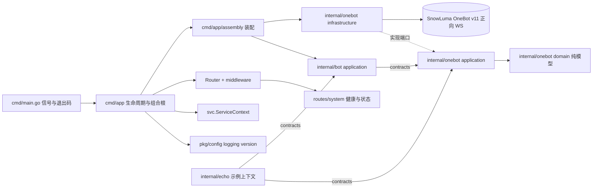

# 架构与运行约定

本项目是接入 [SnowLuma](https://github.com/SnowLuma/SnowLuma)（QQ → OneBot v11 桥接运行时）的
Golang QQ 机器人框架，分层风格参照 Knowledge-Core 的 DDD 约定。

## 依赖方向

## 分层规则

| 包 | 可以出现 | 不应出现 |
| --- | --- | --- |
| domain | 命名类型、校验构造、业务方法、纯策略 | JSON/binding 标签、传输细节、第三方库 |
| application | 类型化 Command/Result、端口（Transport、EventSource）、echo 匹配用例 | WebSocket 拨号、JSON 标签编解码细节 |
| contracts | 稳定接口、只读快照 DTO | 领域别名、传输连接类型 |
| infrastructure | JSON wire 模型、WS 拨号、重连退避、帧解复用 | 其他上下文内部对象 |
| HTTP（cmd/app/routes） | 格式解析、应用调用、响应转换 | 业务规则、领域对象构造 |

- `onebot/domain` 是 OneBot v11 协议的“已发布语言”（published language）；业务上下文经
  `onebot/contracts` 引用协议值类型属于允许的例外。
- `pkg` 放通用技术组件（config/logging/version），不导入 `internal` 或 `cmd`。
- `cmd/app/assembly` 是精确的装配例外：只把端口绑定到具体适配器，不含业务规则。

## 运行链路

1. `cmd/main.go` 以 `signal.NotifyContext` 捕获 SIGINT/SIGTERM，只负责退出码。
2. `cmd/app/initialize.go` 装载配置（优先级：默认值 → YAML → 通用环境变量覆盖 → Flags）、
   初始化 slog JSON 日志，并经 `assembly.Assemble` 为每个 `onebot.endpoints[]` 端点装配一套运行时：
   - `onebot/infrastructure.Transport`：正向 WebSocket 拨号（`Authorization: Bearer <token>`）、
     断线指数退避重连（1s → 30s 抖动）、单写互斥、心跳看门狗
     （`onebot.heartbeat-timeout` 窗口内没有任何入站帧即断开重连，≤0 关闭）。
   - `onebot/application.ClientService`：帧解复用后的动作响应按 echo 匹配回调用方；
     事件进入带缓冲通道并记录 self_id 与最近心跳；提供 OneBot v11 规范全集
     （38 个标准动作）的类型化方法与响应解码，经 `contracts` 按能力分组发布
     （Messenger / GroupAdmin / InfoReader / RequestApprover / Maintenance，聚合为 API）。
     每条连接的身份首次写入后不可改写：后续 `self_id` 不一致的事件会被丢弃并告警。
   - `bot/application.Dispatcher`：消费本连接的事件流，经纯策略 `bot/domain.Select` 匹配处理器，
     并把本连接账号作为 `botID` 传给 `Handle`；单个处理器 panic 被恢复，不影响连接。
   - `cmd/app/svc.Accounts`：账号注册表，按 `bot_id` 路由发送与查询，提供唯一账号时的默认规则。
   - `initialize.go` 的 `identifyAccount`：连接就绪后调用 `get_login_info` 绑定身份；
     与 `expect-qq` 不一致时拒绝该端点（`rejected`），不进入业务流水线。
   - `internal/echo`：示例业务上下文（`ping` → `pong`、`/echo <text>` 复读），
     演示新增上下文的标准路径。
3. 管理 HTTP API（默认 `127.0.0.1:5080`，仅监听本机）：
   - `GET /livez`：进程存活，不检查外部依赖。
   - `GET /readyz`：OneBot 连接就绪返回 200，否则 503。
   - `GET /api/v1/status`：版本、运行时长、处理器列表与事件计数（连接状态见 `/api/v1/accounts`）。
   - 响应统一 `{code,message,data}` 信封，`code` 与 HTTP 状态码一致。
4. 退出顺序：WS 关闭 → HTTP 优雅停机 → 等待在途协程结束。

## 可靠性约定

- 写帧互斥（gorilla 不允许并发写），写超时与调用超时取较早者。
- 心跳看门狗：读期限按 `onebot.heartbeat-timeout` 刷新，窗口内没有入站帧即断开并
  由既有退避重连接管；超时错误明确标记 heartbeat timeout；≤0 关闭。
- echo 匹配表带超时清理；动作调用受 `onebot.call-timeout` 与 ctx 双重约束；
  retcode=1（异步提交）时响应 data 为 null，类型化解码容错为零值。
- 事件 `message` 字段兼容段数组与 CQ 字符串两种形式：数组走 `domain.SegmentsFromWire`
  统一解码，字符串走 `domain.ParseCQ`（转义反转义、畸形降级为字面文本，永不失败）。
- 合并转发节点（`domain.CustomNode`）的 content 以线上形状 JSON 文本内嵌，
  发送时由 `encodeSegments` 还原为真实数组。
- 事件通道有界（256），满时丢弃并告警，绝不阻塞读泵。
- 日志只记录事件类型与 ID，不记录 token 与完整消息体。

## 配置

见 `configs/config-example.yaml`。端点列表 `onebot.endpoints[]`（`url`、`access-token`、
可选 `expect-qq`）是唯一的连接配置形态；未显式配置时使用默认端点
`ws://127.0.0.1:3001`，显式配置为空列表会在启动时报错。
端点 token、`database.dsn`、`ai.api-key`、`intent.api-key`、`observability.{base-url,public-key,secret-key}`
与 `observability.user-id-secret` 都直接写在配置文件中；提交仓库的示例文件只含占位符，真实值只存在于
gitignored 的 `configs/config.yaml`。假名密钥必须自行生成（`openssl rand -hex 32`，至少 32 字符），
示例占位符或过短的值会被启动检查拒绝并关闭用户维度。`observability.raw-identifiers=true` 是可回退的
调试开关，开启后 trace 直接写原始 QQ 号。
通用运行时覆盖：`QQBOT_SERVER_LISTEN`、`QQBOT_LOG_LEVEL`、`QQBOT_OBSERVABILITY_USER_ID_SECRET`、
`QQBOT_OBSERVABILITY_RAW_IDENTIFIERS`，以及 `--config`、`--listen`、`--log-level` Flags，优先级高于 YAML。
`onebot.heartbeat-timeout` 默认 60s，仅经 YAML 或默认值提供。

`ai.enabled=true` 要求 `intent.enabled=true`：AI 回复由意图决策流水线触发，只开生成不会发出任何
消息，配置矛盾在启动阶段直接报错。`echo.enabled` 与 `ai.enabled` 同开时，同一会话可能被回两次，
启动日志会给出 WARN 而不阻断启动。

## 业务上下文（智能助手 MVP）

- `internal/directory`：经账号注册表按 `bot_id` 取对应 `InfoReader` 同步好友/群/成员
  （upsert + last_seen），所有同步与查询都显式携带 `bot_id`，不存在“最近同步账号”兜底。
- `internal/scope`：作用域策略（群/私聊）。默认拒绝（全部关闭），写穿缓存即时生效；
  `scope/contracts.Authorizer` 是唯一授权入口。
- `internal/conversation`：`AIIngress` Handler（`bot/contracts.Handler`）只做作用域检查与
  事务入库（消息 + `message_jobs` 同事务、平台事件去重）即返回，绝不在 Dispatcher 内等待
  LLM/Jev；有界 worker 以 `FOR UPDATE SKIP LOCKED` 原子认领任务（`processing` 状态），
  按会话顺序、跨会话受控并发，重启恢复 processing 任务；出站回复经 `RecordOutgoing`
  在单事务内回写并携带平台消息 ID。
- `internal/intent`：确定性规则（策略/频率/指向闸门，最终否决权；冷却与小时限流读取
  独立于聊天历史授权的发言元数据）→ Jev 语义判定（畸形或越界响应视为不可用，
  降级为仅响应明确 @/引用）→ `ReplyPolicy` 输出 reply/silent/defer 与 reason_code，
  落 `intent_decisions` 供评估。
- `internal/agent`：`contracts.Runtime` 业务端口；`infrastructure/eino` 用 ADK
  `ChatModelAgent` + `Runner` 实现生成，事件迭代器消费到终态，`agent.max-steps` 与
  `agent.max-run-duration` 限定循环与总时长；`application/replier.go` 保留上下文构建
  （系统提示 + 授权历史）、输出净化（长度上限、@全体去除、出站链接关闭式拒绝）、发送前二次
  作用域复核与出站回写。发送超时按 unknown 记录（结果未知不盲目重发），其余失败按 failed 记录。
- `internal/plugins`：`contracts` 定义 `Manifest`/`ToolDescriptor`/`ToolProvider`；
  `application` 提供启动注册（ID 冲突检测、失败回滚、启用列表、不可变快照）与服务端守卫
  （权限、账号/目标绑定、超时、结果大小）；`infrastructure` 提供内置只读工具与 Eino 工具适配。
  工具调用产生的 `qqbot.tool` span 记录 `tool_id`/`tool_status`/`tool_bytes`，结果按不可信数据
  处理，不进入系统提示。
- `internal/memory`：长期记忆。候选 → 去重 → 管理员审批 → 激活；检索先按
  `bot_id + visibility + owner_key + status` 过滤（bot_shared / group / private_user /
  conversation），embedding 向量列留待选定模型后添加。
- `internal/observability`：OTel 全局 tracer + 可选 Langfuse OTLP/HTTP 导出（Basic Auth、
  v4 ingestion header、默认关闭、凭据缺失保持 no-op）；`GET /api/v1/metrics` 提供聚合计数。
  span 默认不记录消息正文，`export-raw-content=true` 时才导出有界 JSON；会话维度用 conversation id，
  用户维度默认是 HMAC 假名（无可用密钥则不写），`raw-identifiers=true` 时改为原始 QQ 号。
  入站消息的 W3C traceparent 随 `message_jobs` 落库，工作器恢复父上下文，因此一条消息的 ingress、
  意图、生成与发送共享一条 trace。

### 管理 API（全部经 `{code,message,data}` 信封）

- `POST /api/v1/directory/sync`、`GET /api/v1/accounts`
- `GET /api/v1/contacts`、`GET /api/v1/groups`、`GET /api/v1/groups/{id}/members?refresh=`
- `GET/PUT /api/v1/scopes(/{type}/{id})`
- `GET/POST/PATCH/DELETE /api/v1/memories(/{id})`
- `GET /api/v1/metrics`

配置 `server.admin-token` 后，以上接口需要
`Authorization: Bearer <token>`；变更类请求写入 `admin_audit_logs`。数据库未配置时，
依赖数据库的路由不注册，机器人仍以 OneBot + echo 模式运行。

### 本地基础设施

`docker compose up -d` 拉起一套完整本地依赖：`pgvector/pgvector:pg16`（主机端口 5433，库
`qqbot`）、完整 Langfuse 自托管栈（web 端口 3010，ClickHouse/Redis/MinIO 仅内网）、以及一次性
建库任务 `db-init`（幂等创建 `langfuse` 与 `qqbot_test`）。Justfile 不承担任何数据库操作。

`migrations/` 为版本化 SQL，每个版本必须同时提供 up 与 down；进程启动连接成功后自动执行
`db.Migrate` 并在日志输出本次应用的版本，失败即退出。集成测试以 `QQBOT_TEST_DSN` 门控，
未设置时自动跳过；由于迁移往返测试会删表，该变量只能指向独立测试库 `qqbot_test`。

## 验证

`just verify`（或依次运行 `go mod tidy && go vet ./... && go test ./... && go fmt ./...`）。
并发相关改动追加 `go test -race ./...`；数据库部分以 `QQBOT_TEST_DSN` 启用集成测试。
