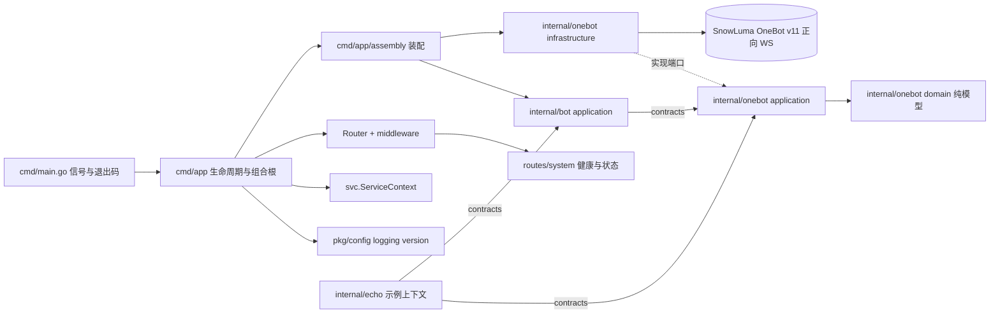

# 架构与运行约定

本项目是接入 [SnowLuma](https://github.com/SnowLuma/SnowLuma)（QQ → OneBot v11 桥接运行时）的
Golang QQ 机器人框架，分层风格参照 Knowledge-Core 的 DDD 约定。

## 依赖方向

## 分层规则

| 包 | 可以出现 | 不应出现 |
| --- | --- | --- |
| domain | 命名类型、校验构造、业务方法、纯策略 | JSON/binding 标签、传输细节、第三方库 |
| application | 类型化 Command/Result、端口（Transport、EventSource）、echo 匹配用例 | WebSocket 拨号、JSON 标签编解码细节 |
| contracts | 稳定接口、只读快照 DTO | 领域别名、传输连接类型 |
| infrastructure | JSON wire 模型、WS 拨号、重连退避、帧解复用 | 其他上下文内部对象 |
| HTTP（cmd/app/routes） | 格式解析、应用调用、响应转换 | 业务规则、领域对象构造 |

- `onebot/domain` 是 OneBot v11 协议的“已发布语言”（published language）；业务上下文经
  `onebot/contracts` 引用协议值类型属于允许的例外。
- `pkg` 放通用技术组件（config/logging/version），不导入 `internal` 或 `cmd`。
- `cmd/app/assembly` 是精确的装配例外：只把端口绑定到具体适配器，不含业务规则。

## 运行链路

1. `cmd/main.go` 以 `signal.NotifyContext` 捕获 SIGINT/SIGTERM，只负责退出码。
2. `cmd/app/initialize.go` 装载配置（优先级：默认值 → YAML → `QQBOT_*` 环境变量 → Flags）、
   初始化 slog JSON 日志，并经 `assembly.Assemble` 装配：
   - `onebot/infrastructure.Transport`：正向 WebSocket 拨号（`Authorization: Bearer <token>`）、
     断线指数退避重连（1s → 30s 抖动）、单写互斥、心跳看门狗
     （`onebot.heartbeat-timeout` 窗口内没有任何入站帧即断开重连，≤0 关闭）。
   - `onebot/application.ClientService`：帧解复用后的动作响应按 echo 匹配回调用方；
     事件进入带缓冲通道并记录 self_id 与最近心跳；提供 OneBot v11 规范全集
     （38 个标准动作）的类型化方法与响应解码，经 `contracts` 按能力分组发布
     （Messenger / GroupAdmin / InfoReader / RequestApprover / Maintenance，聚合为 API）。
   - `bot/application.Dispatcher`：消费事件流，经纯策略 `bot/domain.Select` 匹配处理器，
     单个处理器 panic 被恢复，不影响连接。
   - `internal/echo`：示例业务上下文（`ping` → `pong`、`/echo <text>` 复读），
     演示新增上下文的标准路径。
3. 管理 HTTP API（默认 `127.0.0.1:5080`，仅监听本机）：
   - `GET /livez`：进程存活，不检查外部依赖。
   - `GET /readyz`：OneBot 连接就绪返回 200，否则 503。
   - `GET /api/v1/status`：版本、运行时长、连接状态、self_id、处理器列表与计数。
   - 响应统一 `{code,message,data}` 信封，`code` 与 HTTP 状态码一致。
4. 退出顺序：WS 关闭 → HTTP 优雅停机 → 等待在途协程结束。

## 可靠性约定

- 写帧互斥（gorilla 不允许并发写），写超时与调用超时取较早者。
- 心跳看门狗：读期限按 `onebot.heartbeat-timeout` 刷新，窗口内没有入站帧即断开并
  由既有退避重连接管；超时错误明确标记 heartbeat timeout；≤0 关闭。
- echo 匹配表带超时清理；动作调用受 `onebot.call-timeout` 与 ctx 双重约束；
  retcode=1（异步提交）时响应 data 为 null，类型化解码容错为零值。
- 事件 `message` 字段兼容段数组与 CQ 字符串两种形式：数组走 `domain.SegmentsFromWire`
  统一解码，字符串走 `domain.ParseCQ`（转义反转义、畸形降级为字面文本，永不失败）。
- 合并转发节点（`domain.CustomNode`）的 content 以线上形状 JSON 文本内嵌，
  发送时由 `encodeSegments` 还原为真实数组。
- 事件通道有界（256），满时丢弃并告警，绝不阻塞读泵。
- 日志只记录事件类型与 ID，不记录 token 与完整消息体。

## 配置

见 `configs/config-example.yaml`。环境变量：`QQBOT_ONEBOT_URL`、`QQBOT_ONEBOT_ACCESS_TOKEN`、
`QQBOT_SERVER_LISTEN`、`QQBOT_LOG_LEVEL`、`QQBOT_DATABASE_DSN`、`QQBOT_SERVER_ADMIN_TOKEN`。
Flags：`--config`、`--onebot-url`、`--onebot-token`、`--listen`、`--log-level`，优先级高于环境变量。
`onebot.heartbeat-timeout` 默认 60s，仅经 YAML 或默认值提供。AI/Jev/Langfuse 的密钥一律经
环境变量注入（`ai.api-key-env`、`intent.api-key-env`、`observability.*-env`），不写入配置文件。

`ai.enabled=true` 要求 `intent.enabled=true`：AI 回复由意图决策流水线触发，只开生成不会发出任何
消息，配置矛盾在启动阶段直接报错。`echo.enabled` 与 `ai.enabled` 同开时，同一会话可能被回两次，
启动日志会给出 WARN 而不阻断启动。

## 业务上下文（智能助手 MVP）

- `internal/directory`：经 `onebot/contracts.InfoReader` 同步好友/群/成员（upsert + last_seen），
  提供分页查询。
- `internal/scope`：作用域策略（群/私聊）。默认拒绝（全部关闭），写穿缓存即时生效；
  `scope/contracts.Authorizer` 是唯一授权入口。
- `internal/conversation`：`AIIngress` Handler（`bot/contracts.Handler`）只做作用域检查与
  事务入库（消息 + `message_jobs` 同事务、平台事件去重）即返回，绝不在 Dispatcher 内等待
  LLM/Jev；有界 worker 以 `FOR UPDATE SKIP LOCKED` 原子认领任务（`processing` 状态），
  按会话顺序、跨会话受控并发，重启恢复 processing 任务；出站回复经 `RecordOutgoing`
  在单事务内回写并携带平台消息 ID。
- `internal/intent`：确定性规则（策略/频率/指向闸门，最终否决权；冷却与小时限流读取
  独立于聊天历史授权的发言元数据）→ Jev 语义判定（畸形或越界响应视为不可用，
  降级为仅响应明确 @/引用）→ `ReplyPolicy` 输出 reply/silent/defer 与 reason_code，
  落 `intent_decisions` 供评估。
- `internal/agent`：OpenAI 兼容 `ChatModel`、上下文构建（系统提示 + 授权历史 + 记忆）、
  输出净化（长度上限、@全体去除、出站链接关闭式拒绝）、发送前二次作用域复核、出站回写；
  发送超时按 unknown 记录（结果未知不盲目重发），其余失败按 failed 记录。
- `internal/memory`：长期记忆。候选 → 去重 → 管理员审批 → 激活；检索先按
  `bot_id + visibility + owner_key + status` 过滤（bot_shared / group / private_user /
  conversation），embedding 向量列留待选定模型后添加。
- `internal/observability`：OTel 全局 tracer + 可选 Langfuse OTLP/HTTP 导出（Basic Auth、
  v4 ingestion header、默认关闭、凭据缺失保持 no-op）；`GET /api/v1/metrics` 提供聚合计数。
  span 不记录消息正文。

### 管理 API（全部经 `{code,message,data}` 信封）

- `POST /api/v1/directory/sync`、`GET /api/v1/accounts`
- `GET /api/v1/contacts`、`GET /api/v1/groups`、`GET /api/v1/groups/{id}/members?refresh=`
- `GET/PUT /api/v1/scopes(/{type}/{id})`
- `GET/POST/PATCH/DELETE /api/v1/memories(/{id})`
- `GET /api/v1/metrics`

配置 `server.admin-token`（或 `QQBOT_SERVER_ADMIN_TOKEN`）后，以上接口需要
`Authorization: Bearer <token>`；变更类请求写入 `admin_audit_logs`。数据库未配置时，
依赖数据库的路由不注册，机器人仍以 OneBot + echo 模式运行。

### 本地基础设施

`docker compose up -d` 拉起一套完整本地依赖：`pgvector/pgvector:pg16`（主机端口 5433，库
`qqbot`）、完整 Langfuse 自托管栈（web 端口 3010，ClickHouse/Redis/MinIO 仅内网）、以及一次性
建库任务 `db-init`（幂等创建 `langfuse` 与 `qqbot_test`）。Justfile 不承担任何数据库操作。

`migrations/` 为版本化 SQL，每个版本必须同时提供 up 与 down；进程启动连接成功后自动执行
`db.Migrate` 并在日志输出本次应用的版本，失败即退出。集成测试以 `QQBOT_TEST_DSN` 门控，
未设置时自动跳过；由于迁移往返测试会删表，该变量只能指向独立测试库 `qqbot_test`。

## 验证

`just verify`（或依次运行 `go mod tidy && go vet ./... && go test ./... && go fmt ./...`）。
并发相关改动追加 `go test -race ./...`；数据库部分以 `QQBOT_TEST_DSN` 启用集成测试。
