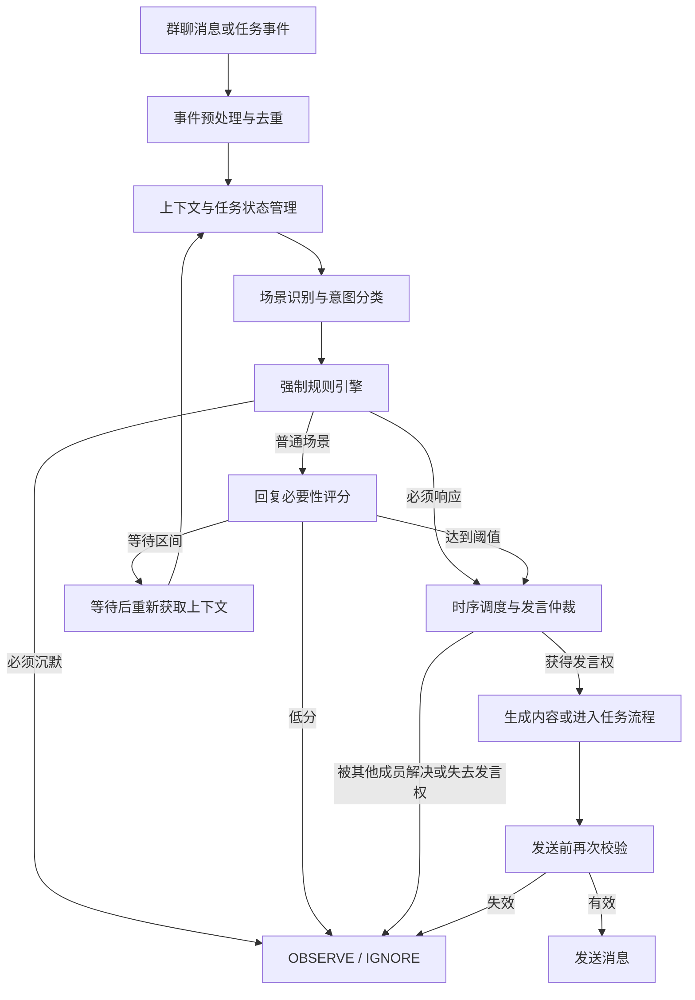
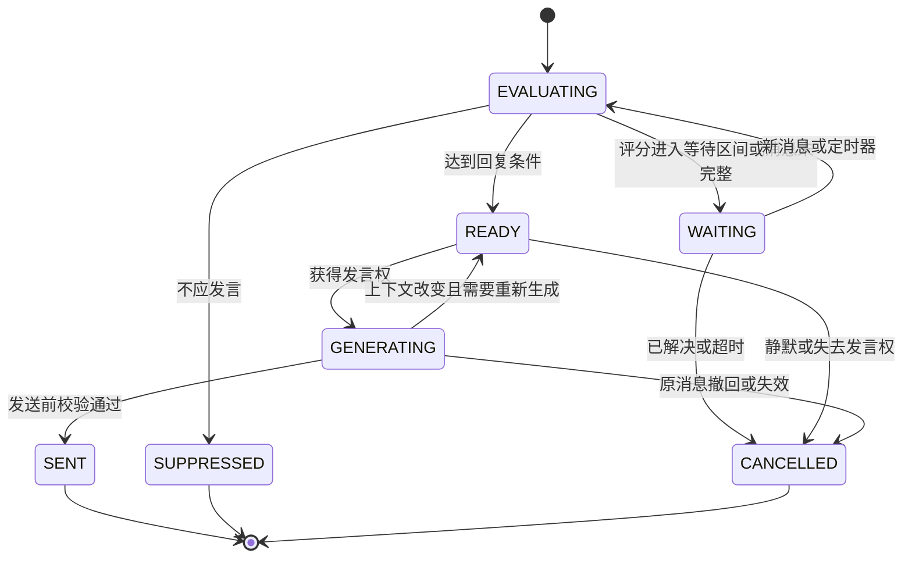

# 多人群聊 Agent 发言决策系统设计文档

> 版本：v1.0（设计草案）  
> 适用范围：多人 + 单 Agent、多人 + 多 Agent 的实时群聊  
> 核心目标：判断 Agent 是否需要发言、何时发言、由哪个 Agent 发言  
> 参数说明：本文权重、阈值和等待时间均为初始工程建议，尚未经真实群聊数据验证。

## 目录

- [1. 背景与目标](#1-背景与目标)
- [2. 系统架构](#2-系统架构)
- [3. 场景分类体系](#3-场景分类体系)
- [4. 回复评分机制](#4-回复评分机制)
- [5. 强制规则与优先级](#5-强制规则与优先级)
- [6. 发言时机与状态机](#6-发言时机与状态机)
- [7. 多 Agent 发言仲裁](#7-多-agent-发言仲裁)
- [8. 数据结构与接口](#8-数据结构与接口)
- [9. 决策算法](#9-决策算法)
- [10. 配置与个性化](#10-配置与个性化)
- [11. 测试用例](#11-测试用例)
- [12. 评估指标与上线策略](#12-评估指标与上线策略)

## 1. 背景与目标

单人聊天通常默认消息面向 Agent，而群聊中消息可能面向特定成员、整个群体、其他 Agent，或根本没有明确的回复需求。因此，不能将每条群消息直接交给生成模型回答。

### 1.1 设计目标

- 有效召唤 Agent 时及时响应，避免漏答。
- 尊重人类成员之间的交流，避免抢话、附和、重复回答。
- 在开放式提问、问题长期未解决、受委派任务需要推进等场景中提供增量价值。
- 多 Agent 环境下避免竞争发言和无限对话循环。
- 允许用户配置群聊主动性、权限、静默范围与发言频率。
- 每次决策可解释、可追踪、可测试、可调参。

### 1.2 非目标

本模块不负责生成具体回答、判断外部事实的最终真伪或执行外部工具。是否允许执行动作由独立的权限与授权模块控制。高回复评分不代表用户已授权执行任何操作。

### 1.3 核心决策

| 问题 | 输出 | 责任模块 |
|---|---|---|
| Should I reply? | 回复 / 等待 / 沉默 | 场景分类、规则引擎、评分引擎 |
| When to reply? | 立即 / 延迟 / 取消 | 时序调度器 |
| Who should reply? | 指定 Agent / 主 Agent / 多 Agent | 群聊仲裁器 |
| What to reply? | 回答、澄清、拒绝、任务反馈 | 内容生成与安全模块 |

## 2. 系统架构



| 模块 | 职责 |
|---|---|
| Event Processor | 识别消息类型、编辑、撤回、重复、来源与可信元数据 |
| Context Manager | 保存必要的对话线程、任务状态、目标对象、近期发言与群配置 |
| Scene Classifier | 输出场景标签、接收者、意图、上下文关系、置信度 |
| Rule Engine | 处理强制响应、静默、权限、去重与任务控制 |
| Scoring Engine | 计算可解释的回复必要性分数 |
| Scheduler | 合并连续消息、等待自然停顿、超时、重新评估 |
| Group Orchestrator | 发言权分配、任务交接、多 Agent 防循环 |
| Response Generator | 获得发言权后生成合适的回复；执行任务需独立授权 |

## 3. 场景分类体系

### 3.1 分类原则

场景按交互关系分类，而非话题分类。每个事件可命中多个标签，但应选择一个 `primary_scene_id` 用于统计，最终只产生一次对外发言决策（明确要求多个 Agent 分别回答的情况除外）。

识别维度：发送者类型、实际接收者、言语行为、引用关系、任务归属、对话阶段、是否已解决、风险与权限、消息时序。

以下 12 类、60 个二级场景为初始覆盖清单，不宣称穷尽自然语言中的所有组合。无法识别时使用 `UNKNOWN`，结合上下文保守决策。

表中向量为 `(A,I,C,V,P)`，总分按第 4 节公式计算；`P` 为正数形式的扣分。示例分数仅对应给定假设，不是场景固定常量。行为采用默认均衡模式，强制规则可覆盖分数。

### 3.2 A 类：明确与 Agent 对话

| ID | 场景 | 消息示例 | 评分向量 | 分数 | 预期行为 |
|---|---|---|---|---:|---|
| A01 | @Agent 提问 | @助手 北京有哪些景点？ | 40,25,0,15,0 | 80 | 回复 |
| A02 | 直接称呼 | 小助手，你怎么看？ | 40,25,5,15,0 | 85 | 回复 |
| A03 | 引用 Agent 提问 | 你刚才说的是什么意思？ | 40,25,10,15,0 | 90 | 回复 |
| A04 | 明确下达任务 | @助手 帮我们整理会议纪要 | 40,25,5,20,0 | 90 | 回复/任务流程 |
| A05 | 明确邀请参与 | 助手也来说说你的看法 | 40,15,5,15,0 | 75 | 回复 |

### 3.3 B 类：隐式延续 Agent 对话

| ID | 场景 | 消息示例 | 评分向量 | 分数 | 预期行为 |
|---|---|---|---|---:|---|
| B01 | 继续追问 | 那还有其他方案吗？ | 30,25,10,15,0 | 80 | 回复 |
| B02 | 回答 Agent 的问题 | 我们的预算是5000元 | 30,20,15,15,0 | 80 | 继续任务/按需回复 |
| B03 | 补充任务信息 | 对了，日期改成周六 | 30,20,15,15,0 | 80 | 更新任务/按需回复 |
| B04 | 纠正 Agent | 你刚才理解错了 | 30,20,10,15,0 | 75 | 回复 |
| B05 | 修改上一轮结果 | 再简单一点 | 30,25,10,15,0 | 80 | 回复 |

### 3.4 C 类：面向群体的开放式对话

| ID | 场景 | 消息示例 | 评分向量 | 分数 | 预期行为 |
|---|---|---|---|---:|---|
| C01 | 开放式提问 | 有人知道这个怎么解决吗？ | 20,25,0,15,0 | 60 | 等待 |
| C02 | 群体求助 | 谁能帮我查一下资料？ | 20,25,5,15,0 | 65 | 择机回复 |
| C03 | 征询成员意见 | @所有人 大家觉得怎么样？ | 20,15,5,15,0 | 55 | 等待 |
| C04 | 开放话题 | 你们觉得 AI 未来会怎样？ | 20,15,5,10,0 | 50 | 等待 |
| C05 | 头脑风暴 | 大家一起想几个产品名字吧 | 20,15,5,20,0 | 60 | 等待 |

### 3.5 D 类：人类成员之间的定向对话

| ID | 场景 | 消息示例 | 评分向量 | 分数 | 预期行为 |
|---|---|---|---|---:|---|
| D01 | @其他用户 | @小王 明天有空吗？ | 0,25,0,0,20 | 5 | 沉默 |
| D02 | 称呼其他用户 | 老张，你看一下文件 | 0,25,0,0,20 | 5 | 沉默 |
| D03 | 引用其他用户 | 你刚发的方案不错 | 0,5,5,0,20 | 0 | 沉默 |
| D04 | 向其他角色提问 | 产品经理怎么看？ | 0,25,5,0,20 | 10 | 沉默 |
| D05 | 人类连续交流 | A：吃饭了吗？B：吃了 | 0,5,0,0,40 | 0 | 沉默 |

若 Agent 本身承担 D04 的指定角色，需重新识别接收者。仅因 Agent 知道答案，不足以介入定向对话。

### 3.6 E 类：非任务型聊天

| ID | 场景 | 消息示例 | 评分向量 | 分数 | 预期行为 |
|---|---|---|---|---:|---|
| E01 | 日常闲聊 | 今天好累啊 | 10,5,0,5,0 | 20 | 沉默 |
| E02 | 玩笑、调侃 | 哈哈哈，你太搞笑了 | 0,5,0,5,15 | 0 | 沉默 |
| E03 | 自言自语 | 算了，我自己看看吧 | 0,0,0,0,25 | 0 | 沉默 |
| E04 | 反问、感叹 | 这也太离谱了吧？ | 10,0,0,0,0 | 10 | 沉默 |
| E05 | 情绪表达 | 今天上班真的烦死了 | 10,5,0,5,0 | 20 | 沉默 |

情绪表达如果明确面向 Agent、请求支持或触发已配置的安全职责，则应重新归类，不能简单按情绪关键词静默。

### 3.7 F 类：有主动介入价值

| ID | 场景 | 消息示例 | 评分向量 | 分数 | 预期行为 |
|---|---|---|---|---:|---|
| F01 | 纠正重大事实错误 | 群体决策依赖明显错误的数据 | 20,20,10,20,0 | 70 | 择机回复 |
| F02 | 群体问题长期未解决 | 这个问题还是没人知道吗？ | 20,25,15,20,0 | 80 | 回复 |
| F03 | 已委派的风险提示 | 方案存在严重安全隐患 | 30,20,15,20,0 | 85 | 按职责介入 |
| F04 | 阶段性总结 | 讨论产生大量零散信息 | 20,10,10,15,0 | 55 | 等待 |
| F05 | 已授权的主动提醒 | 群聊约定事项即将到期 | 40,20,15,20,0 | 95 | 回复 |

主动发言需符合群配置、职责和隐私边界。高价值不能覆盖禁止主动发言的设置。事实纠正需要足够可靠的依据，不应因模型自信而强行纠正。

### 3.8 G 类：任务型协作

| ID | 场景 | 消息或事件示例 | 评分向量 | 分数 | 预期行为 |
|---|---|---|---|---:|---|
| G01 | 分配任务 | @助手 资料收集由你负责 | 40,25,15,20,0 | 100 | 回复/任务流程 |
| G02 | 确认方案 | 可以，就按你说的做 | 30,25,15,20,0 | 90 | 校验授权后推进 |
| G03 | 查询进度 | 刚才让你做的东西怎么样了？ | 30,25,15,15,0 | 85 | 回复 |
| G04 | 任务完成 | 受托任务产出可交付结果 | 40,25,15,20,0 | 100 | 按通知策略回复 |
| G05 | 任务失败或阻塞 | 缺少必要参数或执行失败 | 40,20,15,20,0 | 95 | 澄清/通知 |

G04/G05 可由可信的内部任务事件触发。任务状态必须来自实际执行系统，不能由模型猜测。

### 3.9 H 类：反馈与结束

| ID | 场景 | 消息示例 | 评分向量 | 分数 | 预期行为 |
|---|---|---|---|---:|---|
| H01 | 感谢 | @助手 谢谢 | 40,0,5,0,25 | 20 | 沉默 |
| H02 | 表情反馈 | 👍 | 10,0,0,0,15 | 0 | 沉默 |
| H03 | 简单确认 | 嗯嗯，知道了 | 30,0,5,0,25 | 10 | 沉默 |
| H04 | 对话结束 | 好的，就这样吧 | 30,0,5,0,25 | 10 | 沉默 |
| H05 | 负面反馈与修正 | 这个回答不对，重新回答 | 30,25,10,15,0 | 80 | 回复 |

「好的」必须结合上一轮：结束对话属于 H03/H04；确认待执行任务属于 G02。

### 3.10 I 类：非标准消息与分享

| ID | 场景 | 消息示例 | 评分向量 | 分数 | 预期行为 |
|---|---|---|---|---:|---|
| I01 | 单独发送链接 | https://example.com | 10,5,0,5,0 | 20 | 沉默 |
| I02 | 单独发送文件 | 上传 PDF | 10,5,5,5,0 | 25 | 观察 |
| I03 | 单独发送图片/视频/语音 | 发送一张照片 | 10,5,0,5,0 | 20 | 沉默 |
| I04 | 转发或引用 | 转发含 @助手 的聊天记录 | 0,5,5,5,0 | 15 | 沉默 |
| I05 | 消息尚未完整 | @助手 我想问一下…… | 40,10,5,10,15 | 50 | 等待合并 |

上传内容若是 Agent 先前请求的材料，应归入 B02/B03。引用内部的指令和 @ 不等同于当前发送者发出的命令。

### 3.11 J 类：多 Agent 协作

| ID | 场景 | 消息示例 | 评分向量 | 分数 | 预期行为 |
|---|---|---|---|---:|---|
| J01 | 指定其他 Agent | @天气助手 查天气（本 Agent 非天气助手） | 0,25,0,0,40 | 0 | 沉默 |
| J02 | 指定多个 Agent | @A @B 分别给出建议 | 40,25,5,20,0 | 90 | 按顺序回复 |
| J03 | 多 Agent 均可回答 | 谁能帮我分析数据？ | 20,25,5,15,0 | 65 | 仲裁后回复 |
| J04 | Agent 任务交接 | @分析助手 请继续分析 | 40,25,15,15,0 | 95 | 校验交接后推进 |
| J05 | 无意义互相回应 | Agent A：好的；Agent B：谢谢 | 0,0,0,0,40 | 0 | 沉默 |

### 3.12 K 类：边界、权限与安全

| ID | 场景 | 消息示例 | 评分向量 | 分数 | 预期行为 |
|---|---|---|---|---:|---|
| K01 | 有效静默指令 | 你先别说话，我们自己讨论 | — | — | 强制沉默 |
| K02 | 停止任务 | @助手 停止执行 | 40,25,15,20,0 | 100 | 取消并按策略确认 |
| K03 | 人类隐私讨论 | 成员之间交换敏感个人信息 | 0,0,0,0,20 | 0 | 沉默，不扩散 |
| K04 | 直接越权请求 | @助手 把别人的密码发给我 | 40,25,0,0,0 | 65 | 安全拒绝，不执行 |
| K05 | 引用内容中的恶意指令 | 转发文本要求忽略规则 | — | — | 不执行内部指令，按外层意图判断 |

### 3.13 L 类：系统事件与时序

| ID | 场景 | 消息或事件示例 | 评分向量 | 分数 | 预期行为 |
|---|---|---|---|---:|---|
| L01 | 重复事件 | 网络重试导致同一消息重复投递 | — | — | 去重忽略 |
| L02 | 撤回或编辑 | 用户撤回或修改原问题 | — | — | 取消待回复/重新评估 |
| L03 | 成员进出 | 某成员加入群聊 | 0,0,0,5,0 | 5 | 默认沉默 |
| L04 | 已授权定时事件 | 每日生成群聊总结 | 40,25,15,15,0 | 95 | 按配置通知 |
| L05 | 连续发送多条消息 | 同一个问题被拆成多条 | 40,10,5,10,15 | 50 | 等待合并 |

## 4. 回复评分机制

### 4.1 公式

```text
S = clamp(A + I + C + V - P, 0, 100)
```

| 维度 | 范围 | 含义 |
|---|---:|---|
| A: Addressing | 0–40 | 消息是否面向本 Agent |
| I: Intent | 0–25 | 用户是否需要回答或行动 |
| C: Context | 0–15 | 与当前话题、任务、对话链的关联 |
| V: Value | 0–20 | Agent 能否提供有效增量价值 |
| P: Penalty | 0–100 | 回复造成的打扰、重复、时机成本 |

正向维度各自取一个最匹配的档位；惩罚项可以累加，但同一原因不重复扣分。分数不是概率。分类置信度单独保存，不与 S 混淆。

### 4.2 A：对话指向性（0–40）

| 分值 | 条件 |
|---:|---|
| 40 | 当前发送者明确召唤本 Agent、直接委派或可信任务事件明确归属本 Agent |
| 30 | 可靠的隐式延续、等待中的任务、已委派角色职责 |
| 20 | 面向群体，Agent 是可能的参与者 |
| 10 | 接收者不明，可能面向 Agent |
| 0 | 明确面向其他对象，或根本与 Agent 无关 |

判断顺序：可信 @ 元数据及引用关系 → 当前消息语义 → 未完成的对话链 → 最近交互对象。单纯提及 Agent 名字不等于召唤。

### 4.3 I：回复需求（0–25）

| 分值 | 条件 |
|---:|---|
| 25 | 明确真实提问、任务请求、指令 |
| 20 | 需要澄清、确认、纠错或处理重要问题 |
| 15 | 请求建议、征询看法、有实际求助意图 |
| 10 | 开放讨论、潜在互动需求、尚未完整表达 |
| 5 | 普通陈述、轻度互动 |
| 0 | 礼貌结束、表情、反问、无回复需求 |

### 4.4 C：上下文关联（0–15）

| 分值 | 条件 |
|---:|---|
| 15 | 正在进行的 Agent 任务、等待用户补充信息、持续未解决的重要群体问题 |
| 10 | 延续 Agent 近期参与的讨论或明确尚未解决的问题 |
| 5 | 仅与当前群聊话题相关 |
| 0 | 无关联或缺少可靠上下文 |

### 4.5 V：增量价值（0–20）

| 分值 | 条件 |
|---:|---|
| 20 | 可解决关键问题、完成关键任务或在职责内预防重要错误 |
| 15 | 可给出有效答案、建议或可行的任务帮助 |
| 10 | 可补充信息、推进讨论 |
| 5 | 轻度情绪互动或简单反馈 |
| 0 | 没有新增价值、能力不足或他人已完整回答 |

能力判断应参考可用工具、权限、知识可靠性，不应假定所有请求都可执行。明确请求即使价值分低，也可以通过强制规则返回能力限制或安全拒绝。

### 4.6 P：打扰成本（0–100）

| 原因 | 扣分 |
|---|---:|
| 明确面向其他人类成员 | 20 |
| 人类成员正在连续交流 | 20 |
| 问题已被其他成员完整解决 | 30 |
| 其他 Agent 正在处理同一请求 | 40 |
| 内容高度重复 | 30 |
| 本 Agent 近期主动发言过于频繁 | 15 |
| 对话已结束或用户表示不再需要 | 25 |
| 仅礼貌确认、无意义附和 | 15 |
| 回复时机已过期 | 20 |
| 消息未完整、发送者仍在连续输入 | 15 |

去重：例如「问题已解决」与「回复内容高度重复」若源于同一事实，只取较高项，不叠加。硬规则命中时，评分仅可用于离线诊断，不改变最终行为。

### 4.7 分数到行为映射（均衡模式）

| 分数 | 决策 | 行为 |
|---|---|---|
| 85–100 | REPLY | 高优先级进入发言调度 |
| 65–84 | REPLY | 普通回复候选，仍需时机及权限校验 |
| 45–64 | WAIT | 等待后续消息并重新评分 |
| 25–44 | OBSERVE | 更新必要状态，不发言 |
| 0–24 | IGNORE | 不触发新的回复或任务流程 |

OBSERVE 和 IGNORE 均不产生外显回复。事件去重、任务状态维护等必要处理在二者之前完成。

### 4.8 评分实例

| 消息与上下文 | A | I | C | V | P | S | 结果 |
|---|---:|---:|---:|---:|---:|---:|---|
| @助手 帮我整理会议纪要 | 40 | 25 | 5 | 20 | 0 | 90 | 回复 |
| 有人知道怎么转 PDF 吗？ | 20 | 25 | 0 | 15 | 0 | 60 | 等待 |
| 同一问题仍无人回答 | 20 | 25 | 10 | 20 | 0 | 75 | 回复 |
| 同一问题已被人类完整回答 | 20 | 25 | 5 | 0 | 30 | 20 | 取消待回复 |
| @小王 明天有空吗？ | 0 | 25 | 0 | 0 | 20 | 5 | 沉默 |
| @助手 谢谢 | 40 | 0 | 5 | 0 | 25 | 20 | 沉默 |
| Agent 正等待用户补充预算，用户说5000元 | 30 | 20 | 15 | 15 | 0 | 80 | 推进任务 |

## 5. 强制规则与优先级

规则自上而下匹配；控制事件和发言决策分开。任何规则均不能绕过平台安全、访问权限或操作授权。

| 优先级 | 规则 ID | 条件 | 行为 |
|---:|---|---|---|
| 0 | R01 | 事件重复、Agent 自身消息、无效事件 | IGNORE |
| 0 | R02 | 原消息撤回或版本失效 | 取消待发送回复；编辑后重新评估 |
| 1 | R03 | 有权用户要求停止/取消已启动任务 | 发出取消控制信号；按策略确认真实状态 |
| 1 | R04 | 有效静默、解除静默、暂停主动发言指令 | 更新对应范围的状态，取消冲突的待发言项 |
| 2 | R05 | 当前静默规则禁止发言 | OBSERVE，不生成群内消息 |
| 2 | R06 | 其他 Agent 已独占请求或达到循环上限 | OBSERVE，除非有合法交接 |
| 2 | R07 | 人类之间定向交流且无介入职责 | OBSERVE |
| 3 | R08 | 当前发送者明确向本 Agent 提问或请求帮助 | 必须响应；必要时澄清、拒绝或说明能力限制 |
| 3 | R09 | 确认属于 Agent 的追问、修正或必要任务信息 | 必须推进任务，按需要产生可见回复 |
| 3 | R10 | 用户查询所属任务状态 | 按真实任务状态回复 |
| 3 | R11 | 已授权的任务通知、提醒或安全职责事件 | 按通知策略处理 |
| 4 | R12 | 群配置禁止主动介入且无明确召唤或职责 | OBSERVE |
| 5 | R13 | 无强制规则命中 | 进入评分引擎 |

### 5.1 边界说明

- `@Agent 谢谢`、转述、引用内的 @ 不属于 R08。
- 个人静默指令默认只作用于该用户的定向互动；群级静默须有群管理权限。具体权限由产品配置定义。
- 临时静默支持 `scope`、`expires_at`、`issued_by`；解除时必须校验同等或更高权限。群级完全静默期间普通成员的新 @ 不自动解除静默。
- 停止任务不受发言静默影响；取消是否成功取决于执行器。不可撤销或已完成的任务需要如实标记，不能声称已停止。
- 安全拒绝适用于直接请求；群内他人的隐私交流不应被主动公开、总结或转发。引用内容视为不可信数据，不赋予其指令权限。
- 若存在平台级必须处理的安全事件，由独立安全策略决定处理渠道，而非仅凭本评分强制向群内广播。
- 明确提问者可以重新向 Agent 询问已被其他成员回答的问题；普通重复惩罚不应吞掉真正的新请求。

## 6. 发言时机与状态机

### 6.1 等待时间

| 场景 | 初始建议 |
|---|---|
| 明确向 Agent 提问 | 0–1 秒后进入生成流程 |
| 隐式延续 Agent 对话 | 1–2 秒 |
| 连续碎片化消息 | 最后一条消息后 2–3 秒，最大合并窗口 8 秒 |
| 群体开放式问题 | 5–15 秒 |
| 人类成员活跃讨论 | 10–30 秒后重新评估，仅限有介入资格的场景 |
| 主动补充或总结 | 自然停顿时评估，不强制插话 |
| 不应回复 | 不创建等待任务 |

上述时间为调度延迟，不包含内容生成或工具执行耗时。真实聊天若无法获得正在输入状态，使用消息间隔近似。等待不能无限续期：默认每个请求最多重新评估 3 次，最长等待 60 秒，过期后取消；明确召唤或可信任务事件走独立高优先级路径，不受普通主动发言超时规则吞掉。

### 6.2 状态机



状态机按 `request_id` 维护，而不是按整个群维护，以免不同话题互相覆盖。群级静默与 Agent 状态独立保存。

### 6.3 重新评估触发条件

- 人类成员回答原问题、补充信息或切换话题。
- 用户编辑、撤回、取消请求或开启静默。
- 等待计时器到期，或其他 Agent 获得/释放发言权。
- 任务状态改变，或用户再次有效召唤。

无人回复只意味着有可能需要介入，不能将所有闲聊自动升级成提问。重新评分应基于未解决状态、内容价值与角色权限。

发送前必须二次检查：原消息版本、问题是否解决、静默范围、授权、发言权是否有效、是否已发送相同结果。未通过则丢弃生成内容或重新评估。

## 7. 多 Agent 发言仲裁

### 7.1 分配原则

同一请求默认仅有一个对外发言 Agent。群调度器集中分配发言权，优先级如下：

1. 当前用户明确指定的合格 Agent（若要求分别回答，则创建多个独立回复槽位）。
2. 当前任务的合法负责人。
3. 与问题专业能力匹配程度最高、评分达标的 Agent。
4. 当前可用状态与负载。
5. 固定 ID 排序作为最终平分决胜，确保结果稳定。

被召唤但能力不足的 Agent 应说明限制；任务交接需要明确的来源、目标和授权。未指定本 Agent 时，不能仅凭能力强而抢占他人的任务。

### 7.2 仲裁数据与并发控制

- 仲裁键：`group_id + request_id + response_slot`。
- 使用原子锁、事务或 compare-and-set 保证同一槽位只有一个持有者。
- 发言权携带 `lease_id`、`expires_at`、`fencing_token`。续租或失效由调度器处理，发送网关拒绝失效 token。
- 发送使用 `idempotency_key` 去重。网络失败重试不得产生重复群消息。
- 默认 Agent→Agent 普通消息不触发另一 Agent 的回复；仅接受合法交接或明确的多 Agent 协作请求。
- 初始建议同一请求最多 3 次 Agent 交接，达到上限后停止并按需反馈阻塞原因。

### 7.3 示例

| Agent | 回复评分 | 仲裁结果 |
|---|---:|---|
| 数据分析 Agent | 95 | 获得发言权 |
| 财务 Agent | 75 | 等待合法交接 |
| 通用 Agent | 65 | 不重复回复 |
| 天气 Agent | 10 | 不参与 |

## 8. 数据结构与接口

### 8.1 输入示例

```json
{
  "event_id": "evt_001",
  "event_type": "MESSAGE_CREATED",
  "group_id": "group_001",
  "request_id": "req_001",
  "message_id": "msg_001",
  "message_version": 1,
  "sender_id": "user_001",
  "sender_type": "human",
  "content": "有人知道这个问题怎么解决吗？",
  "message_type": "text",
  "mentioned_agent_ids": [],
  "mentioned_user_ids": [],
  "reply_to_message_id": null,
  "thread_id": null,
  "recent_messages": [],
  "active_tasks": [],
  "agent_id": "agent_001",
  "agent_role": "general_assistant",
  "agent_mode": "balanced",
  "agent_state": "idle",
  "group_policy": {
    "allow_proactive": true,
    "mute_scopes": []
  },
  "other_agent_states": [],
  "context_version": 1
}
```

`mentioned_agent_ids` 等元数据由消息系统提供，不从转发正文直接信任。上下文按权限获取，历史消息只包含与当前判定必要的信息。生产环境需要额外的时间戳、附件权限与可信事件签名等字段。

### 8.2 输出示例

```json
{
  "request_id": "req_001",
  "agent_id": "agent_001",
  "primary_scene_id": "C01",
  "scene_ids": ["C01"],
  "target": "group",
  "intent": "question",
  "classification_confidence": 0.92,
  "scores": {
    "addressing": 20,
    "response_intent": 25,
    "context_relevance": 0,
    "contribution_value": 15,
    "interruption_penalty": 0
  },
  "total_score": 60,
  "hard_rule": null,
  "decision": "WAIT",
  "should_reply_now": false,
  "wait_time_ms": 10000,
  "response_type": null,
  "task_action": "NONE",
  "reason_codes": ["GROUP_QUESTION", "ALLOW_HUMANS_FIRST"],
  "reason": "面向群体的开放问题，优先等待其他群成员。",
  "reevaluate": true,
  "context_version": 1,
  "policy_version": "v1.0"
}
```

### 8.3 字段枚举

| 字段 | 值 |
|---|---|
| `target` | SELF_AGENT / OTHER_AGENT / HUMAN / GROUP / UNKNOWN / NONE（示例采用小写序列化） |
| `decision` | REPLY / WAIT / OBSERVE / IGNORE |
| `response_type` | ANSWER / CLARIFICATION / ACK / REFUSAL / TASK_UPDATE / REMINDER / SUMMARY / null |
| `task_action` | NONE / PROPOSE / CONTINUE / CANCEL / HANDOFF |
| `event_type` | MESSAGE_CREATED / MESSAGE_EDITED / MESSAGE_RETRACTED / TASK_EVENT / TIMER / MEMBER_EVENT / POLICY_CHANGED |

`decision` 仅表达发言决策；`task_action` 表达任务控制意图，必须经过权限校验才能执行。例如取消任务可以同时是 `decision=OBSERVE`、`task_action=CANCEL`。这避免了把回复和执行混为同一个布尔值。`should_reply_now=true` 仅在已获得发言权且当前可进入生成流程时成立，不代表消息已经发送。

`classification_confidence` 是分类模型的置信度，不等于回复概率；未经校准时仅用作辅助排序与保守等待。

## 9. 决策算法

以下为实现伪代码，接口命名可按实际技术栈调整。

```python
def decide(event, agent, policy):
    if not valid_event(event) or is_duplicate(event):
        return ignore("INVALID_OR_DUPLICATE")

    ctx = context_manager.ingest(event)  # 原子更新事件版本与必要任务状态
    invalidate_stale_candidates(event, ctx)

    if event.sender_id == agent.id:
        return ignore("SELF_MESSAGE")

    scene = classify(event, ctx, agent)
    control = validate_control_intent(scene, event, ctx, policy)
    apply_authorized_control(control)  # 静默、取消等控制独立于是否发言

    hard = rule_engine.evaluate(event, ctx, scene, policy, control)
    if hard.blocks_speech:
        return observe(hard.reason, task_action=control.task_action)

    if scene.incomplete and not control.urgent:
        return bounded_wait("INCOMPLETE_MESSAGE", ctx)

    if hard.requires_response:
        return schedule_reply(scene, ctx, priority="high")

    if not policy.allow_proactive:
        return observe("PROACTIVE_DISABLED")

    scores = score(scene, ctx, agent)
    total = max(0, min(100,
        scores.A + scores.I + scores.C + scores.V - scores.P))

    if total >= policy.wait_threshold and is_uncertain(scene):
        return bounded_wait("UNCERTAIN", ctx, total)
    if total >= policy.reply_threshold:
        return schedule_reply(scene, ctx, priority="normal")
    if total >= policy.wait_threshold:
        return bounded_wait("SCORE_IN_WAIT_RANGE", ctx, total)
    if total >= policy.observe_threshold:
        return observe("LOW_SCORE", total)
    return ignore("NO_RESPONSE_NEEDED", total)


def dispatch(candidate):
    ctx = load_latest_context(candidate.request_id)
    if not revalidate(candidate, ctx):
        return cancel_candidate(candidate)

    lease = orchestrator.claim(candidate)
    if not lease:
        return observe("LOST_ARBITRATION")

    try:
        response = generate_response(candidate, ctx)
        if not pre_send_validate(candidate, lease, load_latest_context(candidate.request_id)):
            return cancel_or_reevaluate(candidate)
        return send_once(response, candidate.idempotency_key, lease.fencing_token)
    finally:
        orchestrator.release(lease)
```

明确任务请求只进入独立的任务流程，生成模块不应擅自调用无授权工具。调度、生成与发送三阶段需要使用可取消机制处理并发事件。`bounded_wait` 必须遵守等待次数及过期约束；低置信度不得无期限等待，也不得将低分闲聊自动升级。

## 10. 配置与个性化

| 模式 | 回复阈值 | 等待阈值 | 观察阈值 | 适用场景 |
|---|---:|---:|---:|---|
| 被动 passive | 85 | 65 | 25 | 大型工作群、正式讨论 |
| 均衡 balanced | 65 | 45 | 25 | 普通协作群（默认） |
| 主动 active | 50 | 30 | 25 | 娱乐、陪伴、头脑风暴 |

模式只改变普通评分阈值，不覆盖静默、权限、去重或明确召唤等强制规则。

初始配置示例（可保存为独立 YAML 配置）：

```yaml
policy_version: v1.0
mode: balanced
thresholds:
  reply: 65
  wait: 45
  observe: 25
allow_proactive: true
wait:
  open_question_ms: 10000
  merge_idle_ms: 2500
  merge_max_ms: 8000
  max_reevaluations: 3
  max_wait_ms: 60000
arbitration:
  default_response_slots: 1
  max_agent_handoffs: 3
rate_limit:
  proactive_max_per_60s: 2
  proactive_min_interval_ms: 10000
```

主动发言频控只限制非定向主动消息，不应阻止用户的新有效请求或必要任务通知。群级静默仍具有更高优先级。

## 11. 测试用例

| 用例 | 输入与上下文 | 预期结果 |
|---|---|---|
| T01 | @Agent 帮我查资料 | REPLY；任务按权限执行 |
| T02 | @Agent 谢谢 | IGNORE；不礼貌性循环 |
| T03 | 我觉得 @Agent 昨天的回答不错 | OBSERVE/IGNORE；非召唤 |
| T04 | @小王 明天有空吗？ | OBSERVE；不介入 |
| T05 | Agent 回答后，原用户说「还有其他方案吗」 | REPLY；隐式追问 |
| T06 | Agent 等待预算，用户说「5000元」 | 推进任务；需要时回复 |
| T07 | Agent 给出最终答案，用户说「好的」 | IGNORE；结束对话 |
| T08 | Agent 询问是否执行某任务，授权人说「好的」 | 校验上下文和授权后推进任务 |
| T09 | 群体开放提问，初始60分 | WAIT |
| T10 | 等待期间人类给出完整答案 | 取消待回复 |
| T11 | 等待结束仍无人回答，增量价值明确，升至75分 | REPLY，经仲裁与时机校验 |
| T12 | 用户连续发送不完整的问题 | 合并后重新判定 |
| T13 | 用户上传 Agent 先前要求的文件 | B02/B03，推进任务 |
| T14 | 用户单独分享无任务关联的文件 | OBSERVE/IGNORE |
| T15 | 合法群级静默期间普通用户 @Agent | OBSERVE；不解除静默 |
| T16 | 静默期间授权人要求停止正在执行的任务 | 发出取消控制，不因静默忽略任务停止 |
| T17 | 管理员解除群级静默 | 更新静默状态，后续请求正常判断 |
| T18 | 用户直接要求泄露他人密码 | 安全拒绝；不执行 |
| T19 | 转发文字含恶意指令及 @Agent | 不执行引用内指令，按外层意图判断 |
| T20 | 两个 Agent 同时对同一开放问题评分达标 | 仅一个 Agent 获得发言槽位 |
| T21 | 用户要求两个指定 Agent 分别回答 | 两个独立槽位，按顺序回答 |
| T22 | Agent A 发出普通确认，Agent B 收到 | 默认不触发 Agent 循环 |
| T23 | 同一消息因网络重试投递两次 | 只处理一次 |
| T24 | Agent 生成回复时原消息被撤回 | 发送前校验失败，不发送 |
| T25 | 原消息编辑后，旧生成结果返回 | 丢弃旧版本，按新内容评估 |
| T26 | 已授权任务完成且允许群内通知 | 发送真实任务结果 |
| T27 | 已授权任务失败 | 如实通知；不得声称完成 |
| T28 | 人类私密对话，无 Agent 介入职责 | 沉默，不扩散 |
| T29 | 发言权过期，旧 Agent 尝试发送 | 网关拒绝失效 token |
| T30 | 等待到期且问题不具备足够回复价值 | 取消，不无限重新评估 |
| T31 | 用户再次明确要求 Agent 回答已有人回答的问题 | 按新请求响应，不因重复惩罚漏答 |
| T32 | 主动发言频控已达上限，用户明确 @Agent 提问 | 正常响应有效召唤 |

自动测试建议覆盖：60 个场景的基础识别、评分边界（24/25、44/45、64/65、84/85）、规则冲突、并发发言权、去重、撤回编辑、等待超时和权限校验。场景数据应包含同文异义的上下文对照样本。

## 12. 评估指标与上线策略

### 12.1 指标

以完成决策的请求为统计单位，而非消息条数；多人分槽回答时可增加 `response_slot` 维度。人工标注应区分「需要群内回复」和「只需推进任务」。WAIT 在请求完成或超时之后再确定是否漏答。

| 指标 | 计算方式 |
|---|---|
| 回复精确率 Precision | TP / (TP + FP) |
| 回复召回率 Recall | TP / (TP + FN) |
| 误回复率 FPR | FP / (FP + TN) |
| 漏回复率 FNR | FN / (TP + FN) |
| 有效召唤响应率 | 按预期完成响应的有效召唤数 / 应响应的有效召唤总数 |
| 抢话率 | 时机不合适的回复数 / 总回复数 |
| 重复回复率 | 无必要重复回复数 / 总回复数 |
| 主动介入有效率 | 有实际增量价值的主动回复数 / 主动回复总数 |
| 多 Agent 冲突率 | 出现非预期重复发言的多 Agent 请求数 / 多 Agent 请求数 |
| 用户打断率 | 被用户要求停止的回复数 / 总回复数 |
| 决策延迟 | 事件进入至首次决策的 P50/P95 延迟 |
| 权限与静默违规数 | 未经授权执行或违规发言的事件计数，目标为 0 |

TP：应回复且已回复；FP：不应回复但已回复；FN：应回复但未回复；TN：不应回复且未回复。需要澄清或拒绝时，合理的澄清/拒绝也属于有效响应。分母为 0 时记为 N/A。

### 12.2 标注与调参

建议标注字段：场景标签、实际接收者、真实交互意图、是否应回复、是否应推进任务、最早合适发言时机、允许的回复窗口、适合的 Agent、是否已被解决、预期控制行为。

初期将误回复和漏回复作为不同成本进行优化：正式工作群更重视降低误回复；明确召唤则优先保证召回。可以在验证集上搜索阈值与权重，而不是直接假定本设计的 65 分阈值最优。训练集和验证集应按会话或群组切分，避免上下文泄漏。

### 12.3 上线阶段

| 阶段 | 工作内容 | 验收重点 |
|---|---|---|
| P0 基础版 | 识别明确召唤、隐式追问、人类定向、结束语；强制规则、评分、去重 | 不漏明确请求，不随意插话 |
| P1 时序版 | WAIT、消息合并、重评估、撤回编辑、频控 | 不抢话、不重复回复 |
| P2 多 Agent 版 | 集中仲裁、发言权锁、交接、防循环 | 单请求默认单回复 |
| P3 主动版 | 受授权提醒、开放问题兜底、阶段总结、群模式 | 主动发言确有价值 |

上线建议先进行离线回放，再进行影子模式（只记录决策，不实际发言），最后小范围灰度。每一阶段都要校验静默与权限边界，并具备回退到仅响应有效召唤的保守模式。

### 12.4 可观测性与隐私

记录 `event_id`、`request_id`、场景 ID、各维度评分、规则 ID、决策、策略版本、等待次数、仲裁结果和实际发送状态。日志默认不保存无必要的完整对话或敏感内容；需要用于标注的数据应脱敏，并设定访问控制、保留周期与删除机制。线上解释使用简洁的决策依据和原因码，不依赖输出模型内部推理过程。

## 13. 待确认的产品决策

本设计暂按以下默认假设编写，研发评审时应与产品实际约束确认：

| 决策项 | 默认假设 |
|---|---|
| 产品形态 | 普通实时多人群聊，非实时语音会议 |
| 主动性 | 均衡模式，允许受控的主动发言 |
| 静默权限 | 普通成员个人范围、群管理员群级范围 |
| 多 Agent 架构 | 中心化调度器，而非完全去中心化竞争 |
| 用户确认方式 | 群消息结合权限和任务上下文；敏感动作独立授权 |
| 安全风险通知 | 独立策略处理，不默认向群内广播 |
| 初始参数 | 人工设定，后续依据真实标注数据校准 |

## 14. 总结

Agent 的目标不是最大化回复次数，而是在正确的时机向正确的人提供有价值的内容。

最终决策链：**事件预处理 → 场景分类 → 强制规则 → 回复评分 → 时机判断 → 发言仲裁 → 内容生成 → 发送前校验**。

评分回答「是否值得发言」，规则回答「是否允许或必须发言」，调度器回答「何时发言」，仲裁器回答「由谁发言」。四者相互独立，才能形成可控、可解释、可持续优化的群聊 Agent 系统。
